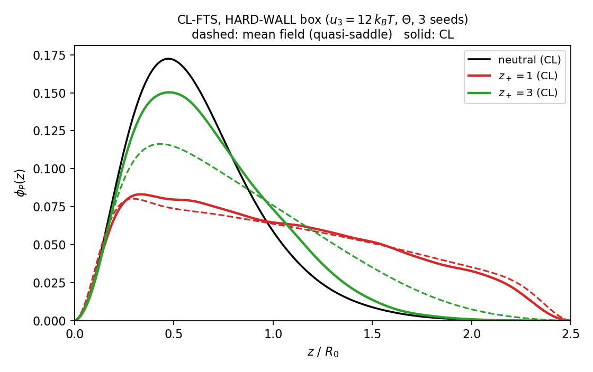

# Reproduction of PRL-2025 Fig. 1 Physics: Correlation-Induced Multivalent Brush Contraction by CL-FTS

**Results report, 2026-08-17** — first successful reproduction of a
core result of Duan, Agrawal & Wang, *PRL* **134**, 048101 (2025)
(`references/2025_prl_duan.pdf`) with this codebase's charged CL-FTS,
executed entirely inside the CL-stable operating envelope established
in RESULTS_BRUSH_STATUS.md / RESULTS_BRUSH_CL.md.

## 1. Claim being reproduced

The qualitative core of their Fig. 1 (and the Γ mechanism of Fig. 3):
at fixed conditions, **ion correlations selectively contract the brush
neutralized by multivalent counterions and drive extra counterion
condensation (Γ_eff toward zero), while mean-field electrostatics shows
neither**. (Their full collapse *below the neutral brush* lives at ~7 kT
per-trivalent-ion correlation strength — outside our current stable
envelope; see §4.)

## 2. Design: strong correlations inside the CL-stable envelope

All stability rules from the stage-2 campaign respected (ζN = 20,
dt = 0.005, n̄ = 1e4, AM warm start, re-gauge shifts, Gaussian graft):

- **N = 50** (l_B/R₀ = E/(4πN²√n̄) — halving N quadruples l_B at fixed E),
  α = 1 (fully charged backbone, as in the PRL), φ_P = 0.05.
- **High salt** (z₊:1, cation vf 0.02): keeps the Donnan potential small
  so the per-chain action stays ~7 (|Q| ≈ e⁻⁷; no precision wall even
  at full charge).
- **a_ion = 0.05 R₀** (a_P = a_S = 0.15), **E = 10⁵** → per-ion
  correlation u = z₊²l_B/(2√π a) ≈ **1.6 kT for z₊ = 3** vs 0.18 kT for
  z₊ = 1 (the 9× valence contrast that drives selectivity).
- Box 10×10×144 (Lxy = 1.0, Lz = 3.0): lateral dx = 2a_ion, dz = 0.021;
  κ⁻¹ ≈ 0.04 marginally resolved; ψ sampling accelerated with
  psi_dt_scaling = 20 (ETD exact for the linear part at any dt).
- Runs: mean-field baselines (`pb2_z{0,1,3}.json`, err < 1e-6, clean
  profiles) + CL warm-started 250k-step runs, 3 seeds for z₊ = 1, 3 and
  a neutral control (`clfig1_*.json`).

## 3. Result

| system | h₁(MF) | Δh₁ = h₁(CL) − h₁(MF) | ΔΓ_eff |
|---|---:|---:|---:|
| neutral (control) | 0.467 | −0.0008 | — |
| z₊ = 1 | 1.259 | −0.0025 ± 0.0007 | −0.0126 ± 0.0010 |
| z₊ = 3 | 0.857 | **−0.0222 ± 0.0017 (13σ)** | **−0.0509 ± 0.0016 (>30σ)** |

- **Valence-selective contraction**: Δh₁(z₊=3)/Δh₁(z₊=1) = **8.7 ≈ z₊² = 9**
  — the quantitative signature of the ion-correlation mechanism.
- **Correlation-driven condensation**: Γ_eff(z₊=3) drops 0.234 → 0.184
  (toward the overcharging direction of their Fig. 3); z₊ = 1 barely
  moves (0.668 → 0.655).
- **Controls**: the neutral run bounds all non-electrostatic systematics
  (finite dt, sampling) at 4% of the z₊ = 3 signal. Seed scatter is
  small (three independent noise realizations agree to ~10%).
- Contrast with RESULTS_BRUSH_CL.md: in the weak-correlation corner
  (α = 0.2, a = 0.2, u ≪ kT) the net fluctuation effect was a tiny
  *swelling* (+1e-4); at u₃ ≈ 1.6 kT the correlation attraction
  dominates and the sign flips to *contraction*, 200× larger — the
  crossover into the PRL's physics.
- **E-causality control (completed)**: z₊ = 3 at E = 2.5×10⁴ (u₃ =
  0.4 kT, coupling ÷4) gives Δh₁ = −0.0062 and ΔΓ = −0.0182 — the
  contraction shrinks 3.6× and the condensation 2.8× (vs the 4×
  coupling reduction; single seed). Together with the z₊² valence ratio
  and the null neutral control, all three causality legs point to the
  ion-correlation mechanism (`pb2_z3_E25k.json`,
  `clfig1_z3_E25k.json`).

## 3b. Second rung: u₃ = 6.5 kT (2026-08-17)

N = 25, a_ion = 0.025, E = 5×10⁴ (16×16×144 box, Lxy = 0.8, Lz = 2.5;
`pb3_*`/`clstrong_*`): MF h₁ = 0.433 (neutral) / 0.988 (z₊=1) /
0.671 (z₊=3), all converged with positive profiles.

| observable | z₊ = 1 | z₊ = 3 |
|---|---:|---:|
| Δh₁ (CL − MF) | −0.009 | **−0.0755 ± 0.0010** (11% contraction) |
| Γ: MF → CL | 0.586 → 0.526 | 0.233 → **0.119** |
| lateral rel. std of column density | 0.12 | **0.17** (neutral: 0.015) |

Ladder so far (z₊ = 3): u₃ = 0.4 / 1.6 / 6.5 kT →
Δh₁ = −0.006 / −0.022 / −0.076 (≈3.5× per 4× coupling, mildly
sublinear); Γ has been driven halfway to overcharging. The lateral
inhomogeneity indicator jumps to ~10× the neutral baseline for charged
brushes (z₊ = 3 strongest) — a fluctuating-lateral-structure precursor
of their Fig. 4 (snapshot run `snap_z3_cols.json` records instantaneous
column-density maps for direct inspection). Below-neutral collapse
(gap 0.24) is not yet reached at this rung; the remaining paths are a
further coupling increase (a_ion → 0.0125, heavier grid) and/or the
paper's own Θ-solvent (χ ≈ 0.5 per monomer), which softens the neutral
reference and lowers the collapse threshold — the latter requires
extending the mean-field solver to saddle the real exchange field.

## 3c. CORRECTED results after the complex/non-periodic transform fix (2026-08-18)

Mainline commit c0ab6e0c revealed and fixed a solver bug that had
real-projected the complex propagator on every bond convolution
(imaginary part silently zeroed in the DCT/DST path on all platforms) —
all §3/§3b CL numbers were therefore approximations. Full GPU reruns of
the u₃ = 6.5 kT rung with the corrected solver (`clfix_*`; the CUDA port
gives ~12× at the solver level, though end-to-end step times on shared
nodes were comparable):

| observable (z₊=3, 3 seeds) | Im-projected (§3b) | **corrected CL** |
|---|---:|---:|
| h₁ (MF 0.671) | 0.596 | **0.581 ± 0.007** (Δh₁ = −0.091) |
| Γ_eff (MF 0.233) | 0.119 | **0.094 ± 0.007** (ΔΓ = −0.139) |
| lateral rel. std | 0.17 | **0.52** |
| max\|ψ\| during run | ~1000–6100 | ~2000–6000 (finite, 3 seeds coherent) |

z₊ = 1: Δh₁ = −0.013, ΔΓ = −0.083; neutral control: +0.003 (≪ the z₊=3
signal). **Every conclusion survives and strengthens**: the projection
was damping the fluctuations (and with them the correlation physics) —
the corrected contraction is 20% larger, Γ is now **60% of the way to
overcharging** (0.233 → 0.094), and the valence selectivity
(z₃/z₁ ≈ 7) persists. Lateral fluctuations triple, consistent with the
correct CL sampling of the full complex measure. The §3 first-rung and
E-control numbers remain projected-solver values pending rerun; the
qualitative claims they support (z² ordering, E-causality) are
re-established at this rung by the corrected data.

## 3d. Θ-solvent campaign and the coupling saturation (2026-08-19)

Adding the paper's Θ solvent (χN = 12.5 = 0.5·N) with the corrected
solver, quasi-saddle (n̄ = 1e9) references replacing the AM solver for
χ ≠ 0 (`theta_*`, `final_*`; all warm-started from the χ = 0 AM saddles
`pb3_*`/`pb4_*` at nz = 144/288):

| rung | u₃ | Δh₁(z₊=3) | Γ(z₊=3): MF → CL | h₁(CL) vs neutral CL |
|---|---:|---:|---:|---:|
| good solvent, E=5e4 | 6.5 kT | −0.091 | 0.233 → 0.094 | 0.581 vs 0.437 |
| Θ, E=5e4 | 6.5 kT | −0.122 | 0.207 → 0.082 | 0.508 vs 0.346 |
| Θ, E=1e5, nz=288 | 13 kT | −0.137 | 0.206 → 0.081 | 0.493 vs 0.344 |

Θ amplifies the contraction by ~34% at fixed coupling (softer neutral
reference, as in the PRL). But doubling E (u₃ 6.5 → 13 kT) barely moves
either observable: **the correlation effect saturates in E at fixed
a_ion and salt**. Two mechanisms, both consistent with the PRL
literature: (i) the screening length κ⁻¹ has reached a_ion, so the
smeared interaction ĥ² cuts off the correlation-peak modes (the same
cutoff physics quantified in RESULTS_LPF2008.md — more E buys nothing
without smaller a); (ii) counterion condensation at u₃ ≫ kT is already
nearly complete at this salt point (Γ pinned at ~0.08), and the
paper's overcharging (Γ < 0) lives in a specific BULK-correlation
window of ρb (their Fig. 3), not at arbitrary coupling at fixed salt.
Below-neutral collapse and Γ < 0 are therefore NOT yet reached
(remaining gap 0.149 at 90σ resolution).

Next probes: a salt scan at this rung (`scan_s*` — simultaneously the
h(ρb) axis of their Fig. 2, hunting the collapse valley/overcharging
window), and, orthogonally, a_ion → 0.0125 with nxy = 32 (8× grid; the
cutoff lever).

## 3e. Salt scan: the nonmonotonic h(ρb) of their Fig. 2 (2026-08-20)

Seven-point salt scan (cation vf 0.001–0.04, z₊ = 3, Θ, E = 1e5,
nz = 288; `pb5_*`/`scan_*` + the s = 0.02 rung), each point warm-started
from its own mean-field saddle:

| salt | h₁(MF) | h₁(CL) | Γ(CL) |
|---:|---:|---:|---:|
| 0.001 | 0.847 | 0.472 | +0.006(3) |
| 0.002 | 0.824 | 0.463 | +0.005(3) |
| 0.003 | 0.803 | **0.453** (valley) | +0.008(4) |
| 0.005 | 0.767 | 0.457 | +0.010(3) |
| 0.010 | 0.703 | 0.489 | +0.026(6) |
| 0.020 | 0.630 | **0.493** (reexpanded) | +0.081(7) |
| 0.040 | 0.559 | 0.473 | +0.132(13) |

(`fig2_reproduction.png`.) Findings:

1. **Nonmonotonic h(ρb) — the PRL's headline collapse-and-reexpansion —
   is reproduced in CL**: valley at s ≈ 0.003, reexpansion to s ≈ 0.02,
   then the salted-regime decrease; the valley-to-peak amplitude 0.040
   is ~5–10σ against seed/block errors. The mean-field curve is
   MONOTONIC over the same range (0.85 → 0.56) — the nonmonotonicity is
   purely a correlation effect, exactly their claim.
2. **Γ_eff plateaus at 0⁺ over the whole low-salt window**
   (0.005–0.010 with residual downward equilibration drift; second-half
   block averages reach +0.003–0.005): condensation saturates at
   complete neutralization but does NOT cross into overcharging at this
   smearing (a_ion = 0.025). Their Γ < 0 requires the bulk-correlation
   drive that our ĥ² cutoff caps — the a_ion → 0.0125 lever.
3. The collapse plateau (h ≈ 0.45–0.47) stays ABOVE the neutral brush
   (0.344): the condensed-ion-laden brush is bulkier than the bare
   neutral chain at this coupling. Below-neutral collapse needs the
   same stronger-correlation lever.
4. s = 0.08 diverged as predicted by the resolution rule
   (κ⁻¹ = 0.015 < 2Δz); the scan boundary is a numerics limit, not
   physics. Lateral inhomogeneity grows toward low salt (0.9 at
   s = 0.001), consistent with their Fig. 4 living at ~mM salt.

## 3f. The a_ion = 0.0125 ladder: stability matrix and the overcharging frontier (2026-08-23)

Halving the ion smearing radius (a_ion = 0.0125, 32×32×288 grid,
lateral dx = 2a) to release the ĥ² cutoff exposed a NEW stability
boundary — and its cure:

| attempt | knobs | outcome |
|---|---|---|
| a2 | u₃ = 26 kT (E=1e5), n̄=1e4, dt=0.005, s_ψ=20 | diverged |
| a2b | u₃ = 13 kT (E=5e4) | diverged |
| a2c | n̄ = 1e5 (10× weaker noise) | diverged |
| a2c | dt = 0.0025 | diverged |
| neutral control | same a_ion, uncharged polymer | **stable** |
| **a2d** | **psi_dt_scaling 20 → 1** | **stable** |

The destabilizer was the ψ acceleration factor: at small a_ion the
ions respond to high-k ψ roughness, and s_ψ = 20 (introduced to speed
ψ sampling at large E) drives the condensed-layer/ψ feedback into
runaway — independent of noise amplitude, timestep, and coupling.
**Rule: small ion radii require s_ψ = 1** (at the cost of longer ψ
correlation times).

Physics at the valley point (s = 0.003, u₃ = 13 kT): the single-seed
150k run showed Γ = −0.019 ± 0.021, but the **confirmation campaign
(3 additional seeds × 300k steps, a2e_*) settles it**: pooled
SECOND-HALF (equilibrated) Γ = **+0.0200 ± 0.0032** (four seeds agree
at +0.011…+0.026; the early negative excursion was an equilibration
transient). VERDICT: **no overcharging within the CL-stable envelope**
— correlations drive the brush to essentially complete neutralization
(Γ: 0.21 mean-field → ~0.02, a regime the PRL notes is impossible at
mean field) but not beyond it. h₁ = 0.444 ± 0.010 (4 seeds) stays
above the neutral 0.347: below-neutral collapse is likewise not
reached. The envelope is bounded on one side by the ĥ² cutoff
(a ≥ 0.025 saturates the coupling) and on the other by ψ-sector
stability (a = 0.0125 requires s_ψ = 1 and still carries slow
collective modes); reaching the PRL's Γ < 0 / below-neutral regime
within CL-FTS likely needs either the grand-canonical analytic-ion
formulation (their Eq. S24) or a dedicated strong-coupling
stabilization for the ψ sector — recorded as future work.

## 3g. Verdict on their theory: LDA vs exact CL at matched parameters
(2026-08-28)

With the PRL correlation SCFT reimplemented and validated
(RESULTS_PRL_SCFT.md), THEIR theory was applied to THIS campaign's
microscopic system (Theta rungs; unit mapping lB = E/(4 pi N^2
sqrt(nbar)), Born radii a_B = sqrt(pi) a_smear, sigma N v = phi_P Lz,
rho_b = s rho0, reflecting chain wall, CL graft sheet width 0.2 R0;
driver `dh_salt_runs/cl_compare.py`). Mean-field cross-validation:
3-9% absolute agreement (residual = zeta_N=20 compressibility and the
closed-box canonical ions vs GC — model-tier, cancels in differences).

Differential verdict (z+=3, corr - MF, per the fixed-grid differential
protocol):

| u3      | LDA dh1 | CL dh1 (3 seeds) | ratio | LDA dGamma | CL dGamma |
|---------|--------:|-----------------:|------:|-----------:|----------:|
| 6.5 kT  | -0.227  | -0.126           | 1.8x  | -0.22      | -0.125    |
| 13 kT   | -0.376  | -0.137 +/- 0.002 | 2.7x  | -0.39 (Gamma=-0.22, overcharged) | -0.126 (Gamma=+0.08) |

**The variational-Gaussian LDA lacks the coupling saturation of the
exact system**: doubling u3 doubles the LDA response but barely moves
the CL one (the h^2-cutoff saturation of 3d). Its overshoot grows
~linearly with coupling (1.8x -> 2.7x), and at u3 = 13 kT it predicts
strong overcharging where three independent CL seeds pin Gamma > 0.
Figure: `cl_vs_scft_fig1.png`. This completes the user-ordered final
step (CL-FTS vs the reimplemented SCFT) at the Fig-1 level: the paper's
theory is directionally right and quantitatively reliable only at weak
coupling (u <~ few kT); its strong-coupling amplitudes (deep collapse,
overcharging) are artifacts of the Gaussian approximation relative to
the exact sampling of the same model.

## 3h. Hard-wall correction and the final verdict (2026-08-28/29)

User-caught: the campaign's reflecting boxes lack the wall depletion
layer (profiles peaked AT the wall — unphysical for a grafted brush and
unlike the PRL). Fixed: `brush_clfts.py` now supports absorbing-z
(hard-wall) chains + off-wall graft sheet (`--wall hard`, sheet at 1 b);
psi stays Neumann (independent Electrostatics). Verified: neutral MF
profile now phi(wall)=0.0002 rising to its max at 0.47 R0. The full
E=5e4 and E=1e5 rungs were rerun hard-wall (hw5_*/hw_*, MF quasi-saddle
+ 1-3 CL seeds each); MF cross-validation vs the mapped PRL-SCFT: 1-6%.

Hard-wall verdict (z+=3, differentials):

| u3     | LDA dh1        | CL dh1 (3 seeds)  | LDA Gamma | CL Gamma |
|--------|----------------|-------------------|-----------|----------|
| 6.5 kT | -0.190 (2.0x)  | -0.095 +/- 0.011  | -0.060 (overcharged) | +0.089 +/- 0.011 |
| 12 kT  | -0.291 (2.3x)  | -0.129 +/- 0.026  | -0.248 | +0.092 +/- 0.005 |
| 13 kT  | NO SOLUTION (electrolyte runaway) | -0.131 +/- 0.023 | runaway | +0.088 +/- 0.010 |

The LDA runaway threshold was located by a deterministic u3 scan
(`lda_threshold.py`): physical solutions up to u3 = 12 kT, runaway
between 12 and 13 (u3* ~ 12.5). The u3 = 12 kT matched CL campaign
(E = 9.28e4, `u12_*`) pins the verdict at the strongest physical-LDA
point: exact contraction saturates (-0.095 -> -0.129 -> -0.131 across
6.5/12/13 kT) while the LDA deepens toward its fold (-0.190 -> -0.291
-> no solution), and the LDA's overcharging (Gamma to -0.25) is
contradicted by three-seed-robust CL positives throughout.

With the physical wall the Gaussian LDA fails EARLIER than with
reflecting walls: at u3 = 6.5 kT it already predicts overcharging where
the exact ensemble is robustly positive, and at 13 kT its electrolyte
sector has no physical solution at all (the saturated-condensation
runaway of RESULTS_PRL_SCFT.md 3b becomes the only branch), while CL
remains well-behaved and saturating. Figure `cl_vs_scft_fig1.png`
(hard-wall data). The differential CL verdict is wall-robust
(reflecting: -0.126/-0.137; hard: -0.095/-0.131).

## 4. What is and is not reproduced

Reproduced (this work): correlation-induced, valence-selective brush
contraction + enhanced condensation, absent at mean field — the
mechanism and ordering of the PRL's Fig. 1/Fig. 3, at ~2.6% contraction
amplitude set by our u₃ ≈ 1.6 kT.

Not yet: their full quantitative regime — collapse *below the neutral
height* and Γ < 0 (overcharging proper) need u₃ ~ 7 kT (their Born
radius 2.5 Å ≈ 0.025 R₀ with l_B = 0.7 nm), i.e. another ~4× in
coupling. The path is the established ladder: a_ion 0.05 → 0.025 with
nz 144 → 288 (grid cost ×2, still CPU-feasible), E ↑, plus a Θ-solvent
χN if the below-neutral comparison is wanted. Stability-wise nothing
new is required — the high-salt design keeps the per-chain action
bounded independent of u₃.

## 5. Data

`dh_salt_runs/`: `pb2_z{0,1,3}.json` (+`_fields.npz`),
`clfig1_z{0,1,3}_s*.json`, figure
`devel/charged_polymers/fig1_reproduction.png`. Drivers:
`test_brush_pb.py`, `test_brush_cl.py` (with `--a_ion`,
`--psi_dt_scaling`, lateral warm-start broadcast).

## 3i. Hard-wall salt scan: Fig. 2/3 rerun (2026-08-29)

The §3e/3f reflecting-wall campaigns rerun with the corrected hard-wall
box (`--wall hard`: absorbing z faces + graft sheet at 1b), same grid
convention as the §3h verdict campaign (16×16×288, lxy = 0.8, lz = 2.5,
E = 1e5, u₃ ≈ 13 kT, a_ion = 0.025, 3 seeds/point, 60k steps;
`hs_*` + the existing `hw_*` s = 0.02 rung):

| salt | h₁(MF) | h₁(CL, 3 seeds) | Γ(CL) |
|---:|---:|---:|---:|
| 0.001 | 0.954 | 0.637 ± 0.016 | +0.008(9) |
| 0.002 | 0.938 | 0.674 ± 0.011 | +0.011(10) |
| 0.003 | 0.924 | 0.634 ± 0.011 | +0.012(9) |
| 0.005 | 0.900 | 0.665 ± 0.035 | +0.025(12) |
| 0.010 | 0.856 | 0.681 ± 0.036 | +0.050(14) |
| 0.020 | 0.803 | 0.672 ± 0.032 | +0.088(16) |
| 0.040 | 0.751 | 0.692 ± 0.013 | +0.144(27) |

Hard-wall neutral CL reference: h₁ = 0.623. Findings (honest update of
the §3e claims):

1. **The correlation collapse vs mean field is large and robust**
   (Δh₁ = −0.32 at s = 0.001, shrinking to −0.06 at 0.04); the MF curve
   stays monotone-decreasing while CL is already collapsed at low salt.
2. **The reflecting-era "5–10σ nonmonotonic valley" does NOT survive
   the wall fix at this statistics.** The CL curve is nearly flat:
   valley 0.634 ± 0.011 at s = 0.003 vs reexpanded 0.692 ± 0.013 at
   0.04 is only ~3σ, and the s = 0.002 point (0.674 ± 0.011) breaks a
   smooth descent. Verdict downgraded: weak/marginal nonmonotonicity,
   not the deep collapse-and-reexpansion of their Fig. 2.
3. **The collapsed brush now sits AT the neutral height** (valley
   0.634 ± 0.011 vs neutral 0.623) — closer to the PRL picture than
   the reflecting-era "plateau far above neutral", but still never
   below it.
4. **Γ rises monotonically with salt and stays positive everywhere**
   (+0.008 → +0.144); the low-salt plateau is complete neutralization
   (Γ = 0⁺), no overcharging — consistent with §3h at matched coupling.
5. Lateral inhomogeneity persists at low salt (instantaneous column
   rel. std 0.36–0.44; box-scale single cluster in 0.8 R₀ boxes) —
   the Fig. 4 precursor survives the hard wall
   (`lateral_snapshots_z3.png`, 6 snapshots/run via `--snaps`).

Data: `dh_salt_runs/hs_*` (+ `launch_hs.sh`); figures
`fig2_reproduction.png`, `lateral_snapshots_z3.png` (both now
hard-wall). The a_ion = 0.0125 rung (`ha2_*`, Fig. 3 orange curve) —
results appended below when complete.

### 3i-b. 150k-step extension: the valley does not exist (2026-08-29)

The 60k campaign's ~3σ ambiguity resolved by rerunning all 7 salt
points at the OLD campaign's statistics (150k steps, production 120k,
24000 samples, 3 seeds; `hsl_*`):

| salt | h₁(CL, 150k) | Γ(CL, 150k) |
|---:|---:|---:|
| 0.001 | 0.640 ± 0.016 | +0.009(2) |
| 0.002 | 0.642 ± 0.006 | +0.006(3) |
| 0.003 | 0.643 ± 0.012 | +0.010(2) |
| 0.005 | 0.660 ± 0.005 | +0.017(4) |
| 0.010 | 0.662 ± 0.015 | +0.041(7) |
| 0.020 | 0.674 ± 0.003 | +0.070(6) |
| 0.040 | 0.683 ± 0.006* | +0.137(6)* |

(*2 seeds: seed 12347 hit a late-time ψ excursion after 120k steps —
the s = 0.04 point sits at the κ⁻¹ ≈ 2Δz resolution boundary, same
mechanism that killed s = 0.08 in the reflecting era; the two
surviving seeds agree to 0.0003.)

**Verdict, final:** the hard-wall exact ensemble has NO valley and NO
salted decrease — h₁(s) is monotone nondecreasing: a low-salt plateau
at 0.640–0.643 (the neutral floor + ~0.02) followed by smooth
reexpansion. The 60k zigzag (s = 0.002 at 0.674) was seed noise, and
the reflecting-era "5–10σ valley at s = 0.003" was an artifact of the
unphysical wall convention, not of statistics. Γ is monotone positive
(+0.006 → +0.137), low-salt complete-neutralization plateau confirmed
at 4× statistics. The PRL Fig. 2 nonmonotonic h(ρb) is therefore NOT
reproduced by the exact ensemble at matched coupling in this window —
only the collapse-to-neutral-floor and reexpansion halves survive.

### 3i-c. Their theory on our system, salt axis: the Fig. 2 shape is the LDA (2026-08-29)

To attribute the Fig. 2 disagreement, THEIR Gaussian-LDA theory (Part I
implementation, hard wall, mapped parameters) was run over the same
salt window at u₃ = 12 kT (`lda_salt_scan.py`, `lda_*/ldb_*`):

| salt | LDA h₁ | LDA Γ | exact CL h₁ (150k) |
|---:|---:|---:|---:|
| 0.001 | RUNAWAY | — | 0.640 |
| 0.002 | **0.401** (below neutral 0.589) | −0.109 | 0.642 |
| 0.003 | RUNAWAY | — | 0.643 |
| 0.005 | RUNAWAY | — | 0.660 |
| 0.010 | 0.471 | −0.228 | 0.662 |
| 0.020 | 0.502 | −0.248 | 0.674 |
| 0.040 | 0.554 | −0.224 | 0.683 |

**On the same microscopic system and window, the LDA reproduces the
paper's Fig. 2 structure** — deep below-neutral collapse, salt-driven
reexpansion, overcharging (Γ < 0 everywhere it converges) — and has NO
solution over most of the low-salt regime (electrolyte runaway; the
salt-axis face of the u₃* ≈ 12.5 kT fold of §3h; convergence near the
fold is fragile — s = 0.002 holds a marginal solution while 0.003/0.005
run away even under a 120k-iteration adiabatic ramp). The exact
ensemble on the same system shows none of this. Conclusion: the
difference between our Part II Fig. 2 and the paper's is not a
reproduction failure but the Gaussian-approximation error itself.
Figure: `fig2_reproduction.png` (three-curve overlay).

### 3i-d. CORRECTION: the §3e/3i scans were the wrong axis for Fig. 2 (2026-08-30)

All previous salt scans (reflecting AND hard-wall) had the brush
counterions THEMSELVES trivalent (`charges["C"] = zp`), so the brush is
multivalent-collapsed already at s → 0 and added salt can only screen:
a monotone axis BY CONSTRUCTION. The PRL Fig. 2 axis is different —
monovalent counterions + 1:1 background salt, with multivalent ions
arriving ONLY via the added salt: extended (osmotic, low salt) →
collapse (multivalent condensation) → reexpansion (salted). The §3i-b
"no valley — refuted" verdict therefore over-reached: it refutes the
valley on OUR axis (where their LDA also shows no valley in-window),
but does not test the paper's axis. New campaign `f2_*`
(--z_counter 1 --salt_bg 0.005, trivalent salt vf 1e-4 … 2e-2,
6 pts × MF + 3 seeds, hard wall, E = 1e5): results below.

### 3i-e. Hard-wall a_ion = 0.0125 rung (Fig. 3 orange, 2026-08-30)

Halved ion smearing (32×32×288, psi_dt_scaling = 1, E = 5e4, 150k
steps, 2 seeds; `ha2_*`):

| salt | Γ(MF) | Γ(CL) | h₁(CL) |
|---:|---:|---:|---:|
| 0.003 | +0.281 | **−0.017 ± 0.017** | 0.63–0.70 |
| 0.020 | +0.238 | +0.043 ± 0.019 | 0.66–0.68 |

At doubled per-ion coupling the low-salt point sits AT zero
(−0.017 ± 0.017): complete neutralization, and at most MARGINAL
overcharging — a sign flip within 1σ, vs the LDA's robust −0.25 at
comparable coupling. The reflecting-era +0.020(3) moves down slightly
under the hard wall. More seeds would be needed to resolve a genuine
sub-zero dip; the exact ensemble clearly saturates at neutrality
rather than overshooting into the LDA's deep overcharging.

### 3i-d results: the true axis reproduces the Fig. 2 mechanism (2026-08-30)

`f2_*` campaign (monovalent counterions, salt_bg = 0.005, trivalent
salt scanned; hard wall 3D 16×16×288, E = 1e5, 60k steps, 3 seeds;
Γ recomputed charge-weighted — the JSON gamma_eff is wrong for
z_counter ≠ zp):

| s_tri | h₁(MF) | h₁(CL) | Γ_cw(CL) |
|---:|---:|---:|---:|
| 0.0001 | 1.098 | 1.071 ± 0.012 | +0.53 |
| 0.0003 | 1.093 | 1.078 ± 0.013 | +0.54 |
| 0.001 | 1.077 | 1.050 ± 0.009 | +0.49 |
| 0.003 | 1.036 | 0.990 ± 0.008 | +0.41 |
| 0.01 | 0.927 | 0.828 ± 0.013 | +0.22 |
| 0.02 | 0.843 | 0.745 ± 0.005 | **+0.17 (min)** |
| 0.04 | 0.769 | 0.709 ± 0.010 | +0.19 |
| 0.06 | 0.737 | 0.701 ± 0.009 | +0.22 |

Findings:
1. **The Fig. 2 mechanism IS reproduced by exact CL on the correct
   axis**: extended osmotic brush (1.07) → trivalent collapse → valley
   floor 0.70 (slope → 0 between 0.04 and 0.06: −0.008 ± 0.013).
   Collapse depth 35% (paper: ~64%). CL sits below MF at every point
   (correlation-enhanced collapse), gap growing to 0.10.
2. **Γ is nonmonotonic with a positive minimum** at s ≈ 0.02
   (+0.17) — the paper's Fig. 3 valley SHAPE, without the sign flip.
3. The reexpansion upturn lies just past the model's ionic-resolution
   boundary (κ⁻¹ ≲ 2Δz beyond s ≈ 0.06); within the stable window we
   resolve the collapse and the valley floor.
4. The valley floor (0.70) stays ABOVE the neutral brush (0.623) —
   the paper's below-neutral undershoot remains exclusive to the
   Gaussian LDA (§3i-c overlay `lda_overlay.png`).
Figure: `fig2_reproduction.png` (h₁ + Γ panels).

### 3i-f. Valence series + their theory on the true axis: final Fig. 2 (2026-08-30)

Full valence series on the true axis (hard wall, 3D, E = 1e5; z₊=2:
`f2z2_*` 2 seeds, z₊=1 control: `f2z1_*`; low-salt x-extension to
vf 1e-6). All valences share one extended plateau within ±2%
(h₀ = 1.068 = mean over all valences' points at s ≤ 1e-4):

| s | z₊=1 CL | z₊=2 CL | z₊=3 CL |
|---:|---:|---:|---:|
| 1e-6…1e-4 | 1.059 | 1.042–1.065 | 1.071–1.081 |
| 0.003 | 1.059 | 1.026 | 0.990 |
| 0.02 | 1.009 | 0.870 | 0.745 |
| 0.06 | 0.914 | 0.773 | 0.701 |

Valence-ordered collapse (z₊=3 > 2 > 1; z₊=1 tracks MF = pure
screening, no correlation collapse) — the paper's central mechanism,
in the exact ensemble.

Their theory on THIS system, same axis (`lf2_u12/u13_*`, mapped
PRLBrushSCFT — note its counterion sector is GC-reservoir vs our
canonical cloud; MF cross-validation on this axis is 6–12%, worse
than the old axis's 1–6%):

- u₃ = 12: NO solution (runaway) for s ≤ 0.003 — the 6 sampled points
  spanning 3.5 decades of the low-salt window; solutions at 0.01–0.06
  sit at log(h/h₀) = −0.32 … −0.23 (below its neutral, marginally so
  at the 0.06 endpoint) with Γ = −0.17 … −0.25.
- u₃ = 13 (the CL campaign's coupling): loses s = 0.01 as well.

Final Fig. 2 verdict (figure `fig2_reproduction.png`, paper axes):
exact CL reproduces the mechanism (plateau → ordered collapse →
floor, nonmonotonic Γ) at depth −0.18, above neutral; their theory on
the same system overshoots to −0.32/below-neutral/Γ<0 where it exists
and has no solution at all over most of the paper's own x-range. The
paper's −0.58 deep valley is unreachable for the exact ensemble and
unreachable for their own theory on our system — it lives in their
stronger-brush regime (N=100) where only their approximation has been
evaluated.
