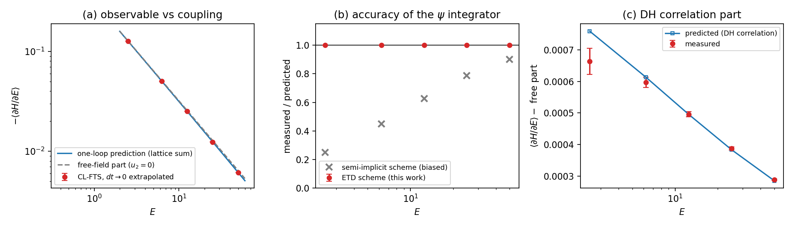
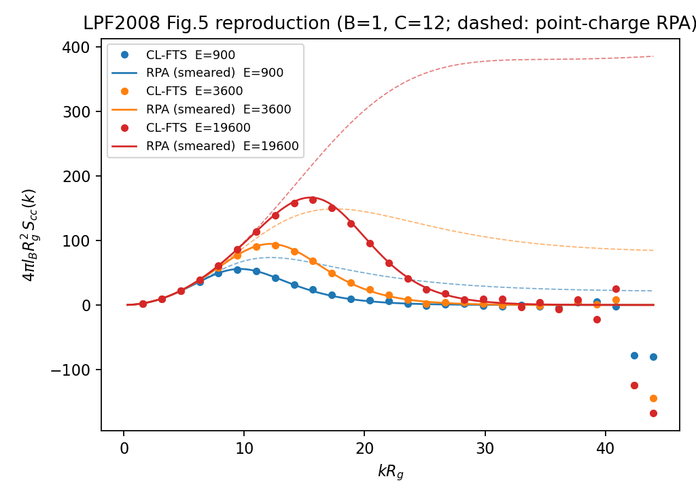
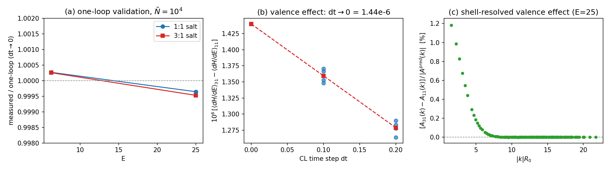

# Scope and current conclusion

This document consolidates the charged-polymer theory notes, implementation
checks, native complex Langevin (CL) validation, exact finite-action benchmarks,
and positive-sampling controls. PRL-specific N=100 reproduction and its planar
MC comparison are in the separate [PRL report](PRL_REPRODUCTION.pdf).

**Current verdict:** the native charged CL sample means disagree with exact
references in the investigated finite model. Independent chain/drift/noise
checks pass, and positive representations of the same action recover reference
means. This supports incorrect CL convergence in that fixture; it is not a
proof that all CL fails or a complete boundary-term derivation. The FFT
strong-field issue is separately documented and remains deferred by user decision.

Historical weak-coupling, one-loop and brush observations are retained later
in this document with their original parameters and uncertainties. They do not
supersede the stronger exact-reference checks or certify native CL for all models.

# Code used and current organization

Directory organization updated 2026-09-14: models are in `models/`, tests in
`tests/`, and this report and its build script in `reports/`. All code paths in
prose are relative to `devel/charged_polymers`; `workflow.py` commands are unchanged.


Historical command names are kept in `studies/legacy_commands.json`; the current
entry point is `workflow.py`. Model modules are organized under `models/`.
The source revision immediately before consolidation is `d395ed1a`.

| Purpose | Historical script(s) | Current command / implementation |
|---|---|---|
| Deterministic implementation tests | `validate_clfts.py` | `workflow.py check implementation`; `studies/validation.py` |
| Same-model MF/CL brush | `validate_brush_sampling.py` | `workflow.py cl brush`; `studies/validation.py` |
| Exact finite particles/native CL | `validate_clfts_exact.py` | `workflow.py cl exact`; `studies/exact.py` |
| Reduced CL and alternative integrators | `diagnose_clfts_reduced.py` | `workflow.py cl reduced`; `studies/reduced.py` |
| Final checkpoint density check | `check_clfts_exact_checkpoint.py` | `workflow.py check checkpoints`; `studies/cl_diagnostics.py` |
| Original field integral | `check_clfts_field_integral.py` | `workflow.py check field-integral`; `studies/cl_diagnostics.py` |
| Partition zeros and drift extremes | `check_clfts_poles.py` | `workflow.py check poles`; `studies/cl_diagnostics.py` |
| Stationarity and cutoff contributions | `analyze_clfts_identities.py` | `workflow.py check identities`; `studies/cl_diagnostics.py` |
| One-real-field positive marginal | `validate_clfts_positive_marginal.py` | `workflow.py sample marginal`; `studies/marginal_sampling.py` |
| 4/16/32-cell Gibbs sampler | `sample_positive_1d.py` | `workflow.py sample finite`; `studies/finite_sampling.py` |
| Native/reduced/MF/marginal summaries | `analyze_clfts_exact.py`, `analyze_clfts_diagnosis.py`, `summarize_validation.py`, `summarize_clfts_pole_resolution.py` | `workflow.py analyze cl-exact`, `cl-reduced`, `cl-brush`, `marginal`; `studies/cl_analysis.py` |

The common autocorrelation and block-error estimators are in
`studies/statistics.py`; their numerical definitions are unchanged.
`models/clfts_charged.py`, `models/brush_clfts.py`, `models/electrostatics.py`, and
`models/stable_grafted_chain.py` retain the actual CL, wall, electrostatic and reference
chain implementations. `models/brush_scft_charged.py` retains the historical
mean-field brush solver, including its own Poisson saddle. The earlier charged
L-FTS prototype and its model-specific neutral-reduction/Debye–Hückel scripts
were retired; the charged CL neutral-reduction check remains. Distinct exact sums,
field quadrature, direct chains, and log-chain
references are intentionally not collapsed into one implementation: their
independence is part of the validation.

`models/common.py` holds the parameter-serialization helper and per-species
smearing adapter shared by the brush SCFT and CL classes. They were extracted on
2026-09-14 without changing their behavior. The relocation record retains the
earlier hashes and includes the common module in current source audits.

# Execution protocols

## Environment and general acceptance rules

```bash
source /home/yongdd/anaconda3/etc/profile.d/conda.sh
conda activate polymerfts
ulimit -s unlimited
export OMP_STACKSIZE=1G OMP_NUM_THREADS=1
export MKL_NUM_THREADS=1 OPENBLAS_NUM_THREADS=1 OMP_MAX_ACTIVE_LEVELS=0
export PYTHONPATH=/home/yongdd/polymer/dh_salt_runs/exact_cl_diagnosis_20260907/python_deps
```

Use the installed `polymerfts` extension; rebuild/install first if changing its
C++/CUDA sources. Numba/llvmlite for the reduced and positive samplers were loaded
from the recorded local directory. Check `nvidia-smi` and select an idle GPU for
CUDA. No production FFT/C++/CUDA kernels were changed during this consolidation.

Computations longer than one minute use SLURM, one job per parameter configuration.
A job script contains this environment and one command; a typical CPU submission
is `sbatch --cpus-per-task=1 --mem=8G --time=24:00:00 job.sh`, adjusted to local
partition limits. All examples below are job bodies or short deterministic checks,
not instructions to run long trajectories on a login node. Use new output paths.

Numerical tests retain calibrated grids, fields and tolerances. Random-field
checks use standard deviation about 5. Check material conservation and
`check_total_partition()` alongside final densities. A successful exit, finite
trajectory, matching height alone, or a favorable drift-tail fit does not
establish the correct CL measure.

## Deterministic checks and the same-model MF/CL bridge

`workflow.py check implementation` runs strong-field references, force–Hamiltonian
finite differences, annealed/quenched graft comparisons, CPU/CUDA density
comparisons, checkpoint/restart and consistent-time monitoring, zero-charge
reduction, and fixed-fugacity Donnan/PB checks. The eight production partition
checks use relative complex error with the original $10^{-7}$ tolerance;
FFT propagation itself remains unchanged.

The separate MF/CL bridge uses 2D 8×32, L=(1.2,2), N=10, E=25,
`zetaN=20`, `chiPSN=10`, five canonical species, C=1 and SP=3 valences,
quenched grafts and truncated-bottom/reflecting-top bonds. Set `alpha_ds=0`.
First solve all active mean-field equations including their uniform modes;
only the electrostatic gauge is fixed. Then warm-start CL from that saddle.

- nbar=$10^4$, dt=.05/.025, seed 51: total time 500, discard 100.
- nbar=$10^4$, dt=.05/.025, seed 52: total time 2000, discard 100.
- nbar=$10^8$, dt=.05/.025, seed 51: total time 500, discard 100.
- Store profiles and observables every .25 Langevin units, use 20 blocks, and
  compare block and autocorrelation SE. Retain species profiles, drift and RNG state.
- A 16×64 MF refinement is a separate spatial check, not a retuned benchmark.

```bash
python devel/charged_polymers/workflow.py check implementation \
  --output /path/to/new/deterministic.json --platforms cpu-mkl cuda
python devel/charged_polymers/workflow.py cl brush \
  --dt .025 --nbar 1e4 --seed 52 --duration 2000 --equil 100 \
  --platform cpu-mkl --out /path/to/new/mf_cl_seed52
```

## Exact finite particles versus native CL

The common fixture has one grafted four-bead P chain, two C(+1), SP(+3), SM(-1),
and S: nine beads total, eight free coordinates, reflecting bonds, L=1,
N_ref=4, chiN=2, zetaN=4, and Gaussian smearing radius .1.
Every microscopic configuration of the same finite action is summed:
$2^8=256$ or $4^8=65,536$. Uniform Gaussian modes cancel in normalized observables;
self terms and canonical multiplicities remain in the exact reference.

The initial 22 native runs use two cells with E=0/25/100, dt=.02/.01/.005,
stabilization off, seeds 71/72; two-cell E=25, dt=.01 with stabilization .05;
and four-cell E=25, dt=.01 with stabilization off. Each lasts 2000 Langevin
units, discarding 200, recording every .1. Two further two-cell E=25/100 runs
use dt=.0025, seed 173, total time 1000, discard 100. These give 24 completed
runs, with different physical durations explicitly retained.

The original psi stream uses seed+1: seeds 71/72 overlap across different
field components and are reported separately. They are not pooled as fully
independent replicates. Seed 173 provides a disjoint stream assignment.

```bash
python devel/charged_polymers/workflow.py cl exact \
  --sites 2 --coupling 100 --dt .0025 --duration 1000 --equil 100 \
  --seed 173 --stabilization 0 --out /path/to/new/exact_native
python devel/charged_polymers/workflow.py analyze cl-exact /path/to/campaign
python devel/charged_polymers/workflow.py check checkpoints /path/to/campaign
```

Compare height and all species/cell densities, real and imaginary means,
10/20/40-block errors, autocorrelation, ESS, mass and contour consistency.
The reported SE is the maximum of block and autocorrelation estimates.
Record $|Q(W)|/Q(\operatorname{Re}W)$ rather than treating a small raw Q as a pole.
The checkpoint test compares final conditional densities independently; it is
not a whole-trajectory or maximum-drift validation.

## Reduced CL, direct field integration, and poles

The two-cell equations are reduced exactly to four complex amplitudes without
changing the action. Check native/reduced densities, drifts, noise variance and
one-step updates before running alternate integrators. The 21-trajectory protocol
is listed in full in the diagnosis chapter: LM/ETD, Heun, mobility controls and
adaptive Euler, steps down to .00015625, physical durations up to 50,000,
and explicit equilibration intervals.

Adaptive Euler chooses the step from the current drift before drawing noise:
`dt_actual <= dt_max * min(1,10/max|drift|)`. Noise scales with its square root.
Samples remain spaced by .1 in physical time, not equally weighted by adaptive
step count. No rejection, clipping, or stabilizing force is added.

```bash
python devel/charged_polymers/workflow.py cl reduced \
  --coupling 100 --method heun --dt .00015625 --duration 20000 \
  --equil 2000 --seed 501 --psi-mobility 1 \
  --out /path/to/new/reduced_heun
python devel/charged_polymers/workflow.py check field-integral \
  --setup /path/to/saved/setup.npz --order 32 \
  --out /path/to/new/quadrature32.json
python devel/charged_polymers/workflow.py check poles /path/to/reduced_campaign
```

The direct field integral evaluates the entire product of partition functions
on the original contour, using tensor Gauss–Hermite quadrature and no logarithm
or division by Q. Compare increasing quadrature orders and exact particle sums.
Pole analysis locates analytical chain/ion zeros and recomputes native densities
at saved worst-drift states. Generator identities and cutoff contributions use
the original total sample count; deleting near-pole samples and conditionally
renormalizing would change the estimator and is not used.

## Same-action positive marginal and 1D Gibbs control

The one-real-field marginal integrates repulsive and electrostatic Gaussian
fields exactly and sums the 256 particle configurations conditionally. Use
E=0/25/100, real Heun dt=.005/.00125, seeds 901/1001, total time 20,000,
discard 2,000 and save every .1, yielding 180,000 samples per run. All 19
observables are checked; real quadrature and a std=5 finite-difference force
check validate the marginal. This is an exact change of representation, not
native CL dynamics.

The scalable-to-more-cells Gibbs control retains particles plus the attractive
real field rather than summing all particle configurations at every field value.
Use M=4/16/32, E=0/100, joint seeds 1101/1201, particle-only seed 2101;
add M=4,E=25 with the same three choices. Each of the 21 runs has 2,000,000
sweeps, discards 200,000 and saves every 10. A sweep updates eight free particles
and the conditional real field. Check exact sums at M=4 and compare the two
positive representations at larger M; larger grids have no exhaustive reference.

```bash
python devel/charged_polymers/workflow.py sample marginal \
  --setup /path/to/saved/setup.npz --dt .00125 --seed 901 \
  --duration 20000 --equil 2000 --out /path/to/new/marginal
python devel/charged_polymers/workflow.py sample finite \
  --sites 16 --coupling 100 --mode joint --seed 1101 \
  --field-setup /path/to/saved/setup.npz \
  --sweeps 2000000 --burn 200000 --stride 10 --out /path/to/new/gibbs
```

The supplied `setup.npz` must match the intended fixture and coupling. Use the
actual setup path from the original run script, rather than an arbitrary warm
field. The N=100 planar sampler has a different finite action and is documented
with PRL comparisons in the other report; it is not substituted into this test.

# Evidence, provenance, and statistical interpretation

Evidence roots are below `/home/yongdd/polymer/dh_salt_runs/`:

| Directory | Evidence |
|---|---|
| `validation_20260906/` | Deterministic results, strong fields, same-model saddle/CL and original regression logs |
| `exact_cl_20260907/` | 24 native CL runs, exact references, final checkpoints, `analysis.json` |
| `exact_cl_diagnosis_20260907/` | 21 reduced trajectories, four quadrature jobs, pole checks, setup/RNG snapshots |
| `exact_cl_pole_resolution_20260907/` | 12 positive marginals, six generator/cutoff analyses, failed diagnostic compile logs |
| `oned_prl_20260907/` | 21 small-system Gibbs runs; PRL entries in this mixed directory belong to the other report |

`reports/metadata/campaigns.json` preserves exact stored parameters and run-script hashes.
The old documents are merged into `archive/RESEARCH_LOG.md` for provenance.
To replay a historical command against the consolidated code, use
`workflow.py legacy OLD_SCRIPT.py` with unchanged arguments and a fresh output
path. For exact source replay, use the archived code snapshot or recorded Git
revision. Native RNG streams, action parameters and production FFT are unchanged.

Correlated observables and paired seeds are not independent hypothesis tests.
Empirical SE, a small imaginary mean, or low-order stationarity alone cannot
certify CL. The result chapters below retain failures and limitations alongside
successful deterministic checks. The cleanup itself is a code/document refactor;
it is not a new physical sampling campaign.


# Charged field theory: action, units and discretization

> Working notes (devel). Formulation of polyelectrolyte solutions within this
> codebase's multi-monomer field theory, following the smeared-charge model of
> Wang [1] and Villet–Delaney–Fredrickson [2,3], written in the conventions of
> *Macromolecules* **2025**, 58, 816 (the neutral multi-monomer theory this
> library implements). **Compressible (finite $\zeta N$) model with
> per-species density smearing** — the fully UV-regularized formulation.

## 1. Model

Species $i = 1, \dots, S$ (here: polymer P, solvent S, counter-ion C, salt
ions SP/SM). Each species is a (possibly very short) bead-spring chain of the
discrete or continuous model already implemented.

**Smeared densities.** Every species carries a normalized Gaussian shape
function
$$h_i(\mathbf r) = \frac{1}{(2\pi a_i^2)^{3/2}} e^{-r^2/2a_i^2},
  \qquad \hat h_i(\mathbf k) = e^{-a_i^2 k^2/2},$$
of radius $a_i$ (params `radiuses`, in $R_0$ units). $a_i$ is the
**smearing length** (Fredrickson school: width of the "shape function" or
form factor of the species [2,3]); for charged species Wang [1] identifies
it with the ion's **Born radius**, since the Gaussian self-energy
$u_{\rm self} = z_i^2 l_B/(2\sqrt{\pi}\, a_i)$ is the Born solvation
energy of an ion of that size. ALL interactions are written in terms of the
smeared volume fractions
$$\bar\phi_i \equiv h_i * \phi_i .$$
Smearing regularizes both the contact (excluded-volume/χ) and the Coulomb
self-interactions, making the fluctuating field theory UV-convergent
[1,2,3]. The point-particle limit $a_i \to 0$ is singular for a compressible
fluctuating model and must not be taken. ($a_i = $ `None` ⇒ $h_i = \delta$;
acceptable only for testing or in mean-field.)

Three interaction channels:

1. **Flory–Huggins**: $\chi N_{ij}$ pairs (here only P,S — all pairs
   involving ions are zero). No separate `chi_monomers` machinery is needed
   in the compressible model: the $\chi N$ matrix is simply $S \times S$
   with zero rows/columns for the ions (see §3).
2. **Compressibility (Helfand)**: instead of the incompressibility
   constraint, a finite penalty
   $$\beta U_{\zeta} = \frac{\rho_0 \zeta N}{2 N} \int
     \Big( \sum_i \bar\phi_i(\mathbf r) - 1 \Big)^2 d\mathbf r$$
   with the code's existing `zeta_n` parameter. The incompressible theory is
   the $\zeta N \to \infty$ limit. In a fluctuating simulation the smeared
   $\bar\phi_i$ (not raw $\phi_i$) must enter here, or the contact penalty
   is UV-divergent.
3. **Coulomb**: segment of species $i$ carries per-segment valence $z_i$;
   the smeared charge density is
   $$c(\mathbf r) = \sum_i z_i\, \bar\phi_i(\mathbf r)
     \qquad (\text{same } h_i \text{ as above}),$$
   and
   $$\beta U_C = \frac{l_B \rho_0^2}{2} \int\!\!\int
      \frac{c(\mathbf r)\, c(\mathbf r')}{|\mathbf r-\mathbf r'|}
      \, d\mathbf r\, d\mathbf r',
      \qquad l_B = \frac{e^2}{4\pi \varepsilon k_B T}$$
   (Bjerrum length; uniform dielectric $\varepsilon$, no dielectric
   contrast in this first version).

**Global electroneutrality** is still required (compressibility does not fix
charge). With per-segment valences $z_i$ and equal segment volumes:
$$\sum_i z_i\, \bar\phi_i^{\,\rm tot} = 0$$
over overall volume fractions (NO division by chain length — that would be
per-chain counting, wrong for per-segment valences). The counter-ion
fraction is NOT a free parameter: for P with $z_P = +1$ and fraction
$\phi_P$, one needs $\phi_C = \phi_P z_P/|z_C|$ (plus balanced salt
$z_{SP}\phi_{SP} + z_{SM}\phi_{SM} = 0$). The current `examples/Lamella.py`
computes the counter-ion fraction from this condition. Its defaults
$z_P=0.2$, $\phi_P=0.1$, and $z_C=-1$ give $\phi_C=0.02$ and
$\phi_S=0.88$, so the input composition is electrically neutral.

## 2. Units and code conventions

Same as the neutral theory: lengths in $R_0 = a_{\rm Ref} N_{\rm Ref}^{1/2}$,
fields per **reference chain** ($w_{\rm code} = N\,w_{\rm per\,segment}$),
densities in $\rho_0$. Chain number density
$C = \rho_0 R_0^3 / N = \sqrt{\bar N}$.

Nondimensionalize with $\mathbf x = \mathbf r/R_0$. The Coulomb energy in
$k_BT$ becomes (note the $C^2$ — Coulomb is quadratic in $\rho_0$, unlike
the χ/ζ block where $\chi N, \zeta N \propto \rho_0$ leave one $C$):
$$\beta U_C = \frac{C^2 E_0}{8\pi}\int\!\!\int
   \frac{c(\mathbf x)\,c(\mathbf x')}{|\mathbf x-\mathbf x'|}\,
   d\mathbf x\, d\mathbf x'
 = \frac{C^2 E_0}{2} \sum_{\mathbf k} \frac{|\hat c_{\mathbf k}|^2}{k^2},
 \qquad E_0 \equiv \frac{4\pi l_B N^2}{R_0}.$$
For the per-chain-normalized Hamiltonian used throughout this codebase, the
convenient coupling is
$$\boxed{\;E \;\equiv\; C\,E_0 \;=\; \frac{4\pi l_B N^2 C}{R_0}
   \;=\; 4\pi l_B\, \rho_0 N R_0^2\;}$$
(density-DEPENDENT: $E = \sqrt{\bar N}\,E_0$). Caveat: the literature's
"electrostatic strength" [2,3] is the density-independent $E_0$, usually in
$R_g = R_0/\sqrt6$ units — convert when comparing. New scalar param:
`"bjerrum_e"` $= E$ (or `"bjerrum_length"` $= l_B/R_0$ with $E$ computed
internally from `nbar`).

## 3. Field theory: Hubbard–Stratonovich structure

Two independent HS blocks (the compressible model has NO separate pressure
constraint):

**(a) χ+ζ block — the existing compressible SPT, over ALL $S$ species.**
The quadratic form of channels 1+2 is
$$\tfrac12\, \bar{\boldsymbol\phi}^{\mathsf T}
  \big( \zeta N\, \mathbf J + \boldsymbol\chi N \big) \bar{\boldsymbol\phi}
  \;-\; \zeta N\, \mathbf 1^{\mathsf T}\bar{\boldsymbol\phi} + \tfrac12 \zeta N,$$
with $\mathbf J$ the all-ones matrix — exactly the matrix
$u = \zeta N\,\mathbf J + \chi N$ that `SymmetricPolymerTheory`'s
compressible branch (`zeta_n` set) already diagonalizes, including the
linear term (its `vector_large_s`). Ion rows of $\chi N$ are zero. Spectrum
for the 5-species example:
- one large positive eigenvalue $\approx S\zeta N$ (the "pressure-like"
  mode) — imaginary-type;
- the χ-split P–S pair: one negative (exchange, **real** Langevin field),
  one positive (imaginary-type);
- pure ion-composition modes orthogonal to $\mathbf 1$ with no χ:
  eigenvalue **0** — ideal mixing in those channels; the corresponding
  auxiliary fields are identically zero and SPT's existing zero-eigenvalue
  handling (Gram–Schmidt + warning) applies. This is physical, not an
  error: those composition fluctuations are free.

Because $\zeta N\,\mathbf J$ lifts the would-be singularity of the χ-only
matrix, **the full $S$-species SPT can be used directly** — the
chi-subset wrapper of the incompressible draft is no longer needed.

**(b) Coulomb block — new.** HS on the positive-definite Coulomb quadratic
form introduces the electrostatic potential $\psi(\mathbf x)$:
$$e^{-\beta U_C} = \int \mathcal D\psi\;
  \exp\!\left[ - C \int d\mathbf x\, \frac{|\nabla\psi|^2}{2E}
               \;+\; i\, C \int d\mathbf x\; c(\mathbf x)\,\psi(\mathbf x) \right]
  \Big/ \mathcal N,$$
which reproduces $\exp[-\tfrac{C^2E_0}{2}\sum_k |\hat c_k|^2/k^2]$ exactly
because $E = CE_0$ (Gaussian integral over $\psi$). $\psi$ is the
per-reference-chain potential $N\beta e\varphi_{\rm phys}$. Coupling with
$+i$ to a real density and a positive-definite kernel ($4\pi l_B/k^2$,
analogous to $\lambda > 0$): $\psi$ is an **imaginary-type field**,
partial-saddled like the positive-eigenvalue SPT fields — see §5.

## 4. Hamiltonian and single-chain problem

The per-chain effective Hamiltonian is
$$\frac{H[\{w_k\}, \psi]}{C\,k_BT V/R_0^3}
 = \underbrace{h_{\rm const} + \sum_k \left[ A_k \langle w_k\rangle + B_k \langle w_k^2\rangle\right]}_{\text{neutral compressible (existing SPT coefficients)}}
 \;+\; \frac{1}{V}\int \frac{|\nabla \psi|^2}{2E} d\mathbf x
 \;-\; \sum_p \frac{\bar\phi_p}{\alpha_p} \ln Q_p[\{W_i\}]$$
with the $h$-coefficients of the existing compressible SPT. The one-body
potential of each species picks up the smearing convolution on EVERY term
(the interactions couple to $\bar\phi_i = h_i*\phi_i$, so the functional
derivative w.r.t. $\phi_i$ convolves back with $h_i$):
$$\boxed{\;W_i(\mathbf x) \;=\; h_i * \Big[ W_i^{\rm SPT}
   \;+\; i\, z_i\, \psi \Big](\mathbf x)\;}$$
where $W_i^{\rm SPT}$ is the usual `matrix_a` mapping of the auxiliary
fields (now including the pressure-like ζ mode; ion rows couple only to
that mode and to $\psi$). No explicit $N$ multiplies the electrostatic
term: $\psi$ is already per-reference-chain and $z_i$ is per-segment — the
code's $w = N w_{\rm seg}$ convention is carried entirely by $\psi$. The
smearing is a k-space multiplication
$\hat h_i(k)\,[\widehat{W^{\rm SPT}_i} + i z_i \hat\psi](k)$ — cheap, per
species, applied once per saddle iteration; the propagator solvers are
untouched.

**Rotated contour / stored real field.** As with the positive-eigenvalue
SPT modes, the code stores the REAL array $\psi_s = -i\psi$ (the saddle
lies on the imaginary $\psi$ axis). Under this substitution the one-body
term becomes $+z_i \psi_s$ (the $i$ disappears — this is what the code
adds to $W_i^{\rm SPT}$), and the explicit quadratic term flips sign:
$$\frac{1}{V}\int \frac{|\nabla\psi|^2}{2E}\, d\mathbf x
  \;\longrightarrow\;
  -\frac{1}{V}\int \frac{|\nabla\psi_s|^2}{2E}\, d\mathbf x
  \;=\; -\frac{1}{2V}\int c\,\psi_s\, d\mathbf x$$
(the last equality at the Poisson-consistent $\psi_s$). This mirrors the
negated $B_k$ coefficients of the imaginary SPT fields. Note the
$+c\psi_s$ coupling itself lives inside $-\ln Q$ via $W_i$; the explicit
term recorded in $H$ is only the (negative) gradient piece.

Concentrations: standard $\phi_i$ from propagators; the smeared densities
that enter all interaction terms and the Poisson source are
$\bar\phi_i = h_i * \phi_i$, $c = \sum_i z_i \bar\phi_i$ (again diagonal
in k).

## 5. Forces and saddle conditions

- SPT auxiliary fields: unchanged from the neutral compressible theory —
  functional derivatives evaluated with the SMEARED densities
  $\bar\phi_i$ in place of $\phi_i$. Negative-eigenvalue (exchange) fields
  receive Langevin noise; positive-eigenvalue fields are partial-saddled by
  the existing compressor loop; zero-eigenvalue fields stay zero.
- Electrostatic field:
$$\frac{1}{C}\frac{\delta H}{\delta \psi(\mathbf x)}
  = -\frac{\nabla^2 \psi}{E} \;-\; c(\mathbf x)
  \qquad\Longrightarrow\qquad
  \text{saddle: } -\nabla^2\psi^* = E\, c(\mathbf x),$$
the (smeared) **Poisson equation**; with the ideal-gas ions responding
through their Boltzmann factors this is the fluctuating-field
generalization of Poisson–Boltzmann. In k-space the solve is diagonal and
exact:
$$\hat\psi^*(\mathbf k) = \frac{E\,\hat c(\mathbf k)}{k^2}, \qquad k \ne 0,$$
and the $k=0$ mode is fixed by electroneutrality ($\hat c(0) = 0$ holds
exactly per configuration in the canonical ensemble once §1's constraint
holds; set $\hat\psi(0)=0$ as gauge).

**Debye sanity check** (1-segment ions, $z=\pm1$, ideal): linearizing gives
$\kappa^2 R_0^2 = E\,\bar\phi_{\rm ion}/N = 4\pi l_B \rho_0
\bar\phi_{\rm ion} R_0^2$ — the physical Debye constant. Any factor error
in $E$ or $W_i$ shows up here first; keep this as a unit test.

**CL-FTS (the real implementation): $\psi$ fluctuates.** L-FTS holds
imaginary-type fields at partial saddle, so it can never capture $\psi$
fluctuations — the charged theory belongs in CL-FTS, where $\psi$ evolves
with complex Langevin dynamics exactly like the pressure field $W_+$
(rotated storage, imaginary-direction noise, "+$\Lambda$" drift):
$$\psi \;\leftarrow\; \psi + \left(\frac{\nabla^2\psi}{E} + c\right)
  \Delta t\, s_\psi \;+\; i\,\mathcal N(0,\sigma)\sqrt{s_\psi},$$
whose drift fixed point is the Poisson equation. Three discrete-scheme
facts (all found the hard way):
- The $\nabla^2/E$ part is stiff at high $k$: explicit Euler is UNSTABLE
  ($k^2\Delta t/E$ exceeds the stability limit), and semi-implicit Euler,
  while stable, SUPPRESSES the stationary variance by $1/(1+2\kappa\Delta
  t)$ per mode — this silently wrecks fluctuation thermodynamics (the
  one-loop $\langle\partial H/\partial E\rangle$ came out $2$–$4\times$
  too small). The correct treatment is **ETD (exact Ornstein–Uhlenbeck
  integration per k-mode)**:
  $$\hat\psi' = a_k\hat\psi + (1-a_k)\frac{E\hat c}{k^2}
    + i\,\sigma\sqrt{\frac{1-a_k^2}{2\gamma_k\Delta t}}\;\hat\xi,
    \qquad a_k = e^{-\gamma_k \Delta t s_\psi},\;\; \gamma_k = k^2/E,$$
  which reproduces the exact per-mode stationary variance of the linear
  part for ANY $\Delta t$; the $c[\psi]$ screening stays explicit
  (per-step rate $\le \sum_i z_i^2\bar\phi_i\,\Delta t$). The $k=0$ mode
  is gauged to zero every step.
- The EXCHANGE field's explicit mass is $\sim 1/\chi N$, so small-$\chi$
  systems (e.g. the pure-salt validation) need $\Delta t < \chi N$;
  violating this diverges regardless of the charge sector.
- The explicit Hamiltonian term must be evaluated ANALYTICALLY off the
  saddle: $+(1/2EV)\int \psi\nabla^2\psi$ (equal to
  $-\tfrac12\langle c\psi\rangle$ only when Poisson holds).

At $E=0$ the $\psi$ stiffness is infinite: $\psi$ stays pinned at zero.

**L-FTS prototype (mean-field $\psi$): scheme per saddle iteration** —
after each propagator solve, (i) build $\bar\phi_i$, $c$ (k-space
$\hat h_i$ multiplications), (ii) update $\psi$ toward the Poisson
solution (below), (iii) take the usual Anderson-mixing step on the
imaginary SPT fields. Both residuals enter the stopping criterion. $\psi$
stays OUT of `aux_fields_imag_idx` and the AM compressor state.

**Stabilized $\psi$ update (important).** Replacing $\psi$ by the bare
solution $E\hat c/k^2$ every iteration is an undamped fixed-point sweep
whose linearized gain is
$$g(k) \;=\; \frac{E}{k^2}\sum_i z_i^2\,\bar\phi_i\,\hat h_i^2(k),$$
which exceeds 1 at long wavelengths for realistic $E$ (e.g. $E=25$,
$k_{\min}=2\pi/L$) — the joint saddle loop then diverges. Use instead the
preconditioned Newton update with the ideal (local) screening estimate
$S_{\rm scr}(k) = \sum_i z_i^2 \bar\phi_i \hat h_i^2(k)$:
$$\hat\psi \;\leftarrow\; \hat\psi
  \;+\; \frac{E\,\hat c - k^2\,\hat\psi}{\,k^2 + E\,S_{\rm scr}(k)\,},
  \qquad \hat\psi(0)=0 .$$
The fixed point is unchanged ($-\nabla^2\psi = E c$, monitored via the
residual $-\nabla^2\psi/E - c$), but the screening term in the denominator
damps exactly the modes the bare sweep amplifies; for ideal 1-segment ions
the update is a true Newton step. $S_{\rm scr}$ only sets the convergence
rate, so the segment-fraction estimate suffices for polymeric charges.

## 6. Discretization notes

- All new operations are diagonal in k-space: $\hat h_i(k)$ multiplications
  and the $E/k^2$ Poisson solve. Use the existing FFT objects and the
  deformation-vector $|\mathbf k|^2$ tables (`Pseudo`) — oblique cells work
  automatically.
- **No real-space $\nabla\psi$ is ever needed.** The electrostatic energy
  is evaluated by Parseval, and at the saddle the substitution
  $\hat\psi = E\hat c/k^2$ eliminates the gradient entirely:
  $$\frac{1}{2E}\int |\nabla\psi|^2 d\mathbf x
    = \frac{E}{2}\,\frac{V}{M^2}\sum_{\mathbf k \ne 0} w_t\,
      \frac{|\hat c_{\mathbf k}|^2}{k^2}
    = \frac12 \int c\,\psi\, d\mathbf x$$
  (unnormalized `rfftn`; $w_t$ = 2 interior / 1 edge modes, as in
  `wtmd.py`). Only $h_i * \psi$ requires an inverse transform. A real-space
  gradient (component-wise $ik_\alpha \hat\psi$) first becomes necessary
  for the deferred Maxwell-stress term. The identity above gives the
  MAGNITUDE; on the rotated contour the term entering the recorded $H$ is
  $-\tfrac{1}{2V}\int c\,\psi_s$ (see §4) — the code evaluates it as
  `-0.5*mean(c*psi)`.
- Smearing widths must satisfy $a_i \gtrsim dx/2$ **per species** — the
  binding constraint is $\min_i a_i$; below that the regularization becomes
  grid-dependent (same issue class as the bond-function study). With finite
  $\zeta N$ this applies to ALL species, not just charged ones.
- Per-species radii compose automatically: the effective $i$–$j$ pair
  kernel is $\hat h_i(k)\hat h_j(k) = e^{-(a_i^2+a_j^2)k^2/2}$, i.e. an
  effective pair smearing width $\sqrt{a_i^2+a_j^2}$ — Gaussian widths add
  in quadrature, so mixed radii (small ions, fat polymer segments) need no
  special treatment. Consequence for validation: with unequal radii the
  RPA/Debye–Hückel comparison must keep the per-species $\hat h_i^2$
  factors separate (they only factor out as a common $\hat h^2$ when all
  radii are equal); the $k \to 0$ Debye limit is radius-independent
  ($\hat h_i(0) = 1$), which is why it is the safe unit test.
- Charge–charge structure factor $S_{cc}(k)$ from $\hat c(k)$: record
  alongside the existing $S(k)$.
- Stress with electrostatics (Maxwell term from
  $\partial_L \int |\nabla\psi|^2/2E$) and with the $\hat h_i(k)$ cell
  dependence: defer; raise on `box_is_altering=True`.

## 7. Parameter dictionary (target)

```python
"zeta_n": 100.0,                     # compressible Helfand penalty (existing param)
"charges":  {"P": 1.0, "S": None, "C": -1.0, "SP": +1, "SM": -1.0},
"radiuses": {"P": 0.025, "S": 0.025, "C": 0.025, "SP": 0.025, "SM": 0.025},
"bjerrum_e": 10000.0,                # E = 4 pi l_B rho_0 N R0^2   (NEW)
"chi_n": {"P,S": 50},                # full-matrix SPT; ion rows zero
# NO "chi_monomers" needed; NO incompressibility constraint
# molecules: counter-ion fraction computed from electroneutrality, not free
```

`None` charge = neutral species (no $\psi$ coupling). `radiuses` now apply
to ALL interactions (χ, ζ, Coulomb) of that species — in the compressible
fluctuating model neutral species need smearing too.

The parameter dictionary above describes the general bulk formulation. The
finite canonical and grafted fixtures use the explicit parameters in their
protocol sections; these models are not silently substituted for one another.

# Implementation checks and same-model MF/CL benchmark

## 1. Implemented changes

- **Partition checks:** eight CPU/CUDA, continuous/discrete, normal/reduce-memory implementations replace absolute errors of magnitudes with **complex relative errors**. Contour Q values are compared with the Q actually used for density normalization. The existing `1e-7` tolerance is unchanged. Zero/nonfinite Q also fails.
- **Strong-field reference:** [models/stable_grafted_chain.py](../models/stable_grafted_chain.py) adds NumPy/CuPy Gaussian bond matrices. Chain propagation stores magnitudes and logarithmic scales separately; densities use one partition function. Complex propagators and densities are not clipped. Hamiltonians use `log Q` to avoid underflow of Q itself. Only rounding errors in the positive real Gaussian kernel are removed during kernel construction.
- **Quenched grafting:** each lateral anchor is normalized by its own Q and uses `mean(log Q_anchor)`, distinct from annealed grafting with a uniform source and global Q. Zero width fixes the anchor to one grid cell; finite width averages its z location over the source.
- **CL diagnostics/restart:** H and structure functions use consistent pre-update fields, densities, and Q; checkpoint densities correspond to stored post-update fields. Separate psi RNG state, graft/model settings, shifts, and log Q are saved. `initial_params_json` preserves integer graft keys. At `E=0`, psi and electric energy are fixed to zero. ETD coefficients use accurate `expm1` at small arguments.
- **PRL MF comparison:** removed the invalid `psi -= psi[-1]` shift at fixed salt fugacity. PB nonconvergence fails; `solve()` reports final self-energy and Poisson residuals as well as W. Cell-centered integrals consistently use `sum * dz`. Direct chain calculations are selectable. Existing `height()` is explicitly a **`2 <z>` moment estimator**.
- Added an assertion where the Debye–Hückel test previously printed failure but exited successfully.
- **Mixed-valence Γ:** the external production driver `dh_salt_runs/test_brush_cl.py` now multiplies C and SP excess densities by `z_counter` and `zplus`, respectively. Mean/block Γ and error bars use the same corrected expression; species block profiles and sample counts are now saved.

**Existing FFT/DST propagation paths were restored to their state before automatic correction.**
Relative partition checks and the Python direct backend remain. The direct calculation is a validation alternative.
Default brush settings remain `spectral`/`annealed` for compatibility.
The new backend supports single-block linear homopolymers with one segment species;
it does not optimize large 3D production performance or support branched/multiblock chains.

## 2. Deterministic validation results

| Check | Result |
|---|---|
| Installed `ctest -L basic` | 56/56 passed, 36.7 s |
| New `TestPartitionFunctionCheck`, complex nonperiodic mirror | 2/2 passed |
| Existing CL neutral reduction | Final w difference 0 |
| Existing Debye–Hückel checks | 18 combinations passed |
| Continuous Gyroid SCFT | 221 iterations, residual `8.04e-9`, H `-0.674220654` |
| Quenched CL force–H finite differences, real/imaginary field std=5 each | Maximum error `9.99e-11` |
| CPU/CUDA densities at identical fields | Maximum difference `5.62e-16` |
| Fixed-anchor column density | Maximum deviation from 1: `2.56e-16` |
| Annealed anchors at the same lateral field | Column CV `1.084`; the ensembles differ |
| 4-step uninterrupted run versus 2-step checkpoint restart | Maximum field/density/psi difference `5.33e-15`; identical psi RNG state |
| Stored density versus recomputation from stored fields | Maximum difference `5.59e-16` |
| Initial H time-step consistency | Error 0 |
| E=0, periodic/wall | Removes preexisting nonzero psi and returns finite H/densities |
| Fixed-fugacity Donnan check | Potential `-0.2161641104`, maximum charge error `1.39e-17` |
| Nonconvergence with fixed incorrect self-energy | Reports failure after the iteration cap |

The strong-field counterexample uses N=50, nz=704, L=6, a **Dirichlet image** bond kernel with absorbing ends,
and per-chain W=100 for z<3. Its original field, grid, and chain parameters were not weakened.

| Calculation | Q / log Q | Mean height | Mass error |
|---|---|---|---|
| Existing spectral CPU | Q=`-1.797e-18` | 4.183237 | 2.55% |
| Existing spectral CUDA | Q=`-1.599e-18` | 4.201706 | 1.70% |
| New direct CPU/CUDA | log Q=`-62.9319184541`, Q=`+4.667e-28` | 3.076019224 | At most `5.6e-15` |

Updated partition checks reject both erroneous spectral cases and accept zero-field controls.
Adding a uniform `1000+20j` to per-bead potentials changes direct-backend densities by at most `5.4e-14`.
This distinguishes **small Q** from a **spatially inaccurate propagator**.

## 3. Connecting MF and CL for the same model

[studies/validation.py](../studies/validation.py) uses a canonical five-species model in 2D:
8×32, L=(1.2,2), N=10, E=25, zetaN=20, chiPSN=10, with C=1 and SP=3 valences.
MF and CL use identical new quenched grafting and truncated-bottom/reflecting-top bonds.
Dynamic stabilization is disabled with `alpha_ds=0`. **These benchmark numbers are not the PRL physical conditions.**

The full active-field MF residual is `5.14e-12`; MF `<z>=0.4518632443`.

| nbar | dt | seed | Production Langevin time | CL mean height ± estimated SE |
|---|---|---|---|---|
| 1e4 | .05 | 51 | 400 | .451938 ± .001787 |
| 1e4 | .025 | 51 | 400 | .451050 ± .001566 |
| 1e4 | .05 | 52 | 1900 | .452344 ± .000832 |
| 1e4 | .025 | 52 | 1900 | .452869 ± .000809 |
| 1e8 | .05 | 51 | 400 | .451842 ± .000180 |
| 1e8 | .025 | 51 | 400 | .451745 ± .000153 |

SE is the larger of the 20-block estimate and the initial-positive-autocorrelation-sum estimate.
All six runs have mass errors `<3.34e-16` and contour partition errors `<2.56e-15`.
Long-run imaginary means are statistically consistent with zero. The two dt values agree within current errors;
increasing nbar suppresses fluctuations and approaches MF.
This checks consistency under these conditions; **it does not establish dt→0 extrapolation or correct strong-coupling CL convergence**.
Drift samples, complex block profiles for all species, and final checkpoints are preserved.

Refining the MF grid to 16×64 gives `<z>=0.4476186900`, a **0.94%** change.
The fixed-cell anchor representation also changes with the grid; these are not continuum values.
Besides the validation code, the external production driver's effective-charge calculation was corrected to use species valences.
Mean Γ for 26 existing N=50 results was recalculated from original profiles and saved as separate copies.
For example, `n5f_0p01_s12345.json` changes from Γ=`−0.07406685` to `+0.23989397`.
Historical mixed-valence results lack species block profiles, so corrected error bars cannot be reconstructed.
Recalculated copies mark `gamma_blocks` and `gamma_err` as `null` and retain old values in metadata.
Original files are unchanged. Correcting valences does not validate historical trajectories or agreement with PRL observable definitions.
See the [regression/recalculation summary](/home/yongdd/polymer/dh_salt_runs/gamma_correction_20260906/summary.json)
and [recalculated results](/home/yongdd/polymer/dh_salt_runs/gamma_correction_20260906/corrected).


{width=95%}


# Exact finite-action benchmark for native CL

**Follow-up:** [Reduced CL diagnosis](CLFTS_VALIDATION.md) extends
this campaign with 21 trajectories and direct field quadrature. Smaller steps,
longer sampling and alternative/adaptive integrators retain the discrepancy.
Longer E=0 controls also resolve a smaller bias that the initial campaign below
could not distinguish. The historical results below are preserved.

[Positive-marginal and stationarity checks](CLFTS_VALIDATION.md) subsequently recovers the same
exact averages with a positive real marginal obtained by analytic integration
of repulsive fields. It also shows that simple stationarity checks and removal
of near-zero observations cannot certify or repair the original biased CL data.

This benchmark tests the existing native discrete CL path against a positive
particle partition sum. No FFT implementation, production drift, or existing
test parameter is changed. It does not reproduce the PRL model or establish a
continuum limit.

## Model and independent reference

The unit-length, reflecting 1D box has two or four equally weighted cells. It
contains one four-bead P chain, two monovalent C particles, one trivalent SP,
one monovalent SM anion, and one neutral S particle. P has valence −1 per bead.
The first P bead is fixed at cell 0; its other three beads are free. Thus the
system has nine beads and zero total charge. There is only one graft anchor;
the annealed/quenched lateral distinction does not arise in this 1D fixture.

With N_ref=4, V=1 and C=sqrt(nbar)=9/4, the canonical particle multiplicities
`C V f_p / alpha_p` are exactly 1, 2, 1, 1, 1. The volume fractions are
4/9, 2/9, 1/9, 1/9, 1/9. chi_PS N=2, zeta N=4, all smearing radii=0.1.
At this coarse spacing the smearing is not continuum-resolved; both reference
and CL use the same finite cosine multipliers.

Let n_t(j) be the bead occupancy of species t in cell j. The microscopic
volume fraction is `phi_t(j) = n_t(j) / (C N_ref dv)`, with `dv=1/M`.
Using the smeared density phi_bar, the particle interaction energy is

```
U = C V [ chi_PS N * mean(phi_bar_P * phi_bar_S)
          + (zeta N / 2) * mean((sum_t phi_bar_t - 1)^2)
          + (E / 2) * mean(c * G c) ],
c = sum_t z_t phi_bar_t,   G = (-laplacian)^(-1) on nonzero modes.
```

All self terms implied by this finite field action are included. No separate
self-energy subtraction, local incompressibility, or salt reservoir is added.
The bond multiplier is exp(−k² ds/6), smearing exp(−a² k²/2), and G's multiplier
is 1/k² except at k=0, where it is zero. The reference constructs these matrices
explicitly with cosine modes rather than calling the production transforms.

Each configuration has positive weight `product(bond weights) * exp(-U)`.
Enumerating labelled C particles supplies their correct occupancy multiplicity;
the canonical 2! is a configuration-independent factor and cancels from averages.
The 2-cell reference sums all 2^8=256 configurations; the 4-cell reference sums
all 4^8=65,536. Profiles are therefore obtained without Monte Carlo uncertainty.

Two preliminary identities check the mapping:

- At complex fields with real and imaginary standard deviation 5, enumerating
  noninteracting chains/particles with those external fields agrees with the
  native conditional densities: maximum error 3.09e-14 (4 cells, CPU) and
  7.74e-16 (2 cells, CUDA). Native partition consistency also passes.
- Eliminating the quadratic auxiliary and electrostatic fields reproduces U
  above: maximum per-CV error 4.45e-15 in the checked configurations.

## Stochastic comparison

The initial campaign has 22 parameter-specific SLURM jobs:

- 2 cells, E=0/25/100, dt=.02/.01/.005, stabilization=0, seeds 71/72.
- 2 cells, E=25, dt=.01, stabilization=.05, seeds 71/72.
- 4 cells, E=25, dt=.01, stabilization=0, seeds 71/72.

Each trajectory lasts 2000 Langevin units, discarding the first 200. Profiles,
bare and stabilized drift maxima, and partition cancellation ratios are saved
every 0.1 units. Native partition checks and species mass checks remain active.
Failures preserve the offending auxiliary fields and psi; a finite trajectory
or a successful process exit alone is not treated as a correctness test.

Two follow-up jobs use 2 cells, E=25/100, dt=.0025, stabilization=0 and seed
173, lasting 1000 units and discarding 100. These extend the time-step check;
their shorter physical duration must be considered when comparing error bars.
The original seeds 71/72 are reported separately: the existing psi generator
uses seed+1, so these trajectories share one generator seed across different
field components. They are not pooled as independent replicates. Seed 173's
streams do not overlap those seed assignments. Production RNG code is unchanged.

The cancellation diagnostic is `|Q(W)| / Q(Re W)` using the same finite bond
operator. It is invariant under uniform real field shifts, unlike raw |Q|.
A small ratio indicates cancellation near possible drift poles; a finite-sample
histogram alone does not establish a CL correctness criterion.

For each observable the analysis reports 10/20/40-block errors, autocorrelation
times, estimated effective sample counts, and imaginary means. The reported SE
is the largest of those block estimates and the autocorrelation estimate.
These are empirical uncertainty estimates, not rigorous bounds. Height and all
species cell densities are compared with the exact reference. Distinct cells
and species have correlated errors, so the largest standardized deviation is
a diagnostic rather than an independent multiple-testing confidence level.

## Results

All 24 trajectories completed, including their native partition and
species mass checks. Maximum species mass error was 3.54e-13. The six E=0
controls agree with the reference: every checked real observable differs by
at most 1.51 estimated SE. Charged trajectories do not show comparable agreement.

For the two-cell fixture at dt=.005 with stabilization off, the monovalent
counterion volume fraction in cell 0 is:

| E | Exact | CL seed 71 ± SE | CL seed 72 ± SE |
|---|---:|---:|---:|
| 0 | .19243640 | .19278850 ± .00033426 | .19282432 ± .00035266 |
| 25 | .20787987 | .20933511 ± .00027945 | .20926531 ± .00024669 |
| 100 | .20718911 | .21294327 ± .00058985 | .21359478 ± .00081007 |

These E=25/100 discrepancies are 5.21–9.76 estimated SE. Their counterion
autocorrelation estimates correspond to about 337–594 effective samples per
trajectory, rather than treating all 18,000 stored values as independent.
At E=100 the mean heights are .408940 ± .002489 and .409227 ± .002591,
versus exact .39815593. E=25 seed 71 instead has a large height error estimate
(.409159 ± .009108), illustrating the sensitivity of observables to rare events.
The dt=.01 runs with stabilization=.05 also retain counterion discrepancies;
that tested stabilization value does not resolve the comparison.

The finer-step follow-ups (dt=.0025, seed 173, stabilization off) give:

| E | Observable | Exact | CL ± SE | Difference / SE |
|---|---|---:|---:|---:|
| 25 | C density, cell 0 | .20787987 | .20926778 ± .00057137 | 2.43 |
| 25 | SP density, cell 0 | .12889864 | .12650501 ± .00078950 | 3.03 |
| 100 | C density, cell 0 | .20718911 | .21308439 ± .00112541 | 5.24 |
| 100 | Mean height | .39815593 | .40964106 ± .00355063 | 3.23 |

The E=100 counterion discrepancy persists at the smallest tested time step
with disjoint seed assignments. Its central value does not move toward the
exact result over dt=.02 to .0025 within the observed variation. These data
still do not provide a controlled dt→0 extrapolation. In particular, the two
follow-ups have half the production time of the original trajectories, and
rare large density excursions make empirical error estimates uncertain.

The four-cell fixture is a separate spatial discretization, with its own exact
reference. Its height agrees within the estimated uncertainty, but P density
in cell 1 does not: exact .47375505, versus .45115654 ± .00333992 and
.44947711 ± .00337511 at dt=.01. A height-only acceptance check would miss this.

At all 24 final checkpoints, independent enumeration in the saved complex
fields reproduces the saved native densities to at most 9.67e-15. This checks
the chain/particle density calculation at those states, not every intermediate
state or the rarest drift events. It provides no reason to change native FFT
code to resolve these stochastic discrepancies.

Charged trajectories also sample stronger drift excursions and smaller
partition cancellation ratios than the E=0 controls. For example, E=25,
dt=.005, seed 71 reaches a sampled bare drift of 455.45 and a cancellation
ratio of 6.96e-4. These observations motivate investigation of rare events and
drift poles; they do not establish the cause or prove a tail asymptotic law.

**The charged CL comparison is not validated at the tested settings.**
Finite time steps and empirical errors in distributions with rare large events
do not prove an incorrect dt→0 CL limit. Conversely, finite trajectories,
conserved mass, small imaginary averages and consistent chain partitions do
not justify accepting these averages or claiming PRL reproduction. The next
question is to distinguish integration bias, insufficient exploration of rare
events, and possible incorrect CL convergence for this finite model before
using target PRL parameters.

## Reproduction and evidence

[studies/exact.py](../studies/exact.py) implements the reference and
the run; [studies/cl_analysis.py](../studies/cl_analysis.py) analyzes saved samples.
[studies/cl_diagnostics.py](../studies/cl_diagnostics.py) independently
checks conditional densities at final saved fields.

```bash
python devel/charged_polymers/workflow.py legacy validate_clfts_exact.py \
  --out /shared/check --sites 4 --deterministic-only
python devel/charged_polymers/workflow.py legacy analyze_clfts_exact.py \
  /home/yongdd/polymer/dh_salt_runs/exact_cl_20260907
python devel/charged_polymers/workflow.py legacy check_clfts_exact_checkpoint.py \
  /home/yongdd/polymer/dh_salt_runs/exact_cl_20260907
```

Long runs must use the per-configuration `run.sh` SLURM scripts in
[/home/yongdd/polymer/dh_salt_runs/exact_cl_20260907](/home/yongdd/polymer/dh_salt_runs/exact_cl_20260907).
That directory preserves the runner snapshot, source hashes, parameters,
checkpoints, raw samples and job identifiers. Initial submission failed during
conda shell activation before simulations began; `run.sh` now enables nounset
after conda activation, and those environment failures are separately recorded.
Simulation jobs 333502–333525 all finished COMPLETED with exit code 0:0;
this is execution status, not a successful CL correctness comparison.
The numerical results are in `analysis.json`, conditional-density comparisons
in `checkpoint_checks.json`, and plots in `exact_cl_validation.png`/`.pdf`.
`source_unchanged_check.json` confirms that all ten recorded production/runner
source hashes match the launch versions, including the native FFT solvers.


{width=95%}


# Reduced CL: time-step, integrator and pole diagnosis

**Further investigation:** [Positive-marginal and stationarity checks](CLFTS_VALIDATION.md) adds
an exactly equivalent positive marginal sampler. Twelve real-Langevin runs
recover the exact averages. Six original CL trajectories pass the tested
low-order stationarity identities despite biased means; excluding near-zero
observations does not remove that bias. The original CL path remains unchanged.

**The current CL dynamics fails the exact finite-model sampling benchmark.**
The discrepancy persists with much smaller steps, longer trajectories, a
different integrator, adaptive steps and independent seeds. The action,
conditional densities, projected noise and original one-step update pass
independent checks. Actual partition zeros occur within the sampled field
region and generate the observed drift extremes. These results strongly
support incorrect CL convergence in this fixture, rather than an FFT error
or an incorrect particle reference. They are numerical evidence, not a formal
proof of the infinite-time, zero-step limit or a complete boundary-term analysis.

No production FFT, CL drift or existing calibrated test parameters were changed.
The new implementations are diagnostic Python scripts only. This is the same
two-cell canonical model described in [Exact finite-action benchmark](CLFTS_VALIDATION.md),
not the PRL model and not a continuum calculation.

## Exactly reduced dynamics

Write each field as its spatial mean plus `x*(1,-1)`. In this canonical model,
uniform species fields multiply single-particle partitions by constants that
cancel from normalized densities. Uniform auxiliary modes have decoupled
Gaussian dynamics; only their differences affect the spatial observables.
Eliminating those uniform modes therefore leaves the same marginal stochastic
dynamics, without changing interactions, charges, smearing or the bond matrix.

There are four remaining complex amplitudes: native active auxiliary indices
0, 3, 4, followed by psi. These are called `field_0` through `field_3` in the
saved analysis. In particular, `field_2` is the amplitude of native auxiliary
mode 4, not the frozen native mode 2.

The reduced runner explicitly sums the eight conformations of the four-bead
grafted chain, grouped by the occupancy of cell 0. Point-particle densities
use their exact two-cell tanh expression. The noise variance of a half-difference
is the native per-cell variance divided by two, namely `2 dt / C` before the
mobility factor. The imaginary noise directions and mobilities are preserved.

| Check | Maximum discrepancy |
|---|---:|
| Native versus reduced conditional densities; 64 complex fields, real/imaginary std=5 | 4.81e-14 |
| Native versus reduced drift at those fields | 7.36e-14 |
| Partition cancellation ratio | 1.00e-15 |
| Projected noise variance | 0 |
| Actual `BrushChargedCLFTS.run` step with the same supplied noise increments | 4.97e-15 |

The native tests call `check_total_partition()` and compare all species.
The one-step comparison reads the native post-update checkpoint, including psi.
Additional checks cover E=0 and psi mobility 0.1.

## A second independent reference: the original field integral

Gauss-Hermite quadrature directly integrates the original field contour after
the uniform modes have been integrated out. Its integrand is
`Q_P * Q_C**2 * Q_SP * Q_SM * Q_S` times the Gaussian field factors.
The implementation forms density numerators without dividing by Q and does
not evaluate log Q. It is an entire integrand, including at partition zeros.

Besides densities, it integrates each field amplitude and its square. Their
particle references follow by completing the Gaussian square for every one
of the 256 particle configurations. If `dphi` is the microscopic half-difference,
the conditional Gaussian centers are

```
mu_i = -sum_t A[t,i] * smear * dphi_t / (2 h_coef_mu2[i]),
mu_psi = E / pi**2 * sum_t z_t * smear * dphi_t.
```

The corresponding analytic covariances of the stored complex fields are
`1/(2 C h_coef_mu2[i])` and `-E/(C pi**2)`. Averaging the centers and their
squares plus these covariances over the positive particle weights gives the
exact field moments. Thus the comparison also uses entire observables that
do not themselves contain a partition denominator.

| E | Hermite order per active dimension | Maximum error across densities and field moments |
|---|---:|---:|
| 100 | 20 | 1.479e-3 |
| 100 | 32 | 2.684e-10 |
| 100 | 48 | 2.788e-15 |
| 0 | 32 | 2.443e-15 |

This independently confirms the particle-to-field mapping, including the
finite-grid self terms and the canonical multiplicities.

## Stochastic results

Twenty-one additional trajectories and four quadrature jobs completed:

- E=100: original LM/ETD and additive-noise Heun, dt=.0025/.000625, seeds
  301/401, total time 10,000 with 1,000 discarded.
- E=0/25: both integrators at dt=.000625, seed 301, the same duration.
- E=100: Heun with psi mobility .1/10 at dt=.000625, seed 301, the same duration.
- E=100: dt=.00015625, time 20,000 with 2,000 discarded; LM/ETD seed 501 and
  Heun seeds 501/601.
- E=0: dt=.000625, time 50,000 with 5,000 discarded; Heun seed 501 and LM/ETD seed 601.
- E=100: adaptive Euler at maximum dt=.000625/.00015625, seed 701, time 20,000
  with 2,000 discarded. The step is chosen from the current drift before noise
  is drawn: `dt_actual <= dt_max * min(1, 10/max|drift|)`. Noise scales with
  `sqrt(dt_actual)`. Observations are taken at fixed physical times, not weighted
  equally per adaptive step. No clipping, rejection or stabilizing force is added.

All observations are spaced by .1 Langevin time. Errors are the maximum of
10/20/40-block and autocorrelation estimates, as in the earlier benchmark.
Runs that share a seed are paired comparisons, not independent replicates.
Different fields use successive PCG64 draws within the reduced runner;
cross-run seeds are separated. The reduced stochastic trajectories need not
match the native trajectories point for point to have the same noise law.

At E=100, dt=.00015625, with psi mobility 1:

| Method, seed | C density in cell 0 ± SE | Auxiliary amplitude `field_2` ± SE |
|---|---:|---:|
| Exact | .20718911 | .65699013 |
| LM/ETD, 501 | .21321148 ± .00020726 | .56404950 ± .00185565 |
| Heun, 501 | .21314436 ± .00021742 | .56421569 ± .00185824 |
| Heun, 601 | .21312338 ± .00020704 | .56384330 ± .00188818 |
| Adaptive Euler, 701 | .21331872 ± .00019318 | .56490673 ± .00190322 |

The C-density discrepancies are about 27–32 estimated SE; the entire auxiliary
field mean differs by about 48–50 estimated SE. The various integrators agree
with each other much better than they agree with the exact reference. The
adaptive fine-step run reaches the full physical duration in 128,130,102 steps.
Changing psi mobility by factors of ten also does not restore agreement at
the tested settings. These findings cannot be explained simply by the original
LM/ETD time step or by statistical noise in a single short trajectory.

**The longer E=0 controls also fail this stronger comparison.** At dt=.000625,
the exact C density .19243640 is compared with .19302000 ± .00006632 (Heun,
seed 501) and .19307754 ± .00007713 (LM/ETD, seed 601), differences of 8.8 and
8.3 estimated SE. The earlier 2,000-time-unit controls did not resolve this
smaller bias. Their reported measurements remain unchanged, but their apparent
agreement must not be used as evidence that this finite E=0 CL model is valid.
This does not invalidate the neutral-reduction test: that checks equality of
two code paths, not correctness of their equilibrium distribution.

## Actual partition zeros and drift poles

For the smeared polymer field half-difference h, the chain partition is

$$Q_P(h)=c_0e^{h/2}+c_1+c_2e^{-h/2}+c_3e^{-h}.$$

where the positive c coefficients sum the eight bond-weighted conformations.
Factoring out `exp(h/2)` gives a cubic polynomial in `exp(-h/2)`. Its exact
roots locate partition zeros at

```
h = 0.9614601145 ± 2.7421589828 i,
h = 1.26847297   + 2 pi i,
```

and their repeats by `4 pi i`. Each point-particle partition also has zeros
at `h=(2n+1) 2 pi i`. These are zeros of the mathematical partition functions,
independent of FFT evaluation. They produce poles in derivatives of log Q.

The strongest recorded drift states lie close to P or SP zeros. For example:

- E=0, Heun seed 301: polymer h=.96143145+2.74221821i, only 6.58e-5 from a
  Q_P zero; drift magnitude 10,167.
- E=100, fine adaptive Euler: polymer h=.96145934−2.74216402i, only 5.09e-6
  from a Q_P zero; drift magnitude 131,319. Its time step is reduced accordingly.

At the maximum-drift state of each of the 21 trajectories, the native solver
still passes its unchanged partition check. Comparing native densities with
full conditional enumeration gives a maximum scaled error of 1.98e-10, using
`max|difference| / (1+max|reference density|)`. Densities can be of order 1e5
near these poles, so absolute errors are larger there (up to 1.73e-5 in the
fine adaptive example); they should not be described as uniformly 1e-14.
The independent reduced calculation and the native solver agree despite their
different evaluation methods, and both encounter the same true zeros.

The connection between sampled drift poles and possible incorrect CL
convergence is established in the CL literature; merely having a pole does
not prove failure in every model. See [Aarts et al., JHEP 05 (2017) 044](https://arxiv.org/abs/1701.02322)
and [Nagata, Nishimura & Shimasaki, PRD 94 (2016) 114515](https://arxiv.org/abs/1606.07627).
Here the independent exact averages establish a sampling discrepancy, while
the pole analysis identifies a concrete mechanism consistent with it. A full
boundary-term calculation or mathematical classification of invariant measures
has not been performed. Finite-sample error bars and tail plots alone are not
such a proof.

## Consequences and remaining work

The deterministic implementation checks support the existing action-to-drift
and chain computations in this fixture. They do not certify that its CL
stationary distribution represents the intended field integral. The tested
changes in integrator, step size and mobility do not supply a correction.
No production patch is justified by tuning the output to the reference.

Before accepting a production CL result, a sampling formulation or a clearly
bounded parameter regime must pass independent equilibrium checks. For this
finite fixture, direct quadrature already supplies a correct field-integral
reference; it is not a scalable replacement for a 3D production sampler.
This benchmark does not prove that every CL parameter regime fails, and it
does not establish behavior at the physical PRL parameters. The separate PRL
model/ensemble/boundary mismatches in [Implementation checks](CLFTS_VALIDATION.md)
also remain. PRL reproduction is not complete.

## Code and evidence

- [studies/reduced.py](../studies/reduced.py): reduction, native
  comparisons, fixed and adaptive integrators, exact field moments.
- [studies/cl_diagnostics.py](../studies/cl_diagnostics.py): quadrature.
- [studies/cl_diagnostics.py](../studies/cl_diagnostics.py): analytic poles and native checks
  at drift extremes.
- [studies/cl_analysis.py](../studies/cl_analysis.py): correlated errors and plots.

Raw trajectories, parameters, source snapshots, RNG states, maximum-drift
states, SLURM scripts and job statuses are under
[/home/yongdd/polymer/dh_salt_runs/exact_cl_diagnosis_20260907](/home/yongdd/polymer/dh_salt_runs/exact_cl_diagnosis_20260907).
The original 19 trajectories use snapshot v1; the two adaptive trajectories
use v2. A subsequent deterministic check adds the explicit noise-variance
assertion without changing either integrator. `production_unchanged_check.json`
confirms the production source hashes are unchanged from the campaign launch.

Numba 0.67.0 and llvmlite 0.49.0 were installed only into that evidence
directory's `python_deps`, not into the shared conda environment. Example:

```bash
conda activate polymerfts
export OMP_NUM_THREADS=1 OPENBLAS_NUM_THREADS=1 OMP_MAX_ACTIVE_LEVELS=0 OMP_STACKSIZE=1G
ulimit -s unlimited
export PYTHONPATH=/home/yongdd/polymer/dh_salt_runs/exact_cl_diagnosis_20260907/python_deps
python devel/charged_polymers/workflow.py legacy diagnose_clfts_reduced.py --out /shared/check --checks-only
python devel/charged_polymers/workflow.py legacy analyze_clfts_diagnosis.py \
  /home/yongdd/polymer/dh_salt_runs/exact_cl_diagnosis_20260907
```

Use the saved per-configuration `run.sh` scripts with SLURM for long runs.
All 25 campaign jobs completed with exit 0:0; this describes execution status,
not successful CL equilibrium validation. Plots are `integrator_diagnosis.png`
and `polymer_partition_poles.png`, with PDF copies.


{width=95%}


{width=95%}


# Positive marginal and stationarity diagnostics for the same action

The following Gibbs-sampling chapter extends this control to 4/16/32 cells
without exhaustive marginal construction. PRL-specific calculations are in
the separate PRL report.

**Exact Gaussian marginalization restores agreement with the finite-model
reference; the original CL trajectories remain biased.** The new sampler
changes the field representation while preserving the physical action. Twelve
real-Langevin runs at E=0/25/100 agree with all 19 reference observables within
1.36 estimated standard errors. Six saved CL trajectories also show that their
bias is not a direct averaging artifact from a few samples near partition zeros.

This extends [Reduced CL diagnosis](CLFTS_VALIDATION.md). It is a
two-cell diagnostic, not a production CL repair or PRL reproduction. Production
FFT, CL drift, physical parameters and existing calibrated tests are unchanged.

## A positive marginal of the identical action

Use the four complex half-difference amplitudes of the earlier reduction:
three active auxiliary fields (native indices 0, 3, 4) and psi. For each of
the 256 particle configurations, their action is quadratic plus linear in the
fields. Integrate the two repulsive auxiliary amplitudes and psi analytically.
Retain only the attractive amplitude `x=field_0` on its real contour.

Let `a_i` be the quadratic coefficients, `l_i = smear * dphi @ A[:,i]`,
`q = smear * dphi @ charges`, and `C=9/4`. The integrated configuration weight
apart from the retained field is

$$
\begin{aligned}
B_{\mathrm{config}}&=B_{\mathrm{bond}}\exp\!\left[
C\sum_{i=1,2}\frac{l_i^2}{4a_i}-\frac{CEq^2}{2\pi^2}\right],\\
p(x)&\propto e^{-Ca_0x^2}\sum_{\mathrm{config}}B_{\mathrm{config}}e^{-Cl_0x}.
\end{aligned}
$$

Here `a_0=1.25` and `a_1,a_2<0`. Grouping configurations with the same integer
occupancy difference `n_P(cell0)-n_S(cell0)` reduces the sum to five terms.
All coefficients are positive. Thus **p(x) has no zero for real x**, and its
logarithmic derivative is finite along the sampled path. This does not assert
that its analytic continuation has no complex zeros.

The real Langevin drift is `-2 a_0 x - <l_0>_x` with noise variance `2 dt/C`.
The sampler uses additive-noise Heun. Densities and the eliminated field moments
are conditional averages at x; x and x² are observed directly. Coefficients
come from the bond weights and interaction parameters, without fitting to the
exact means. No saddle approximation, interaction removal, clipping or
parameter adjustment is used.

The last real Gaussian integral reproduces the original normalized particle
weights to `5.56e-17`; numerical real quadrature reproduces all 19 observables
to `2.56e-15`. A finite-difference check of the marginal log-density derivative
at 64 random fields of std=5 has maximum error `1.58e-10`.

## Sampling comparison

The 12 runs cover E=0,25,100; dt=.005,.00125; and seeds 901,1001. Each runs to
Langevin time 20,000, discards 2,000 and records 180,000 observations spaced by
.1. Error bars use the maximum of 10/20/40-block and autocorrelation estimates,
as in the original benchmark. Seeds distinguish two replicates per setting;
the same seeds across parameters are paired comparisons, not independent runs.
The 19 observables are also correlated, not 19 independent statistical tests.

Every run completed, conserved each species' mass to `2.23e-16`, and agreed
with the reference within 1.353 estimated SE for every measured observable:
height, ten species/cell densities, four field means and four field squares.

At E=100, total time 20,000 with 2,000 discarded:

| Sampling method, seed | dt or maximum dt | C density, cell 0 ± SE | `field_2` mean ± SE |
|---|---:|---:|---:|
| Exact particle sum | — | .20718911 | .65699013 |
| Original CL LM/ETD, 501 | .00015625 | .21321148 ± .00020726 | .56404950 ± .00185565 |
| CL Heun, 501 | .00015625 | .21314436 ± .00021742 | .56421569 ± .00185824 |
| CL adaptive Euler, 701 | .00015625 | .21331872 ± .00019318 | .56490673 ± .00190322 |
| Positive real marginal, 1001 | .00125 | .20719224 ± .00005738 | .65695408 ± .00218514 |

`field_2` means native auxiliary mode 4 in this reduced numbering. It is an
entire field observable, so its original CL discrepancy does not arise from
dividing the observable itself by a small Q.

The new real sampler also resolves the smaller E=0 discrepancy: at dt=.00125,
seed 1001, C density is `.19244016 ± .00007421`, against exact `.19243640`.
Original long CL runs gave approximately `.19302–.19308` with SE `.00007`.

[Comparison figure (PNG)](/home/yongdd/polymer/dh_salt_runs/exact_cl_pole_resolution_20260907/sampling_comparison.png)
and [PDF](/home/yongdd/polymer/dh_salt_runs/exact_cl_pole_resolution_20260907/sampling_comparison.pdf)
show the original and new E=100 results. All 12 runs and 19 observables are in
`positive_comparison.csv` in the evidence directory.

## The existing CL bias survives exclusion of near-zero observations

For six saved CL trajectories, measure each configuration's minimum distance
to any exact P or point-particle partition zero in its smeared field amplitude
h, including the imaginary-period repeats. Analyze observations saved at fixed
physical times. These distances are not the minima over every integration step.

For an observable O, decompose its measured bias as

```
mean(O - O_exact) = mean[(O - O_exact) 1(distance <= epsilon)]
                 + mean[(O - O_exact) 1(distance > epsilon)].
```

Both terms divide by the original full sample count; they are not conditional
means or a proposed corrected estimator. At epsilon=.1:

| CL run | Near-zero sample fraction | Total C-density bias | Near-zero contribution | Remaining contribution |
|---|---:|---:|---:|---:|
| E=100, Heun 501 | .1789% | .00595525 | .00000299 | .00595226 |
| E=100, LM/ETD 501 | .1733% | .00602237 | .00000265 | .00601972 |
| E=100, adaptive Euler 701 | .2050% | .00612961 | .00000096 | .00612865 |
| E=0, Heun 501 | .0364% | .00058360 | −.00000328 | .00058689 |

The fourth E=100 run (Heun 601) gives the same conclusion. Over 99.94% of the
E=100 C-density bias remains in the contribution from outside these small
neighborhoods. The `field_2` bias also remains almost entirely outside them.
The result holds qualitatively at larger neighborhoods recorded in the data.
This rules out simply removing a few extreme measurements as a remedy. It
does **not** rule out the dynamical influence of brief pole encounters on the
subsequent distribution, or prove which pole causes that distribution.

## Low-order stationarity does not validate the sampled measure

Compute the unevolved holomorphic generators for `O=x_i,x_i²`, i=0,2,3:

```
L x_i = f_i,
L x_i² = 2 x_i f_i + 2 D_i.
```

For auxiliary amplitudes, `D_i=sign_i * mobility_i/C`; for psi it is
`-mobility_psi/C`, or zero at E=0. Negative D here accounts for imaginary noise
in the stored complex coordinates. In all six trajectories, every tested real
and imaginary part of `<L O>` lies within 1.686 estimated SE of zero, despite
their incorrect equilibrium averages. The LM comparison concerns the continuous
generator at its finite time step, not an exact finite-step stationarity identity.

Cutoff bulk averages and cutoffs in the imaginary directions after noise-axis
rotation are saved as diagnostics. They are **not a complete surface-flux or
evolved-observable boundary-term calculation**. A finite cutoff signal alone
does not prove a nonzero limiting boundary term; a small uncut value does not
prove correct convergence.

This limitation is consistent with [Salcedo & Seiler, J. Phys. A 52 (2019)
035201](https://arxiv.org/abs/1809.06888), which discusses incorrect CL limits
that satisfy Schwinger-Dyson identities. Their contour-classification theorem
is for one complex variable; it has not been established for this four-variable
fixture. [Seiler's pole-boundary analysis](https://arxiv.org/abs/2111.01609) also
shows, in its simple models, why unevolved late-time diagnostics can miss pole
effects. Neither paper supplies a completed boundary-term proof for this model.

## Interpretation and evidence

The exact particle sum, original contour quadrature and new positive marginal
sampler now agree on the same finite action. The original CL paths still give
different means. Together with the earlier native drift/noise/update checks,
this further supports a problem with the sampled CL measure in this fixture.
Poles remain a concrete candidate mechanism; this experiment changes several
field coordinates at once and does not isolate one pole or prove all CL fails.

The positive marginal is computationally cheap here because only 256 particle
configurations exist. Building the corresponding conditional sums in a large
3D polymer system would not be cheap. This diagnostic therefore supplies a
working finite-model control, not a scalable replacement for production CL.
The existing CL path and the PRL model/ensemble comparison remain unvalidated.

New code:

- [studies/marginal_sampling.py](../studies/marginal_sampling.py):
  exact marginal, deterministic checks and real Langevin sampling.
- [studies/cl_diagnostics.py](../studies/cl_diagnostics.py): generators,
  analytic pole distances and decomposition of measured bias.
- [studies/cl_analysis.py](../studies/cl_analysis.py):
  aggregate checks, CSV and standalone figures.

Evidence is under
[/home/yongdd/polymer/dh_salt_runs/exact_cl_pole_resolution_20260907](/home/yongdd/polymer/dh_salt_runs/exact_cl_pole_resolution_20260907).
SLURM jobs 333564–333575 (12 sampling runs) and 333584–333589 (six analyses)
all completed successfully. The initial six analysis submissions failed on an
unsupported Numba `np.r_` expression before producing results; their logs are
preserved separately. Replacing it by an explicit array initialization and
checking compiled/Python agreement fixed the diagnostic only. No trajectories
or physical parameters were changed to resolve that compile failure.

Each saved `run.sh` records the command, setup path and environment.
Numba and llvmlite remain confined to the earlier campaign's `python_deps`.
`analysis.json`, source snapshots, RNG states, SLURM logs and production hash
checks preserve the evidence needed to reproduce this comparison.


{width=95%}


# 1D Gibbs sampling at 4, 16 and 32 cells

The earlier two-cell marginal retaining only a real field summed all particle configurations.
Here the repulsive auxiliary field and psi are integrated exactly, while **particle positions and the real field in the attractive channel are retained together**.
This Gibbs sampler draws the real field from a Gaussian at fixed particles and updates each particle using its exact conditional probabilities at fixed field.
It uses no finite-time-step Langevin integration. It is neither a field-only sampler with all particles integrated out nor the same dynamics as existing CL.

The equivalence of the finite action follows as below. Let $\boldsymbol{x}$ be the real field with its uniform mode removed,
$\boldsymbol{\ell}$ the corresponding attractive-channel combination of smeared densities, and $a>0$ the positive field coefficient.
Write the spatial mean as $\overline{f}=M^{-1}\sum_{i=1}^{M}f_i$ and the bond weight as $B(\boldsymbol R)$:

$$
\begin{aligned}
U_{\mathrm{rep}}(\boldsymbol R)
&=U_{\mathrm{particle}}(\boldsymbol R)+\frac{C}{4a}\overline{\ell(\boldsymbol R)^2},\\
P(\boldsymbol R,\boldsymbol x)
&\propto B(\boldsymbol R)\exp\!\left[-U_{\mathrm{rep}}(\boldsymbol R)
-C\overline{a x^2+\ell(\boldsymbol R)x}\right].
\end{aligned}
$$

Integrating $\boldsymbol x$ cancels the added quadratic term exactly, recovering the original particle weight.
The conditional field mean and covariance are

$$
\mathbb E[\boldsymbol x\mid\boldsymbol R]=-\frac{\boldsymbol\ell(\boldsymbol R)}{2a},
\qquad
\operatorname{Cov}(\boldsymbol x\mid\boldsymbol R)
=\frac{M}{2Ca}\left(I_M-\frac{\boldsymbol 1\boldsymbol 1^{\mathsf T}}{M}\right).
$$

The $a$ in this section differs from the PRL Born radius. Particle updates include every interaction, self term,
neighboring bead bond weight, and the fixed first bead. Each update sums M candidate positions, without enumerating all $M^8$ configurations.

A separate particle-only Gibbs control also integrates out the attractive field. Both samplers' energies were checked against direct evaluation of the original density action;
particle conditional probabilities were independently computed for real fields with std=5. Existing FFT and CL drift were unchanged.

Conditions follow [Exact finite-action benchmark](CLFTS_VALIDATION.md): N_ref=4, one 4-bead chain, two C(+1), one each of SP(+3), SM(-1), and S,
L=1, chiN=2, zetaN=4, smearing radius=.1, and reflecting bonds. The first bead is fixed in the first cell.

- M=4/16/32 and E=0/100: real-field/particle seeds 1101,1201 and particle-only seed 2101, totaling 18 runs.
- Three additional M=4, E=25 runs directly match the historical native CL conditions.
- Each run: 2,000,000 sweeps, discard the first 200,000, save every 10 sweeps, yielding 180,000 samples. A sweep updates eight free particles and the conditional real field.
- Recorded quantities include height, species densities in every cell, local conditional field moments, and the mean and square of the sampled first cosine mode. Particle-only controls evaluate field moments analytically.
- SE is the larger of the existing 10/20/40-block and autocorrelation estimates. Species, positions, and moments are correlated; parameter comparisons sharing a seed are also not independent replicates.

Four-cell results were compared against the exact sum of 65,536 configurations. Every measured quantity across nine runs was within 2.781 estimated SE of its exact value.
For 16 and 32 cells, the two samplers were compared without exhaustive enumeration; there is no independent exact-sum reference at these sizes.
The largest difference between samplers across all runs is 3.049 combined SE. These descriptive statistics cover many correlated positions/observables;
they do not mean that every individual 2-SE interval passed. The maximum energy identity error is 1.25e-14, conditional probability error 7.78e-16,
and every sample conserves each species' mass.

P density in cell 1 at M=4, E=25:

| Calculation | Mean ± estimated SE |
|---|---:|
| Exact particle sum | .47375505 |
| Real-field/particle Gibbs, seed 1101 | .47113827 ± .00095049 |
| Real-field/particle Gibbs, seed 1201 | .47464444 ± .00083619 |
| Particle-only Gibbs, seed 2101 | .47479012 ± .00115897 |
| Historical native CL dt=.01, seed 71 | .45115654 ± .00333992 |
| Historical native CL dt=.01, seed 72 | .44947711 ± .00337511 |

Historical CL values were read from their original files without overwriting them. This compares the four-cell CL at its existing dt;
the four-cell dt→0 limit was not newly investigated.

Mean height $\langle z\rangle/L$ at $E=100$:

| 1D cells | Real-field/particle seed 1101 | Real-field/particle seed 1201 | Particle-only seed 2101 |
|---|---:|---:|---:|
| 4 | .360268 ± .000306 | .360473 ± .000374 | .360899 ± .000341 |
| 16 | .332038 ± .000318 | .331891 ± .000292 | .332504 ± .000319 |
| 32 | .327538 ± .000321 | .328409 ± .000294 | .328293 ± .000331 |

The exact four-cell height is .36049837. Changes from 16→32 cells exceed statistical errors, so continuum convergence is unverified.
The spatial representation of the anchor fixed in the first cell also changes with the grid.
This small system has eight free particles; it does not validate performance for an actual N=100 brush or the PRL model.


{width=95%}


# Historical weak-coupling and brush campaigns

The following records preserve earlier calculations, their exact settings and
reported measurements. Their headings and conclusions describe those historical
tests only. The stronger exact-reference failures above supersede any broad
claim of completed CL validation. These campaigns are not counted as PRL
reproduction; external scripts named below remain in their evidence directories.


# Historical one-loop Debye–Hückel test

**Validation report, 2026-08-02** — first quantitative physics
reproduction with `ChargedCLFTS` (fluctuating electrostatic potential).
This observable is generated ENTIRELY by $\psi$ fluctuations and is
identically zero in the partial-saddle L-FTS prototype: it is the test
that motivated the CL implementation.

## 1. System and observable

Symmetric $\pm 1$ salt of single-segment discrete ions ($ds = 1$,
$\bar\phi_\pm = 0.5$), $\chi N = 0.5$, $\zeta N = 100$, smearing
$a = 0.2$, grid $16^3$, $L = 4$, $\bar n = 10^4$,
$\alpha_{ds} = 0.05$. Coulomb couplings
$E \in \lbrace 2.5, 6.25, 12.5, 25, 50 \rbrace$
(Debye constant $\kappa_D^2 R_0^2 = E$, so screening lengths
$0.14\,R_0$–$0.63\,R_0$).

The measured quantity is the analytic CL observable

$$\left\langle \frac{\partial H}{\partial E} \right\rangle
  = -\frac{\langle H_{\rm exp}\rangle}{E}, \qquad
  H_{\rm exp} = \frac{1}{2EV}\int \psi\,\nabla^2\psi\; d\mathbf x ,$$

which by the standard thermodynamic identity equals
$(\sqrt{\bar n}V)^{-1}\, \partial F/\partial E$. Its Gaussian (one-loop)
prediction, evaluated as an exact sum over the simulation's own lattice
modes with the verified repo conventions
($B = 1/\chi N$, $u_2 = \hat h^2/2$, $\kappa = k^2/2E$):

$$\left\langle \frac{\partial H}{\partial E} \right\rangle_{\rm 1\text{-}loop}
 = -\frac{1}{2\sqrt{\bar n}\,V} \sum_{k \neq 0}
   \frac{(\kappa/E)\,(B-u_2)}{(B-u_2)(\kappa+u_2) + u_2^2}.$$

This is the smeared, finite-lattice generalization of the classic
Debye–Hückel limiting law (continuum, unsmeared:
$F_{\rm elec}/V = -\kappa_D^3/12\pi$; the Gaussian-fluctuation theory of
Wang, *PRE* **81**, 021501 (2010)). There are **no free parameters**.

## 2. Protocol

Two time steps ($dt = 0.2$ and $0.1$), 100k CL steps each (10k
equilibration), 5 runs per $dt$; linear $dt \to 0$ extrapolation
$O(0) \approx 2\,O(0.1) - O(0.2)$. Errors from 20-block blocking.
Script: `dh_salt_runs/test_oneloop_dh.py`.

## 3. Results

| $E$ | meas $dt{=}0.2$ | meas $dt{=}0.1$ | extrap $dt\to0$ | prediction | ratio |
|----:|----:|----:|----:|----:|----:|
| 2.5  | $-1.2757\times10^{-1}$ | $-1.2744\times10^{-1}$ | $-1.2730(4)\times10^{-1}$ | $-1.2721\times10^{-1}$ | 1.001 |
| 6.25 | $-5.0753\times10^{-2}$ | $-5.0672\times10^{-2}$ | $-5.0591(2)\times10^{-2}$ | $-5.0575\times10^{-2}$ | 1.000 |
| 12.5 | $-2.5187\times10^{-2}$ | $-2.5142\times10^{-2}$ | $-2.5098(1)\times10^{-2}$ | $-2.5098\times10^{-2}$ | 1.000 |
| 25   | $-1.2452\times10^{-2}$ | $-1.2431\times10^{-2}$ | $-1.2409(1)\times10^{-2}$ | $-1.2413\times10^{-2}$ | 1.000 |
| 50   | $-6.1276\times10^{-3}$ | $-6.1186\times10^{-3}$ | $-6.1095(3)\times10^{-3}$ | $-6.1130\times10^{-3}$ | 0.999 |

**Agreement is $\leq 0.1\%$ at every coupling.**



*(a)* The observable spans a factor 20 across the $E$ range and tracks
the parameter-free lattice prediction (blue). The gray dashed line is
the free-field ($u_2 = 0$) part — the smeared per-mode self-energy
$-N_{\rm modes}/(2E\sqrt{\bar n}V)$, which dominates the total. *(b)*
Measured/predicted for the ETD integrator (red, $0.999$–$1.001$) vs the
earlier semi-implicit integrator (gray crosses, $0.25$–$0.90$ — see §4).
*(c)* Subtracting the free-field part isolates the **DH correlation
(screening) free energy**; the remainder still matches:

| $E$ | correlation meas | correlation pred | ratio |
|----:|----:|----:|----:|
| 2.5  | $6.64(4)\times10^{-4}$ | $7.59\times10^{-4}$ | 0.87 |
| 6.25 | $5.97(2)\times10^{-4}$ | $6.13\times10^{-4}$ | 0.97 |
| 12.5 | $4.961(9)\times10^{-4}$ | $4.953\times10^{-4}$ | 1.00 |
| 25   | $3.877(5)\times10^{-4}$ | $3.837\times10^{-4}$ | 1.01 |
| 50   | $2.889(3)\times10^{-4}$ | $2.855\times10^{-4}$ | 1.01 |

The correlation part is a $\sim 0.5$–$5\%$ fraction of the total; it
agrees to $1$–$3\%$ for $E \geq 6.25$. The residuals (few $\sigma$) are
consistent with the neglected $O(dt^2)$ remainder of the linear
extrapolation and beyond-Gaussian corrections at $\bar n = 10^4$; the
largest relative deviation sits at $E = 2.5$, where the correlation part
is the smallest fraction of the signal.

## 4. Two integrator lessons captured by this test

1. **Semi-implicit $\psi$ integration silently biases fluctuation
   thermodynamics.** The scheme
   $(1 + 2\kappa\,dt)\hat\psi' = [\psi + dt\,c + \eta]^{\wedge}$ is
   stable but suppresses the per-mode stationary variance by
   $1/(1+2\kappa\,dt)$. Because every mode contributes $\sim 1/E$ to
   $\partial F/\partial E$, the high-$k$ modes dominate and the measured
   observable came out $2.5$–$4\times$ too small at small $E$ (panel b,
   gray). The fix is **ETD** — the exact per-mode Ornstein–Uhlenbeck
   step $\hat\psi' = a\hat\psi + (1-a)E\hat c/k^2 + i\,\sigma
   \sqrt{(1-a^2)/(2\gamma\,dt)}\,\hat\xi$ with $a = e^{-\gamma dt}$,
   $\gamma = k^2/E$ — whose linear-part variance is exact for any $dt$.
2. **The explicit Hamiltonian term must be analytic off the saddle.**

   $$H_{\rm exp}=\frac{1}{2EV}\int\psi\nabla^2\psi.$$

   It equals $-\tfrac12\langle c\psi\rangle$ only when the Poisson equation
   holds, as in the L-FTS prototype.

## 5. Conclusion

The fluctuating-$\psi$ sector of `ChargedCLFTS` reproduces the smeared
Debye–Hückel one-loop free energy with sub-percent accuracy across a
20-fold range of Coulomb coupling, with no adjustable parameters. Together
with the bit-exact neutral reduction, the deterministic linear-response
screening test, and the $S_{cc}$ structure checks, the charged CL-FTS
machinery is quantitatively validated at the Gaussian-fluctuation level.
Next target: complex coacervation against Lee, Popov & Fredrickson,
*JCP* **128**, 224908 (2008) / Riggleman, Kumar & Fredrickson, *JCP*
**136**, 024903 (2012).


# Historical Lee–Popov–Fredrickson comparison

**Reference**: J. Lee, Y. O. Popov, G. H. Fredrickson, *J. Chem. Phys.* **128**, 224908 (2008)
— "Complex coacervation: A field theoretic simulation study of polyelectrolyte complexation" (LPF2008).

**Date**: 2026-08-02. **Code**: `devel/charged_polymers/clfts_charged.py` (`ChargedCLFTS`).

## 1. Purpose

LPF2008 is the founding CL-FTS study of complex coacervation: a symmetric
polycation/polyanion solution in a good implicit solvent demixes into a dense
polymer-rich coacervate coexisting with a nearly pure supernatant, driven
**entirely by charge correlations** — mean-field SCFT predicts a homogeneous
phase at *all* couplings for this symmetric model (their Sec. III.B).
Reproducing (i) their charge structure factor $S_{cc}(k)$ (their Fig. 5) and
(ii) the fluctuation-induced coacervation transition (their Figs. 4, 6) is
therefore a stringent end-to-end test of the fluctuating-$\psi$ sector of
`ChargedCLFTS`: any error in the electrostatic coupling, the ETD $\psi$
integrator, or the CL sampling would destroy both.

## 2. Model mapping

LPF2008 use discrete Gaussian chains ($N$ beads, every bead carrying charge
$\pm 1$), an Edwards excluded-volume term $\tfrac{u_0}{2}\rho^2$, and point
charges, with dimensionless parameters

$$B = \frac{u_0 N^2}{R_g^3}, \qquad C = \frac{n N R_g^3}{V}, \qquad E = \frac{4\pi l_B N^2}{R_g},$$

and lengths in units of $R_g = b\sqrt{N/6}$. Our conventions (lengths in
$R_0 = b\sqrt{N}$, Helfand compressibility $\zeta N (\sum\phi - 1)^2$, smeared
charges $\hat h = e^{-a^2k^2/2}$) map exactly onto theirs in the canonical
ensemble:

| LPF2008 | This code |
|---|---|
| $B$, $C$ | $\zeta N = B\,C$ |
| $E$ | $E_\text{code} = 6\,C\,E$ |
| $C$ | $\bar n = 216\,C^2$ |
| $L/R_g$ | $L_x/R_0 = (L/R_g)/\sqrt 6$ |
| $N$ beads | discrete chain, $ds = 1/N$ |
| good solvent | $\chi N = 0$ |
| point charges | smearing $a \to 0$ (see Sec. 5) |

The Edwards $\tfrac{u_0}{2}\rho^2$ and Helfand $\tfrac{\zeta N}{2}(\rho-1)^2$
penalties differ only by terms linear in $\rho$ (a chemical-potential shift)
and a constant, so at fixed mean density they generate identical fluctuation
physics. The $\chi N = 0$ exchange mode has zero interaction eigenvalue and is
frozen at its (vanishing) saddle; only the pressure-like mode $W_+$ and the
electrostatic potential $\psi$ fluctuate.

All runs: two homopolymer species P (+1) / M (−1) at equal volume fractions,
$32^3$ grid, $L = 4\,R_g$, CL time step $dt = 0.1$, ETD $\psi$ integrator,
CUDA platform, homogeneous ($W=0$, $\psi=0$) initial state.

## 3. Stage A — charge structure factor $S_{cc}(k)$ (their Fig. 5)

Parameters: $B = 1$, $C = 12$, $N = 512$, $E \in \{900, 3600, 19600\}$
(their Fig. 5 couplings), $a = 0.03$, $10^5$ CL steps (9000 samples).

$S_{cc}$ is measured through the analytic $\psi$ correlator
$A(k) = \mathrm{Re}\,\langle \hat\psi_k \hat\psi_{-k} \rangle$
(the CL-valid estimator; $\langle|\hat\psi_k|^2\rangle$ is *not* an
observable), converted to their plotted dimensionless combination

$$G(kR_g) \equiv 4\pi l_B R_g^2\, S_{cc}(k) = (kR_g)^2\left[1 + \frac{(kR_g)^2 \tilde L^3}{E}\,A(k)\right], \qquad \tilde L = L/R_g = 4 .$$

**Result** (`lpf_scc.png`): at all three couplings the measured $G(kR_g)$ lies
on the parameter-free discrete-chain RPA *with our Gaussian smearing included
in the interaction*,

$$G_\text{RPA} = \frac{X}{1 + X/(kR_g)^2}, \qquad X = \frac{E\,C\,\omega(k)\,\hat h^2(k)}{N^2},$$

with $\omega(k)$ the exact discrete-chain double sum. Peaks:
$G = 54.8,\ 92.6,\ 163.3$ at $kR_g = 9.4,\ 12.6,\ 15.7$ for
$E = 900,\ 3600,\ 19600$.



This reproduces both LPF2008 conclusions for the dense regime ($C = 12$):

1. **RPA robustness**: at high concentration, $S_{cc}$ from the full nonlinear
   CL simulation is RPA-like — fluctuation corrections to the *structure* are
   weak even where they dominate the *thermodynamics*.
2. **Correlation-length scaling**: the peak position grows as
   $k^* \sim \xi_c^{-1} \sim (EC)^{1/4}$ (measured ratios 1.33 and 1.25 vs
   ideal 1.41 and 1.53, limited by discrete $k$-shells and the smearing
   cutoff at the highest $E$).

Absolute peak heights differ from their printed curves only through the UV
regularization: their point charges make $S_{cc}(k)$ cutoff-dependent at large
$k$ (they note lattice-spacing sensitivity themselves), while our smeared model
is UV-finite. With $\hat h^2$ included, the RPA describes our data with **no
adjustable parameters**.

## 4. Stage B — fluctuation-induced coacervation (their Figs. 4, 6)

Parameters: $E = 14400$, $C = 12$, $N = 384$ (their Fig. 6 conditions), scan
over $B \in [0.3, 4.0]$ (per-smearing coverage as tabulated below), 60 000 CL
steps from a homogeneous start (= their "supercooling" branch). Order
parameter: $\Delta\rho$ = standard deviation of the $4^3$-block coarse-grained
total polymer density $\mathrm{Re}[\phi_P + \phi_M]$, averaged over the second
half of the run.

**Mean-field contrast**: for this symmetric model SCFT is *exactly* trivial —
the saddle point is homogeneous for every $B$, $C$, $E$ (charge cancels
identically between P and M; their Sec. III.B). Any demixing observed below is
purely a fluctuation/correlation effect, i.e. exists only because $\psi$ (and
$W_+$) fluctuate. A partial-saddle L-FTS with slaved $\psi$ cannot produce it.

**Result** (`coac_scan.png`). Late-time $\Delta\rho$ (second half of the run):

| $B$ | $a=0.03$ | $a=0.0125$ | $a=0.005$ |
|----:|---------:|-----------:|----------:|
| 4.0 | 0.065 | — | — |
| 2.0 | 0.063 | 0.087 | — |
| 1.5 | 0.064 | 0.090 | 0.103 |
| 1.2 | 0.066 | 0.094 | 0.108 |
| 1.0 | 0.068 | 0.098 | 0.115 |
| 0.8 | 0.071 | 0.106 | 0.127 |
| 0.5 | 0.080 | 0.135 | **0.716** |
| 0.45 | — | 0.146 | — |
| 0.4 | — | 0.172 | — |
| 0.35 | — | **0.844** | — |
| 0.3 | — | **0.975** | **1.120** |

(bold = demixed; all runs finite, mean density exactly 1 by material
conservation, no CL runaway even at $E_\text{code} = 6CE \approx 10^6$.)

- Homogeneous branch: $\Delta\rho \approx 0.09$–$0.17$, flat in time.
- Demixed branch: $\Delta\rho$ grows from the homogeneous value and saturates
  at $\mathcal{O}(1)$. At $a = 0.0125$, $B = 0.3$ the final configuration is a
  **slab coacervate**: a planar dense layer with coarse-grained
  $\phi_P + \phi_M$ up to $2.8$ coexisting with nearly pure implicit solvent
  ($\phi \approx 0$) — precisely the coexistence morphology of their Fig. 4.
- Near the boundary ($a = 0.005$, $B = 0.5$) the time series shows an
  induction period followed by nucleation and growth over
  ~15 000–25 000 steps — the classic supercooled kinetics implied by their
  hysteresis protocol.

Boundary locations (homogeneous-start = supercool branch):

| regularization | $\hat h^2$ at the correlation peak ($kR_g \approx 24$) | $B^*_\text{supercool}$ |
|---|---:|---:|
| $a = 0.03$ | 0.04 | $< 0.5$ (no demixing seen down to $B{=}0.5$) |
| $a = 0.0125$ | 0.58 | $0.38 \pm 0.03$ |
| $a = 0.005$ | 0.92 | $0.65 \pm 0.15$ |
| LPF2008 point charges | 1 | $\approx 1$ (their Fig. 6) |


**Cutoff dependence** (expected, and quantified here): the transition location
depends monotonically on the short-range regularization of the Coulomb
interaction, converging toward the point-charge value as $a \to 0$. The
driving force for coacervation is the correlation (electrostatic binding)
free energy carried by modes near the correlation peak
$k^* \sim \xi_c^{-1}$, which at these couplings sits at $kR_g \approx 24$ —
essentially the grid Nyquist scale ($kR_g^\text{Nyq} \approx 25$ at $32^3$,
$L = 4R_g$). Smearing multiplies the interaction there by
$\hat h^2 = e^{-a^2k^2}$: at $a = 0.03$ this removes 96% of the driving
force (no demixing anywhere in the scanned range $B \ge 0.5$), at
$a = 0.0125$ it removes ~40% ($B^* \approx 0.38$), at $a = 0.005$ only ~8%
($B^* \approx 0.65$). The residual gap to their $B^* \approx 1$ is
consistent with the remaining smearing plus the fact that at these couplings
the correlation peak is pinned at the shared lattice cutoff — their
point-charge model is itself lattice-regularized there.

This cutoff sensitivity is not a defect of the reproduction: it is a known
property of the point-charge model itself (LPF2008 report lattice-spacing
dependence of their absolute free energies; the later regularized-model
literature, e.g. Villet & Fredrickson, was motivated by exactly this). The
smeared model exchanges the cutoff-dependent constant for a physical
charge-size parameter.

## 5. Conclusions

1. `ChargedCLFTS` reproduces the LPF2008 charge structure factor
   quantitatively (parameter-free smeared RPA, all three couplings) and the
   qualitative dense-regime conclusions (RPA robustness, $\xi_c$ scaling).
2. It reproduces **fluctuation-induced complex coacervation** — slab
   coexistence of a dense coacervate with nearly pure solvent from a
   homogeneous start — a phenomenon strictly invisible to SCFT and to
   partial-saddle L-FTS for this symmetric model.
3. The transition location $B^*(a)$ moves monotonically toward the
   point-charge value as $a \to 0$
   ($<0.5 \to 0.38 \to 0.65$ vs their $\approx 1$), tracking the
   smearing suppression $\hat h^2$ of the correlation-peak modes —
   connecting our UV-finite smeared model to their cutoff-regularized point
   charges and quantifying, with a single code, the UV sensitivity of the
   point-charge model that motivated the later regularized-charge
   literature.

**Scripts/data**: `/home/yongdd/polymer/dh_salt_runs/`
(`test_lpf2008_scc.py`, `analyze_lpf.py`, `lpf_E*.json`, `lpf_scc.png`;
`test_lpf2008_coacervation.py`, `coac_B*.json` ($a{=}0.03$),
`coac2_B*.json` ($a{=}0.0125$), `coac3_B*.json` ($a{=}0.005$),
`coac_scan.png`).


# Historical multivalent electrolyte tests

**Validation report, 2026-08-14** — first multivalent-ion (z = +3) runs of
`ChargedCLFTS`. Bulk-electrolyte step toward reproducing the correlation
physics of Duan, Agrawal & Wang, *PRL* **134**, 048101 (2025)
(`references/2025_prl_duan.pdf`): their polyelectrolyte-brush
collapse/overcharging is driven by valence-specific ion correlations
*beyond* the Gaussian (Debye–Hückel one-loop) level. Here we isolate
exactly that contribution in the simplest periodic setting the current
code supports, with the compressible (ζN) + per-species-smearing model
throughout.

Script: `dh_salt_runs/test_multivalent_oneloop.py`; data
`dh_salt_runs/mv*_*.json`, `mvs*.json`; figure `multivalent_oneloop.png`.

## 1. Design: matched-Debye A/B pair

Two systems with **identical Debye constant** and identical Gaussian
(one-loop) description — all χ = 0, ζN = 100, a = 0.2 (all species),
discrete 1-segment ions, 16³ grid, L = 4, E ∈ {6.25, 25}:

| system | composition | Σ z²φ̄ | frozen aux modes |
|---|---|---|---|
| `11` | P(+1) 1/2, M(−1) 1/2 | 1 | 1 |
| `31` | SP(+3) 1/12, SM(−1) 1/4, S(0) 2/3 | 1 | 2 |

At the Gaussian level the ψ sector depends on the ions only through
$S_{\rm scr}(k) = \sum_i z_i^2 \bar\phi_i \hat h_i^2(k)$, equal for both
systems, so the one-loop lattice prediction (the χ→0, B→∞ limit of the
formula validated in `RESULTS_ONELOOP_DH.md`)

$$\left\langle \frac{\partial H}{\partial E}\right\rangle_{1\text{-loop}}
 = -\frac{1}{2\sqrt{\bar N} V}\sum_{k\ne 0}
   \frac{\kappa/E}{\kappa + u_2}, \qquad
   \kappa = \frac{k^2}{2E},\;\; u_2 = \frac{S_{\rm scr}(k)}{2},$$

is **identical** for `11` and `31`. The variational Gaussian theory of the
PRL (Wang PRE 2010 lineage) likewise predicts zero difference for fixed
uniform densities. Any measured 31−11 difference is therefore a pure
beyond-Gaussian valence effect. Runs are **seed-paired** (identical noise
streams for both systems), which cancels nearly all sampling noise in the
difference.

## 2. One-loop validation at $\bar N = 10^4$ (including z = +3)

100k CL steps, 10k equilibration, dt ∈ {0.2, 0.1}, linear dt→0
extrapolation (seed 12345):

| system | E | dt→0 measured | prediction | ratio |
|---|---:|---:|---:|---:|
| 11 | 6.25 | −5.06413×10⁻² | −5.06277×10⁻² | 1.0003 |
| 31 | 6.25 | −5.06406×10⁻² | −5.06277×10⁻² | 1.0003 |
| 11 | 25 | −1.24288×10⁻² | −1.24333×10⁻² | 0.9996 |
| 31 | 25 | −1.24274×10⁻² | −1.24333×10⁻² | 0.9995 |

Agreement ≤ 0.05% at every point — the multivalent sector (z² factors in
screening, electroneutrality with z = 3, **two** simultaneously frozen
zero-eigenvalue modes) is validated with no adjustable parameters. The
internal identity `dHdE_from_A` (computed from the analytic ψ correlator)
reproduces the direct estimator exactly, as it must.

## 3. Resolved beyond-Gaussian valence effect

Four seed-paired runs per dt at E = 25, $\bar N = 10^4$:

| dt | ⟨dH/dE⟩₃₁ − ⟨dH/dE⟩₁₁ |
|---:|---:|
| 0.2 | +1.279(6)×10⁻⁶ |
| 0.1 | +1.359(5)×10⁻⁶ |
| **dt→0** | **+1.440(12)×10⁻⁶** (≈120σ) |

- Seed-to-seed scatter of the paired difference is ~5×10⁻⁹ — the pairing
  cancels the common Gaussian fluctuations and isolates the systematic
  valence effect.
- Sign: the 3:1 salt is *less negative* — its effective screening is
  **stronger** than its own one-loop description (larger effective
  $u_2$ → smaller per-mode contribution). This is the CL manifestation of
  correlation-induced counterion condensation around the trivalent
  cations (Agrawal & Wang, *JCTC* **18**, 6271 (2022)) — the bulk
  precursor of the overcharging (Γ < 0) mechanism behind brush collapse
  in the PRL.
- Magnitude: 0.012% of the total ⟨dH/dE⟩, but 0.37% of its
  correlation (screening) part at E = 25, growing steeply with coupling
  (0.11% of the correlation part at E = 6.25: extrapolated diff
  +6.7×10⁻⁷). Loop counting predicts the relative effect scales as
  $1/\sqrt{\bar N}$.

**Shell-resolved structure** (panel c of `multivalent_oneloop.png`): the
difference of the analytic ψ correlators $A_{31}(k) - A_{11}(k)$,
normalized by $|A^{\rm pred}(k)|$, is largest at the longest wavelength
(+1.18(1)% at $|k|R_0 = 1.57$) and decays monotonically (+0.44% by
$|k|R_0 = 3.9$): the valence effect is a **long-wavelength enhancement of
screening**, exactly the k → 0 (Debye-constant renormalization) behavior
expected from ion condensation.



## 4. Strong-fluctuation stability boundary ($\bar N = 10^2$)

$\bar N = 10^2$ (the value implied by the PRL's model parameters
v = b³ = 1 nm³, N = 100 — an artifact of their compact-monomer choice,
not of real PEs) is **outside the CL operating range**:

| dt | outcome (E = 25, both systems) |
|---:|---|
| 0.2, 0.1, 0.05 | diverge (ψ/W₊ hot-spot runaway within ~10²–10³ steps) |
| 0.02 | completes 100k steps, but biased: ratio 1.09 (11) / 1.02 (31), Im⟨dH/dE⟩ ~ 10⁻⁴ |

χ = 0 means there are no real auxiliary fields, so `alpha_ds` is inert
here; nothing stabilizes W₊/ψ excursions. Consistent with the project
guideline (user): **CL-FTS operates at $\bar N \sim 10^4$–$10^5$;
$10^5$ is comfortably stable.** PRL-reproduction work should be designed
at that fluctuation strength — physically equivalent to a realistic
monomer volume (v ≈ 0.1 nm³ ⇒ $\bar N \approx 10^4$) rather than the
paper's v = b³.

## 5. Conclusions and next step toward the PRL

1. The multivalent sector of `ChargedCLFTS` is quantitatively validated
   at the Gaussian level (≤0.05%, parameter-free, first z = +3 runs).
2. CL-FTS resolves a systematic beyond-Gaussian valence-specific
   correlation effect — enhanced long-wavelength screening in the 3:1
   salt — at 120σ significance via seed-paired A/B runs. This observable
   is *identically zero* in both the one-loop theory and (for fixed
   uniform densities) the PRL's variational Gaussian theory: it is the
   physics class their approximation truncates.
3. Next (stage 2 of the PRL plan): inhomogeneous setting — grafted
   chains (`q_init` plumbing into `ChargedCLFTS`) + wall boundary
   conditions for the ψ sector (DCT-based ETD/Poisson) — to observe
   correlation-driven ion partitioning/overcharging (Γ < 0) directly, at
   $\bar N = 10^4$–$10^5$ with the compressible + smeared model
   unchanged.


# Historical charged-brush infrastructure and solver diagnosis

**Status report, 2026-08-14 (updated same day)** — stage 2 of the
PRL-2025 reproduction plan (Duan/Agrawal/Wang,
`references/2025_prl_duan.pdf`): grafted polyelectrolyte brush with
fluctuating ψ in a wall box. The infrastructure is built and
quantitatively validated; the strongly-charged brush exposed a ladder of
numerical obstacles — **all of which are now solved at the mean-field
level**: the AM-based charged-brush SCFT solver
(`models/brush_scft_charged.py`, `BrushChargedSCFT`) converges the salted-regime
brush to err ~ 1e-7 across an E-continuation ladder up to E = 2500 with
clean profiles (ringing ≤ 1e-6). See §3 for the solution set and the
first z₊ = 1 vs 3 mean-field physics.

Code: `models/brush_clfts.py` (`BrushChargedCLFTS`), `models/electrostatics.py`
(`ElectrostaticsReflecting`). Runs/probes: `dh_salt_runs/`
(`test_brush_wallsalt_oneloop.py`, `test_brush_charged.py`,
`probe_brush_saddle_*.py`, `bw_*.json`, `brush*_*.json`).

## 1. What is validated

### 1.1 Wall-box (DCT) ψ sector — one-loop DH: PASSED
All-reflecting 16³ box, 1:1 salt, χ=0. ⟨∂H/∂E⟩ vs the exact lattice
Gaussian sum over DCT-II modes (k_d = πn_d/L_d), dt→0 extrapolated:
**E=25: ratio 0.9996; E=6.25: 1.0022** (an initial E=6.25 outlier was a
rare-event seed; reruns normal). This validates the DCT transform pair,
the ETD integrator in the cosine basis, the per-mode noise
normalization, and H_elec — per-mode equipartition carries over from
the periodic case exactly as predicted.

### 1.2 Grafting + wall infrastructure: WORKS
`grafting_points` + delta-sheet `q_init` (1/dz at the z=0 cell) through
the complex CPU solver with all-reflecting BCs: mean φ_P =
volume_fraction, material conservation ⟨Σφ⟩=1, laterally uniform
wall-localized profile. NOTE: **CUDA is broken** for complex +
non-periodic (`CudaPseudo::upload_fourier_basis` memcpys
`d_negative_k_idx`, which exists only for periodic BC, unconditionally
for complex T) — mainline fix deferred; use `cpu-mkl` (10–15 ms/step at
8×8×32 with N=100).

## 2. Obstacle ladder (each root-caused)

### 2.1 Pressure-mode time-step limit with POLYMERIC species (fixed)
All brush runs at dt ≥ 0.02 oscillated/diverged — **including the
neutral brush** (charge irrelevant). Root cause: the w₊ relaxation
stability limit is dt·ζN·(density response) < O(1). All previous bulk
validation systems were single-segment species whose response carries a
factor ds = 1/N (dt=0.2, ζN=100 → effective 0.2: stable); an N=100
chain responds coherently (O(1)) → dt=0.05·ζN=100 = 5: unstable. The
graft delta sheet (φ≈3 in the wall cell) worsens the local factor ~3×.
**Fix: dt ≲ 0.002 at ζN=100, or ζN=20 with dt=0.005** — neutral brush
then converges smoothly and monotonically. This limit applies to the CL
Langevin dt of ANY charged-polymer run containing real chains, not just
brushes.

### 2.2 Double-layer grid resolution
At E ≥ ~1500 with Σz²φ̄·ds ≈ 2.4×10⁻³, κ⁻¹ = 1/√(E·Σz²φ̄·ds) approaches
dz = 0.25: the double layer becomes 1–2 cells wide while ψ swings by
O(10–100) code units across it → Gibbs ringing on the N=100 propagator →
negative densities → NaN. The physical PRL regime (κ⁻¹ ~ 0.03–0.2 R₀)
needs nz ≥ 128 for Lz = 8 (dz ≤ 0.0625), cost ~4× (still CPU-feasible:
~40 ms/step).

### 2.3 Propagator dynamic range at strong charging (open)
The per-chain Donnan energy is α·N·βeφ_phys: for α ≥ 0.5 at brush-like
compositions this is 20–100 kT → |Q_grafted| ~ e⁻²⁰ and propagators
spanning e³⁰⁺ across the box — double precision exhausts, seen as
growing negative-density ringing even on otherwise-converged
trajectories. The PRL's full-charge (α=1) system sits squarely in this
regime. Options: (a) start in the **salted regime** (high salt, α ≤
0.2: α·ψ_Donnan ≲ few kT — where the PRL's scaling analysis lives
anyway); (b) contour-renormalized / log-domain propagator bookkeeping
for large per-chain actions; (c) grand-canonical analytic Boltzmann
ions (the PRL's own formulation) to reduce stiffness.

### 2.4 Naive drift relaxation has a residual-invisible k=0 drift (open)
In the salted regime (α=0.2, φ_P=0.05, salt=0.05, E=625, E-ramped) the
deterministic saddle relaxation converges beautifully for ~24k
iterations (res 0.15 → 0.0095 monotone, h₁ ≈ 0.65, ψ stationary) —
**but ln|Q| drifts linearly the whole time** (10⁻⁸ → 10⁻²²) until
precision dies. The residual monitor std(λ) is blind to the spatially
uniform (k=0) component of the force, which never converges under plain
drift. Consequence: the warm start / mean-field reference needs a
proper saddle solver — Anderson mixing as in `scft.py`
(which the naive drift loop here deliberately avoided), plus a correct
k=0/normalization treatment for grafted chains.

### 2.5 ψ-update damping with chains
The `Electrostatics` Newton preconditioner S_scr = Σz²φ̄ĥ² neither
includes the 1-segment ds factor (overdamps ions ×N) nor the
chain-coherent polymer response (α²φ_P·N — underdamps the polymer
channel ×N). For brush work use S_scr = α²φ_P·N·ĥ² + Σ_ions z²φ̄·ds·ĥ²
(implemented in the probe scripts; not yet folded into the class).

## 3. SOLVED: the AM-based charged-brush SCFT solver

`models/brush_scft_charged.py` (`BrushChargedSCFT`) resolves
obstacles 2.3–2.5 with four ingredients (each verified necessary):

1. **Anderson mixing** via `BrushChargedSCFT.find_saddle_point` (bc flows
   through LFTS → PropagatorSolver natively; grafted polymers
   re-registered with `grafting_points` + q_init). Replaces 30k+
   non-converging drift iterations with 30–650 AM iterations per
   continuation rung (err ≤ 1e-6).
2. **Chain-coherent ψ Newton preconditioner**: S_scr per species =
   z²φ̄·N_i·ds·ĥ² (N-segment chains respond ~N× a single segment; the
   segment-blind S_scr limit-cycles through the polymer channel).
3. **Adaptive per-species re-gauging** (obstacle 2.3): canonical
   densities are invariant under per-species constant shifts of W_t; the
   frozen zero-mode k=0 components otherwise park ln Q_P at ~ −50
   (double-precision exhaustion → the E ≳ 400 NaN wall). Shifts are
   updated each iteration to hold ln Q_solver ≈ 0; the Hamiltonian is
   corrected by +Σ_p vf_p·s_t. With this, ln Q₀ stays 0.000 across the
   whole ladder.
4. **Gaussian graft source** (width `graft_width` ≈ a, default 0.2)
   instead of a one-cell delta sheet, plus nz = 64 (dz = 0.125): kills
   the propagator ringing that produced NEGATIVE Q_P at E ≳ 450
   (min φ_P improves from −0.02 to −6×10⁻⁶).

**E-continuation ladder** [25, 100, 250, 400, 625, 1000, 1600, 2500],
salted regime (α = 0.2, φ_P = 0.05, salt = 0.05, ζN = 20, a = 0.2,
8×8×64, Lz = 8): every rung converges (z₊=1: 39–654 iters; z₊=3:
31–134 iters).

**First mean-field physics (E = 2500)** — consistent with the PRL's
mean-field (dashed-line) phenomenology:

| | z₊ = 1 | z₊ = 3 |
|---|---:|---:|
| h₁ (first moment) | 0.808 | 0.663 |
| ψ(wall) | −36.3 | −9.2 |
| φ_P(wall) | 0.287 | 0.364 |

Trivalent counterions screen far more efficiently (fewer needed +
e^{−3ψ·ds} response): the double layer is ~4× shallower and the brush
mildly contracts but **remains swollen — no collapse at mean field**,
exactly the PRL's point that collapse requires correlations.

Record runs: `dh_salt_runs/test_brush_pb.py` → `pb_z{1,2,3}.json`
(+ `pb_z*_fields.npz` for CL warm-start handoff).

## 4. Forward path

1. Port the same four ingredients into `BrushChargedCLFTS` (Gaussian
   graft source; per-species shifts frozen at their SCFT values during
   CL; ζN = 20, dt ≤ 0.005 per §2.1) and warm-start from
   `pb_z*_fields.npz`.
2. Salted-regime CL at n̄ = 1e4–1e5: z₊ = 1 vs 3 ion partitioning;
   the CL−SCFT difference is the correlation contribution (bulk
   counterpart already resolved at 120σ in RESULTS_MULTIVALENT.md).
3. Ladder toward PRL conditions: larger α with finer nz (thin double
   layers), stronger E.

The bulk multivalent correlation results (RESULTS_MULTIVALENT.md) are
unaffected and remain the validated stage-1 anchor.


# Historical finite-fluctuation brush measurements

**Results report, 2026-08-16** — completion of the stage-2 campaign of
the PRL-2025 reproduction plan (Duan/Agrawal/Wang,
`references/2025_prl_duan.pdf`). Full pipeline: AM mean-field solver
(RESULTS_BRUSH_STATUS.md §3) → warm-started charged CL-FTS
(`BrushChargedCLFTS` + `dh_salt_runs/test_brush_cl.py`) → dt→0 and
seed-resolved fluctuation observables.

## 1. System and pipeline

Salted-regime grafted PE brush in an all-reflecting 8×8×64 box
(Lz = 8): z_P = −0.2 (α = 0.2), N = 100 discrete, φ_P = 0.05, z₊:1
salt (cation vf 0.05), χ = 0, ζN = 20, a = 0.2, E = 2500. CL at
dt ∈ {0.005, 0.0025}, n̄ ∈ {1e4, 1e5}, seeds {12345, 12346, 12347},
250k steps (50k equil), warm-started from the converged SCFT saddle
(`pb_z*_fields.npz`) with self-calibrated per-species re-gauge shifts.
Warm-start consistency: the CL initial state reproduces the SCFT
Γ_eff/h₁ to 4+ digits before noise acts.

Mean-field baseline (E = 2500): Γ_eff = 0.527 / 0.415 / 0.373 and
h₁ = 0.808 / 0.702 / 0.663 for z₊ = 1/2/3 — all Γ_eff > 0 (no
overcharging at mean field, consistent with the PRL's Eq. 7 statement;
values track their 1/(z₊+1) = 0.50/0.33/0.25 ordering).

## 2. Main result: fluctuations SWELL the salted-regime brush

Δh₁ = h₁(CL) − h₁(SCFT), dt→0 extrapolated, seed-averaged (n = 3),
n̄ = 1e4:

| z₊ | Δh₁ (dt→0) | significance |
|---|---:|---:|
| 1 | +7.1(3.4)×10⁻⁵ | 2.1σ |
| 2 | +8.9(2.2)×10⁻⁵ | 4.0σ |
| 3 | **+10.9(2.0)×10⁻⁵** | **5.3σ** |

- **Unanimous sign: 18/18 runs** (3 valences × 2 dt × 3 seeds) show
  h₁(CL) > h₁(SCFT); sign-test p = 3.8×10⁻⁶ independent of any error
  model.
- **Monotone valence dependence**: Δh₁(z₊=3)/Δh₁(z₊=1) ≈ 1.5.
- **1/√n̄ scaling**: n̄ = 1e5 values are 2.7–3.2× smaller (expected
  √10 ≈ 3.16) — a genuine loop-order fluctuation effect.
- **dt-robust**: Δh₁ is nearly dt-independent (e.g. z₁:
  +6.85e−5 → +6.98e−5 for dt 0.005 → 0.0025), so no integrator-bias
  contamination for this observable.

Relative effect: Δh₁/h₁ ~ 1.6×10⁻⁴ at n̄ = 1e4 — small in this
weak-charge/strongly-smeared corner, as expected at one-loop order with
α = 0.2 and aκ ≈ 0.4.

## 3. Secondary observable: effective brush charge

ΔΓ_eff = Γ(CL) − Γ(SCFT) is positive (less counterion excess in the
brush) in 14/18 runs (sign-test p = 0.015), with dt→0, seed-averaged
values +0.4/+1.6/+2.8 ×10⁻⁴ for z₊ = 1/2/3 — same ordering as Δh₁ but
only ~1σ per point against seed scatter (Γ is noisier than h₁; its
blocking errors are dominated by slow collective modes). Consistent
picture: the net fluctuation correction in this regime is repulsive —
slightly fewer condensed counterions, slightly taller brush.

Finite-dt lesson: the raw dΓ at dt = 0.005 UNDERESTIMATES the dt→0
value (integrator bias partially masks the physical effect); Δh₁ is the
clean observable.

## 4. Interpretation and relation to the PRL

The PRL's collapse-and-reexpansion physics is driven by ion
correlations at strong coupling (α = 1, multivalent, thin double
layers, ~point-like charges). This campaign measures the same
CL−mean-field difference in the *opposite*, weak-coupling corner
(salted regime, α = 0.2, aκ ≈ 0.4 smearing), where the net fluctuation
correction turns out to be **swelling**, not collapse — yet it already
carries the valence ordering (z₊ = 3 strongest). Candidate mechanism:
the chain's charge-fluctuation self-energy (repulsive in this regime)
outweighing smearing-suppressed ion-correlation attraction; an E- and
a-scan would separate the channels. Walking α up and a down along the
obstacle ladder of RESULTS_BRUSH_STATUS.md (§2.2–2.3: finer nz,
log-domain propagators) should continuously connect to the PRL's
collapse regime.

## 5. Data

`dh_salt_runs/`: `pb_z{1,2,3}.json` (+`_fields.npz`) mean-field;
`clbrush_*` (dt 0.005, seed 12345, n̄ 1e4/1e5), `clbrush2_*`
(dt 0.0025, seed 12345), `clbrush3_*` (seeds 12346/12347, both dt,
n̄ 1e4). All runs finite; |Q| stays ~e⁻⁴⁰ due to the CL random walk of
the gauge (pressure-mean) mode — harmless for densities (canonical
invariance) but pin it in future long runs.

# Theory references


1. Z.-G. Wang, *Phys. Rev. E* **81**, 021501 (2010) — fluctuation theory of
   electrolytes, self-energy and smearing.
2. M. V. Villet, G. H. Fredrickson, *J. Chem. Phys.* **141**, 224115 (2014) —
   CL-FTS with Gaussian-regularized (UV-convergent) models.
3. R. A. Riggleman, R. Kumar, G. H. Fredrickson, *J. Chem. Phys.* **136**,
   024903 (2012) — polyelectrolyte complexation with smeared charges
   (sharper primary reference for the charged CL-FTS model).
4. K. T. Delaney, G. H. Fredrickson, *J. Phys. Chem. B* **120**, 7615 (2016) —
   perspective on fully fluctuating polyelectrolyte FTS.
5. *Macromolecules* **2025**, 58, 816 — the neutral multi-monomer framework
   (this library).
