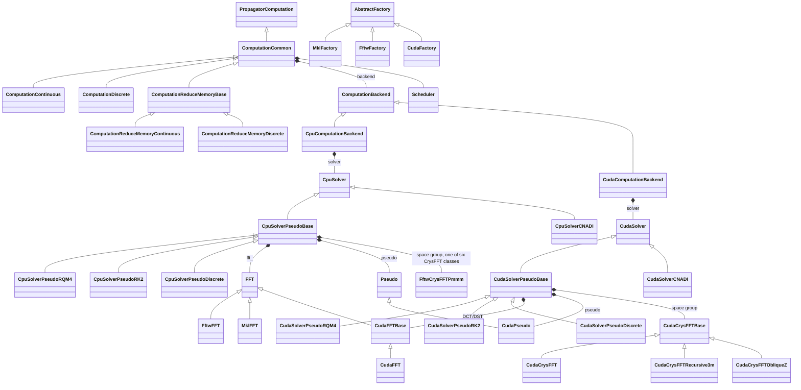

# Architecture at a Glance

> **⚠️ Warning:** This document was generated with assistance from a large language model (LLM). While it is based on the codebase, it may contain errors or omissions. Please verify against the source before relying on it.

One page with the classes, who owns whom, and how one iteration runs through them. The details are in [DeveloperGuide.md](DeveloperGuide.md) (hierarchies and rules), [PropagatorSystem.md](PropagatorSystem.md) (propagator keys and scheduling), [FFTImplementation.md](FFTImplementation.md) (transforms) and [MemoryManagement.md](MemoryManagement.md) (storage modes).

## 1. Layers

```
Python (src/python)
  SCFT / LFTS / CLFTS ───────────── SymmetricPolymerTheory (χN → auxiliary fields)
        │
        ▼
  PropagatorSolver ──────────────── holds the C++ objects of one simulation
        │   _core module (src/pybind11)
════════╪══════════════════════════════════════════════════════════════════════
C++     ▼
  PlatformSelector ──► AbstractFactory<T> = MklFactory | FftwFactory | CudaFactory
        │ creates
        ├── ComputationBox<T>          CpuComputationBox | CudaComputationBox
        ├── Molecules, PropagatorComputationOptimizer
        ├── PropagatorComputation<T>   ComputationContinuous | ComputationDiscrete
        │      │                       | ComputationReduceMemoryContinuous | ...Discrete
        │      └── owns ComputationBackend<T> = CpuComputationBackend | CudaComputationBackend
        │             └── owns the solver: CpuSolver<T> | CudaSolver<T>
        │                    └── owns the transforms: FFT/DCT/DST, CrysFFT, Pseudo tables
        └── AndersonMixing<T>          CpuAndersonMixing | CudaAndersonMixing[ReduceMemory]
```

The computation classes are written once (`src/common/Computation*.cpp`) and decide **what** is computed and in **which order**. Everything that touches grid data goes through `ComputationBackend`, so the CPU and CUDA code differ only below that line.

## 2. Class Map

### Platform-neutral classes (`src/common`)

```
PropagatorComputation<T>                interface used by Python
└── ComputationCommon<T>                backend, scheduler, φ storage, accessors, solvents, stress conversion
    ├── ComputationContinuous<T>        continuous chains, q(r, s) stored at every step
    ├── ComputationDiscrete<T>          discrete chains, half-bond states at junctions
    └── ComputationReduceMemoryBase<T>  checkpoints, recomputation, walk over the segment pairs of a block
        ├── ComputationReduceMemoryContinuous<T>
        └── ComputationReduceMemoryDiscrete<T>

ComputationBackend<T>                   every operation on grid data (implemented per platform)
AbstractFactory<T>                      creates the objects of one platform
ComputationBox<T>                       grid, box, boundary conditions, mask, integrals
Pseudo<T>                               Fourier-space tables: bond Boltzmann factors, stress bases
FFT<T>                                  forward/backward transform interface (FFT, DCT, DST);
                                        header in src/platforms/cpu/FFT.h, used by both platforms
SpaceGroup                              reduced basis, symmetrization, physical bases for CrysFFT
Molecules, Polymer, PropagatorCode      polymer definitions and propagator keys
PropagatorComputationOptimizer          which propagators to compute (aggregation)
Scheduler                               in which concurrent groups
AndersonMixing<T>                       field update
```

### Platform implementations (`src/platforms/cpu`, `src/platforms/cuda`)

| Role | CPU | CUDA |
|------|-----|------|
| Backend | `CpuComputationBackend` | `CudaComputationBackend` |
| Factory | `MklFactory`, `FftwFactory` | `CudaFactory` |
| Computation box | `CpuComputationBox` | `CudaComputationBox` |
| Solver interface | `CpuSolver<T>` | `CudaSolver<T>` |
| Pseudo-spectral base | `CpuSolverPseudoBase<T>` | `CudaSolverPseudoBase<T>` |
| Continuous, RQM4 | `CpuSolverPseudoRQM4` | `CudaSolverPseudoRQM4` |
| Continuous, RK2 | `CpuSolverPseudoRK2` | `CudaSolverPseudoRK2` |
| Discrete chains | `CpuSolverPseudoDiscrete` | `CudaSolverPseudoDiscrete` |
| Real space, CN-ADI2 | `CpuSolverCNADI` | `CudaSolverCNADI` |
| Transforms | `FftwFFT<T,DIM>`, `MklFFT<T,DIM>` (FFT, DCT, DST) | periodic: cuFFT plans in `CudaSolverPseudoBase`; DCT/DST: `CudaFFT<T,DIM>` over `CudaRealTransform` |
| Fourier-space tables | `Pseudo<T>` | `CudaPseudo<T>` (device copy) |
| CrysFFT (space groups) | `{Fftw,Mkl}CrysFFT{Pmmm,Recursive3m,ObliqueZ}` | `CudaCrysFFT` (Pmmm), `CudaCrysFFTRecursive3m`, `CudaCrysFFTObliqueZ` |
| Field update | `CpuAndersonMixing` | `CudaAndersonMixing`, `CudaAndersonMixingReduceMemory` |

### Diagram

GitHub renders this diagram; arrows with a triangle are inheritance, arrows with a diamond are ownership.



## 3. One SCFT Iteration Through the Layers

```
SCFT.run (src/python/scft.py)
├─ PropagatorSolver.compute_propagators(w)      → ComputationContinuous::compute_propagators
│   ├─ set_fields: check w and q_init, keep w for solvents, backend.update_dw → solver Boltzmann factors
│   ├─ for each scheduler group, its propagators concurrently (OpenMP thread i uses stream i):
│   │     initial condition: set_unity | copy q_init | junction_product | junction_sum, then apply_mask
│   │     advance_propagator n times → solver: e^{-w ds/2} F⁻¹[ e^{-b²k²ds/6} F[ e^{-w ds/2} q ] ] (+ RQM4 extrapolation)
│   │   synchronize
│   └─ Q = inner_product(q, q†) / V
├─ compute_concentrations, per block: set_zero, add_segment_products (Simpson pairs), normalize_concentration; then solvents
├─ compute_stress, per block: block_stress (segment pairs) → solver segment stress; sum the blocks; lattice derivatives
└─ AndersonMixing.calculate_new_fields(w, w_out - w)
```

Reduce-memory mode runs the same steps one propagator at a time, keeping q only at checkpoints and recomputing the other segments when a sum needs them; the results are the same bit for bit.

## 4. Where to Change What

| To change | Edit |
|-----------|------|
| Order of a computation, which segments enter a sum, normalization | `src/common/Computation*.cpp` (once, for both platforms) |
| A new kind of grid operation | `src/common/ComputationBackend.h` and both backends |
| A numerical method (advance step, segment stress) | the solvers in `src/platforms/cpu` and `src/platforms/cuda` |
| Transforms (FFT, DCT, DST) and CrysFFT | the FFT and CrysFFT classes ([FFTImplementation.md](FFTImplementation.md)) |
| Fourier-space tables | `src/common/Pseudo.cpp` (`CudaPseudo` uploads them) |
| Which propagators are computed, aggregation | `PropagatorComputationOptimizer`, `PropagatorAggregator` |
| Concurrent groups | `Scheduler` |
| Which objects a platform creates | the factories |
| Simulation loop and parameters | `src/python` |

## 5. Ownership and Lifetime

- `PropagatorSolver` (Python) holds the box, the molecules, the optimizer and the computation; the bindings keep the arguments of each object alive while it exists.
- A computation owns its backend, the scheduler, the concentration fields and the propagator storage; the backend is deleted last.
- A backend owns its solver, and on CUDA the streams, events and scratch buffers.
- A solver owns its transforms, its `Pseudo` tables, its CrysFFT objects and its Boltzmann factors.
- The computation, backend, box, solver and transform constructors release what they already hold when they throw, so a failed construction (for example out of GPU memory) can be retried in the same process. The CUDA Anderson-mixing constructors do not yet. Errors inside the parallel loops reach Python as exceptions.
