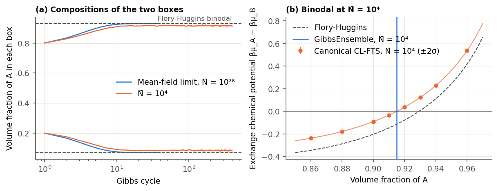
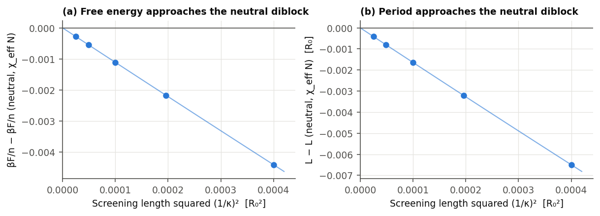
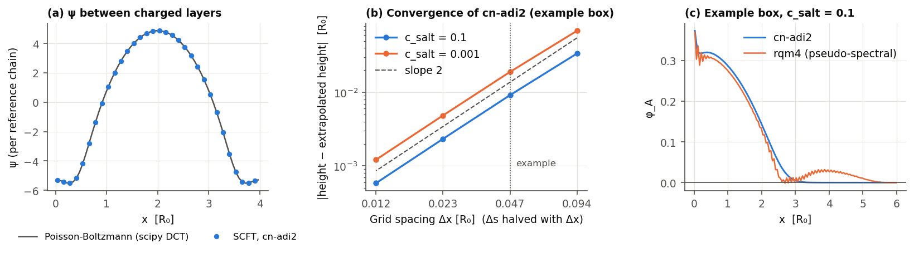
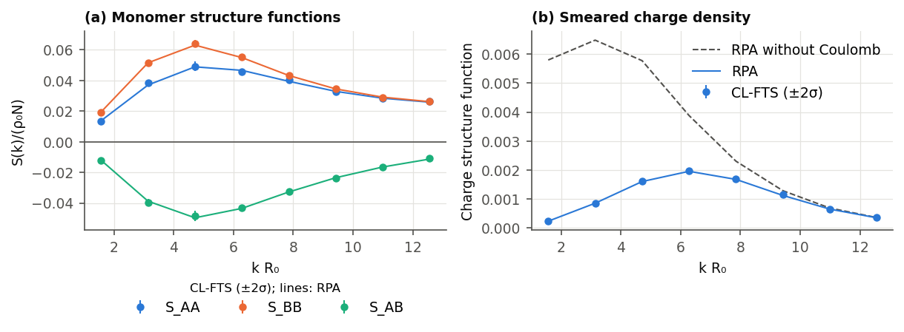
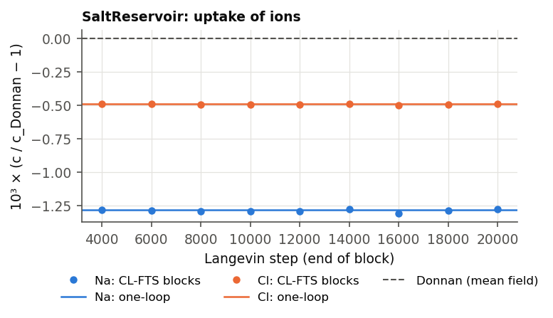

# Validation of the Examples

What the tests and validation runs check for the examples under [`examples/`](../../examples/README.md), with the compared numbers and figures, and what has not been checked. `TestExamples` builds every example (inputs, input checks and construction) but does not run it. [Numerical Validation](NumericalValidation.md#comparison-with-published-results-and-other-codes) lists the papers and codes that polymerfts reproduces, and its section [Differences and limits](NumericalValidation.md#differences-and-limits) collects the differences from published results and their causes. The full references of the papers are listed in the [examples index](../../examples/README.md#references).

Each example lists under these labels:
- **Checked**: what a test or a validation run compared with a reference, and the result.
- **Not checked**: what has not been compared with a reference.
- **Not reproduced**: what was compared but differs from the reference.
- **Not reproducible**: what needs a model feature that the code does not have.
- **Limits found**: limits of the method that the comparisons showed.

## Summary

| Example | Compared with | Result |
|---|---|---|
| `block_copolymer/clfts/SoftBeadDiblockMelt.py` | CL-FTS of Lequieu 2024; exact Monte Carlo of a Gaussian-core fluid | Agrees: chemical potentials within 0.003–0.02 kT, pressures within about one standard error; the excess pressure of the polyampholyte lies 2 % of its fluctuation correction below (not confirmed) |
| `blend/scft/MixtureBlockRandom.py`, `blend/lfts/MixtureBlockRandom.py` | Flory-Huggins (homogeneous states) | Checked; the ordered blend not checked |
| `blend/scft/CanonicalCoexistence.py` | Common tangent of the Flory-Huggins free energy | Checked |
| `blend/clfts/GibbsEnsemble.py` | Flory-Huggins binodal; canonical CL-FTS at N̄ = 10⁴ | Agrees: 0.92928 in the mean-field limit, 0.91497 ± 0.0001 against 0.91497 ± 0.00013 at N̄ = 10⁴ |
| `blend/clfts/HomopolymerSolutionBook.py` | Fredrickson and Delaney 2023 | Agrees within the reading precision (0.1–0.2 %) |
| `charged/scft/ChargedDiblockLamella.py` | Strong-screening limit, grid convergence | Checked; the unscreened lamellae not compared |
| `charged/scft/SaltDopedLamella.py` | Locally neutral limit (a neutral salt molecule), grid convergence | Checked; published salt-doped lamellae not compared |
| `charged/scft/PolyelectrolyteBrush.py` | Independent Poisson-Boltzmann solution, Δx and Δs convergence | Checked; brush theory not compared |
| `charged/scft/CounterionsBetweenPlates.py` | Poisson-Boltzmann of Netz 2001 | Agrees: profile within 10⁻³, pressure within 3×10⁻⁵ |
| `charged/clfts/CounterionsBetweenPlates.py` | Netz's loop expansion, exact lattice Monte Carlo | Agrees up to Ξ ≈ 0.6; wrong at Ξ ≥ 0.85 (limit of CL-FTS) |
| `charged/clfts/SmearedSaltSelfEnergy.py` | One-loop theory, exact Monte Carlo | Agrees: 0.1 % at weak coupling, Monte Carlo up to l_Bκ = 4.8 |
| `charged/clfts/ChargedDiblock.py` | RPA at N̄ = 10⁶ | Checked at weak fluctuations; the example's regime not checked |
| `charged/clfts/SaltReservoir.py` | Donnan equilibrium, one-loop theory | Agrees: the one-loop theory predicts the shift of the ions to 0.5 % |
| `charged/clfts/ComplexCoacervate.py` | Lee et al. 2008; Danielsen et al. 2019 | Structure factors agree; the phase diagram of Lee's Fig. 6 not reproduced (explained); Danielsen's converged binodal lies 3.4–5 % below the paper; with the paper's contour step the gap closes at E = 4000 and shrinks to 2 % at E = 2000 (explained) |
| `charged/clfts/PolyampholyteSolution.py` | McCarty et al. 2019 | Chemical potentials, pressures and the binodal agree; the density structure function lies 3–8 % below (undecided); two state points inside the two-phase region differ (explained) |

The sections below give the details.

## Block copolymers

Paths are relative to `examples/block_copolymer/`. The other systems of Lequieu's paper (a homopolymer solution, a polyampholyte solution and polyelectrolyte gels) are in the same comparison.

- **`clfts/SoftBeadDiblockMelt.py`** (Lequieu 2024). The paper shows that molecular dynamics and CL-FTS of the same soft-bead models give the same pressure and chemical potentials. Its systems map onto the compressible model of polymerfts without missing features: discrete chains of N beads and N − 1 bonds, Gaussian-smeared excluded volume and Coulomb interactions (the paper's pair kernels are Γ² of the code), explicit solvent and ions as molecules of one segment. The paper's excluded volume differs from the compressibility penalty by terms linear in the fixed numbers and the volume, which shift P by BC²/2 and the chemical potentials by BCα. Its plotted μ_ex − μ_s is −⟨ln Q⟩ including the self-interaction of the beads.
  - Checked (validation runs, ETD integrator): CL-FTS against the paper's CL-FTS, read from the vector data of its figures:

| System (figure) | Quantity | polymerfts | Lequieu 2024 | Mean field |
|-----------------|----------|-----------:|-------------:|-----------:|
| Diblock melt χN = 2, N = 50 (Fig. 2) | βP R_g³ / β(μ_ex − μ_s) | 254.37 ± 0.11 / 102.106 ± 0.001 | 254.254 / 102.109 | 257.5 / 101.0 |
| Diblock melt χN = 10, N = 100 (Fig. 2) | βP R_g³ / β(μ_ex − μ_s) | 264.20 ± 0.27 / 105.778 ± 0.003 | 263.897 / 105.773 | 267.5 / 105.0 |
| Homopolymer solution C = 0.7, N = 50 (Fig. 1) | βP R_g³ / β(μ_ex − μ_s) | 2.993 ± 0.037 / 8.494 ± 0.001 | 2.953 / 8.4875 | 3.150 / 7.0 |
| Polyampholyte C = 3, N = 50, E = 10³ (Fig. 4) | βP_ex R_g³ / β(μ_ex − μ_s) | 1.313 ± 0.021 / 4.394 ± 0.002 | 1.388 / 4.390 | 4.5 / 3.0 |
| Polyelectrolyte gel with salt, E = 10³ (Fig. 5) | βP_ex / μ_ex,+ + μ_ex,− / μ_ex,1 + 20 μ_ex,− | 12.699 ± 0.021 / 0.1555 ± 0.0003 / 19.369 ± 0.026 | 12.712 / 0.156 / 19.386 | 12.788 / 0.200 / 17.779 |
| Polyelectrolyte gel with salt, E = 10⁴ (Fig. 5) | same | 12.285 ± 0.045 / −0.513 ± 0.002 / 8.181 ± 0.047 | 12.273 / −0.515 / 8.201 | 12.788 / 0.200 / 17.779 |

  Pressures are extrapolated to δτ → 0 from δτN = 0.5 and 1 where both were run. The chemical potentials agree within 0.003–0.02 kT, for fluctuation corrections of 0.04–9.6 kT, and the pressures within about one standard error, except the polyampholyte, whose excess pressure lies 0.075 (2 % of its fluctuation correction) below the paper and changes with the time step (1.388 ± 0.018 at δτN = 1, 1.332 ± 0.015 at 0.5). The paper gives no errors for its CL-FTS values. In a Gaussian-core fluid (one-bead molecules, βu0 = 0.5, a = 0.2, ρ = 30) CL-FTS agrees with an exact Monte Carlo simulation of the particles: P = 251.240 ± 0.017 against 251.2285 ± 0.0052, and μ_ex = 14.4910 against 14.4900 ± 0.0021 from Widom insertion (after the shift (1/2V) dμ/dρ between the insertion of one particle and the derivative dA/dn).
  - The example `SoftBeadDiblockMelt.py` (χN = 2, 40000 steps at δτN = 0.5, 36 min on an A10 GPU) gives βP R_g³ = 254.35 ± 0.08 and β(μ_ex − μ_s) = 102.107 ± 0.001.
  - Not checked: the lamellar diblock points, the two-phase polyampholyte points, the dilute points (C ≤ 0.05, 1–40 chains per box), the gels at higher polymer fraction and at E = 10⁵.

## Blends and coexistence

Paths are relative to `examples/blend/`.

- **`scft/MixtureBlockRandom.py`, `lfts/MixtureBlockRandom.py`**
  - Checked: the random copolymer in the homogeneous SCFT thermodynamics, against Flory-Huggins (`TestPhaseEquilibrium`).
  - Not checked: the ordered blend against a reference.
- **`scft/CanonicalCoexistence.py`**
  - Checked (`TestPhaseEquilibrium`): the coexistence solver against the common tangent of the Flory-Huggins free energy; homogeneous SCFT states against Flory-Huggins within 10⁻¹²; the exchange chemical potential of a modulated diblock/homopolymer blend against dF/dφ. The binodal of this example is therefore the Flory-Huggins binodal.
  - Not checked: a binodal with a modulated phase against an independent calculation.
- **`clfts/GibbsEnsemble.py`**
  - Checked (`TestGibbsEnsemble`, small boxes of a symmetric blend at χN = 3 with N = 20): in the mean-field limit N̄ = 10²⁸, the Flory-Huggins binodal within 2×10⁻⁶ and the coexistence of charged chains with canonical ions and with grand-canonical salt (Donnan potentials) against independent solutions within 10⁻⁶; at N̄ = 10⁴, bitwise continuation of a run.
  - Checked (validation runs with the settings of the example): in the mean-field limit the boxes reach the Flory-Huggins binodal. At N̄ = 10⁴, where fluctuations shift the binodal by −0.014, the Gibbs ensemble agrees with an independent route: canonical CL-FTS runs of one box at fixed compositions, whose exchange chemical potential βμ_A − βμ_B vanishes at the binodal of this symmetric blend.
  - Not checked: published fluctuating binodals; the dependence on `exchange_rate` and `cycle_steps`; finite-size effects (both routes use the same box).
  - The method follows Riggleman and Fredrickson (*J. Chem. Phys.* **2010**, 132, 024104), but each box is held at the reference density, so the pressures of the boxes need not agree ([CL-FTS theory, Section 8](../theory/ComplexLangevinSimulation.md#8-gibbs-ensemble)).

| Volume fraction of A in the A-rich phase | Value |
|------------------------------------------|-------|
| Flory-Huggins binodal | 0.92928 |
| `GibbsEnsemble`, N̄ = 10²⁸ (after 40 cycles) | 0.92928 |
| `GibbsEnsemble`, N̄ = 10⁴, 400 cycles (second half) | 0.91497 ± 0.0001 |
| `GibbsEnsemble`, N̄ = 10⁴, the example (40 cycles) | 0.9149 |
| Canonical CL-FTS, N̄ = 10⁴: zero of βμ_A − βμ_B | 0.91497 ± 0.00013 |

Settings of the example: 16 × 16 grid, boxes of 2 R₀ × 2 R₀ (the area of each box stays within about 1 % of 4 R₀²), discrete chains with N = 32, χN = 3, ζN = 100, δτN = 0.5. The canonical runs take 200,000 steps at each of eight compositions φ = 0.86–0.96, recorded in 20 blocks of which the first is left out. Their exchange chemical potential is fitted with ln(φ/(1 − φ)) plus a quadratic in φ (largest residual 9×10⁻⁶). All compositions use the same random seed, so their noise is correlated: the zero is fitted block by block, and its error is the spread of the 19 zeros. The error of the Gibbs ensemble comes from blocks of 20 cycles.

- **`clfts/HomopolymerSolutionBook.py`** (Fredrickson and Delaney 2023, Figs. 5.6, 5.7, 5.8 and 7.14)
  - Checked (validation runs, ETD integrator): the excess chemical potential and pressure of a homopolymer in implicit good solvent (continuous chains, B = C = 1, a = Δx = 0.1 R_g; the Edwards model maps onto the compressible model with ζN = BC), and the excess chemical potential of a disordered diblock melt (χN = 10, f = 0.34, C = 20, ζN = 100, a = 0.2 R_g, 48³ points), against the book's figures:

| System | Quantity | polymerfts | Fredrickson and Delaney |
|--------|----------|-----------:|------------------------:|
| Homopolymer solution, L = 1.6 R_g (16³) | βμ_ex / βP_ex R_g³ | 1.2905 ± 0.0011 / 0.45703 ± 0.00026 | 1.292 ± 0.002 / 0.4571 ± 0.001 |
| Homopolymer solution, L = 3.2 R_g (32³) | βμ_ex / βP_ex R_g³ | 1.3291 ± 0.0005 / 0.47727 ± 0.00027 | 1.330 ± 0.002 / 0.4773 ± 0.001 |
| Homopolymer solution, L = 6.4 R_g (64³) | βμ_ex / βP_ex R_g³ | 1.3350 ± 0.0008 / 0.48311 ± 0.00039 | 1.335 ± 0.002 / 0.4831 ± 0.001 |
| Disordered diblock melt | βμ_ex | 4.5948 ± 0.0002 | 4.5949 ± 0.0003 |

  The book's values are read from its figures, with errors that include the reading. The time step changes nothing within the errors (δτN = 0.5 and 2 at L = 1.6 R_g; 1 and 2 for the diblock). The recorded pressure is the virial form of the operator. The dilation of the box at fixed grid values has the same average, but its Gaussian terms, which cancel on average, raise the standard deviation per sample from 0.013 to 10.3 at L = 1.6 R_g (0.497 ± 0.096 at L = 3.2 R_g in the same run) ([CL-FTS theory, Section 7](../theory/ComplexLangevinSimulation.md#7-chemical-potential-and-osmotic-pressure)). The diblock run starts at the homogeneous saddle point, since the uniform mode of the pressure field relaxes slowly from zero.
  - The example `HomopolymerSolutionBook.py` (L = 3.2 R_g, 20000 steps, 11 min on an A10 GPU) gives βμ_ex = 1.3274 ± 0.0006 and βP_ex R_g³ = 0.4768 ± 0.0002.
  - Not checked: the book's discrete-chain homopolymer (Fig. 5.11, whose two quoted values disagree), its Gibbs-ensemble binodal (Fig. 7.2), the coacervate surface tension (Fig. 7.11, parameters not given) and its free energies (Figs. 7.8–7.10, which need thermodynamic integration).

## Charged systems

Paths are relative to `examples/charged/`. SCFT solves a deterministic mean-field problem. CL-FTS adds the question whether complex Langevin sampling converges to the correct averages, which has been checked for charged systems only where the fluctuations are weak ([CL-FTS theory, Section 6](../theory/ComplexLangevinSimulation.md#6-charged-systems), "Checked range").

- **`scft/ChargedDiblockLamella.py`**
  - Checked (`TestScftElectrostatics`, mostly with essentially the system of this example: charged AB diblock with Na⁺ Cl⁻ point ions, discrete chains, N = 50, E = 2000): zero valences reproduce neutral SCFT; the stress equals dF/dL with canonical and with grand-canonical ions; the Donnan potential of homogeneous states; canonical and grand-canonical ions reach the same state; the platforms agree. With the oppositely charged blocks and continuous chains described below: under strong screening the free energy and the relaxed period approach those of the neutral diblock with χ_eff N within 10⁻⁵.
  - Checked (validation runs): the strong-screening limit below, and the convergence of the periods that the example prints in the grid. With 64, 128 and 256 grid points they agree to seven digits: 4.35597, 4.38527, 4.43950, 4.58712 and 4.78701 R₀ for c_salt = 0, 0.01, 0.03, 0.1 and 0.3, and 4.97436 R₀ for the neutral diblock. The contour step is fixed by the discrete chains (N = 50).
  - Not checked: the periods and free energies of the unscreened lamellae against another code or published results.

Strong screening: blocks with valences +0.5 and −0.5, continuous chains (Δs = 1/50), 64 grid points, χN = 25 and E = 10/λ² for screening lengths λ = 1/κ = 0.02 to 0.005 R₀. The Coulomb term then acts as the contact interaction −E (z_A − z_B)²/(2κ²) = −5, and the free energy and the relaxed period approach those of the neutral diblock at χ_eff N = 20 linearly in λ² (the ratio of the differences at λ = 0.01 and 0.005 is 3.99).

- **`scft/SaltDopedLamella.py`**
  - Checked (validation runs, tolerance 10⁻⁹): (a) the strong-coupling limit, at φ_s = 0.02 with 256 and 512 grid points. When the Debye length is much shorter than the domains, the cation and the anion have the same concentration everywhere, and the salt acts as one neutral molecule of one segment with the volume fraction 2φ_s and χN = (χ_AP N + χ_AM N)/2 = 62.5. As E doubles from 10⁵ to 6.4×10⁶ (Debye length 0.11 to 0.014 R₀), the differences of the free energy and of the relaxed period from those of this neutral salt shrink by the factors 1.79, 1.88, 1.93, 1.96, 1.98, 1.99 and 1.56, 1.75, 1.86, 1.92, 1.96, 1.98, so they vanish linearly in 1/E. At E = 6.4×10⁶ they are −2.0×10⁻⁴ and −3.6×10⁻⁴ R₀, the partitions are 2.998 (P) and 2.991 (M) against 2.994 of the neutral salt, and the largest local charge is 6×10⁻⁵. The free energies and periods of the 256- and 512-point runs agree to nine digits. (b) The periods that the example prints (128 points) agree with 64 and 256 points to eight digits: 4.70783, 4.72989, 4.77735 and 4.87378 R₀ for φ_s = 0.005, 0.01, 0.02 and 0.04. (c) At the relaxed period of φ_s = 0.04 (64 points), the central difference of F over L(1 ± h) falls as h²: −2.0×10⁻⁵, −3.2×10⁻⁶ and −7.8×10⁻⁷ for h = 1 %, 0.4 % and 0.2 %. (d) In every run of (b), the mean ion concentrations equal φ_s, and the mean charge vanishes to 10⁻¹⁷.
  - Not checked: the periods and ion partitions against published SCFT of salt-doped block copolymers or another code.

- **`scft/PolyelectrolyteBrush.py`**
  - Checked (`TestConfinedElectrostatics`, with discrete chains and pseudo-spectral propagators): ψ in a closed box against an independent Poisson-Boltzmann solution between fixed charge layers (10⁻⁹); the closed-box stress against dF/dL; charged chains grafted to a wall converge to the Poisson equation.
  - Checked (validation runs, figure and table below): (a) with `cn-adi2`, the method of this example, ψ between the charged layers of that test agrees with the independent Poisson-Boltzmann solution within 2.8×10⁻¹¹ (|ψ| ≤ 5.5); (b) the brush heights converge at second order in Δx and Δs, and those of the example are 0.9 % (c_salt = 0.1) to 1.6 % (c_salt = 0.001) above the extrapolated values; in a 4 R₀ box, where the pseudo-spectral `rqm4` still runs at high salt, `rqm4` with 512 points and Δs = 0.0025 agrees with the extrapolated `cn-adi2` heights within 3×10⁻⁵ R₀ (c_salt = 0.1 and 0.03), although its iteration stalls at errors of 5×10⁻⁸ to 10⁻⁷ and its check of the partition functions fails at c_salt = 0.01; (c) `rqm4` in the example's box puts a spurious second layer of A segments at x ≈ 4 R₀ and negative φ_A between the brush and that layer (down to −0.0014) and near the far wall (down to −0.0005); its iteration stalls at an error of 10⁻⁵ already at c_salt = 0.1, and at c_salt = 0.03 the check of the partition functions fails. The propagators of the grafted chains fall by many orders of magnitude across the box: the true φ_A drops from 0.37 to 4×10⁻¹⁷ at the far wall of the 6 R₀ box (c_salt = 0.1), but only to 10⁻⁷ in the 4 R₀ box. The round-off of the pseudo-spectral transforms, about 10⁻¹⁶ of the largest value of a propagator, grows into the spurious density where the propagators are small; the real-space `cn-adi2` method does not have it.
  - Not checked: the electrostatics with `cn-adi2` in a ctest; the brush heights against brush theory (osmotic and salted regimes) or published profiles.

| Brush height ⟨x⟩ [R₀], example box | c_salt = 0.1 | c_salt = 0.001 |
|------------------------------------|-------------:|---------------:|
| Δx = 0.094 (64 points), Δs = 0.02 | 1.05194 | 1.28034 |
| Δx = 0.047 (128 points), Δs = 0.01 (the example) | 1.02733 | 1.23055 |
| Δx = 0.023 (256 points), Δs = 0.005 | 1.02049 | 1.21642 |
| Δx = 0.012 (512 points), Δs = 0.0025 | 1.01874 | 1.21278 |
| Richardson extrapolation | 1.01816 | 1.21157 |

Every run converged to the error 10⁻⁸ of the example, with relative partition-function errors below 10⁻¹³. The potential difference between the walls converges only at first order, since it is read in the first cell, which also holds the substrate charge: the example's −0.648 and −2.833 lie 5 % and 2 % from the extrapolated −0.681 and −2.881 (c_salt = 0.1 and 0.001).

- **`clfts/ChargedDiblock.py`**
  - Checked: the forces of ψ and of the auxiliary fields against derivatives of H, the exact step of ψ and its stationary variance, the neutral limits and bitwise restarts (`TestClftsElectrostatics`); the structure functions of a charged diblock with one-segment counterions against the RPA at N̄ = 10⁶ (`TestChargedStructureFunctionRPA`, figure below).
  - Not checked: the regime of the example (N̄ = 10⁴, χN = 12 from a lamellar start, E ≈ 10³), where the fluctuations are not Gaussian. No reference exists there, and whether complex Langevin sampling converges to the correct averages at this coupling has not been established.

System of `TestChargedStructureFunctionRPA`: discrete AB diblocks with N = 20, f = 0.5, valence 0.2 on A and one-segment counterions of valence −1, χN = 6, ζN = 100, E = 10⁴, N̄ = 10⁶, 32 × 32 grid with L = 4 R₀, Gaussian smearing 0.1 (A, B) and 0.15 (counterions); 30,000 steps, 29 blocks after the first. Mean ratios to the RPA over the eight shells: S_AA 1.000 ± 0.009, S_BB 1.002 ± 0.006, S_AB 0.996 ± 0.010, charge structure function 1.008 ± 0.008. The Coulomb interaction lowers the charge structure function at small k to a few percent of its value without it.

- **`clfts/SaltReservoir.py`**
  - Checked: the forces with the grand-canonical terms, canonical and grand-canonical species on the same fields, the mean-field limit (Donnan potential, numbers of ions, chemical potentials, osmotic pressure), the pressure against −dH/dV and bitwise restarts (`TestClftsGrandCanonical`); the Debye-Hückel statistics of ψ with point ions at weak coupling (`TestClftsPointIons`).
  - Checked (validation run of the example, figure and table below): the ion concentrations lie below the Donnan values, by the same 4.0×10⁻⁵ per segment for both ions (neutrality fixes their difference), and the one-loop theory of ψ on the same grid predicts this shift to 0.5 %, within about two standard errors. In it each ion is weighted by ⟨e^(−z_s Γ_s ψ/N)⟩ = e^(−z_s² σ²/(2N²)), where σ² is the variance of the smeared potential from the Gaussian theory of ψ: (k² + κ²)/E plus the screening by the point ions and the RPA charge response of the chains, summed over the 32³ modes of the grid. The unscreened part, σ² = 20.1, is the self-energy of the smeared ions; screening lowers it to σ² = 14.3. The weight then enters the Donnan equilibrium.
  - Not checked: stronger coupling, where the one-loop theory no longer suffices.

| Ion concentration per segment | Na⁺ | Cl⁻ |
|-------------------------------|----:|----:|
| Donnan (mean field) | 0.0309017 | 0.0809017 |
| One-loop theory | 0.0308621 | 0.0808621 |
| CL-FTS (the example, 9 blocks of 2000 steps) | 0.0308619 ± 0.0000001 | 0.0808619 ± 0.0000001 |

- **Electrolytes: `scft/CounterionsBetweenPlates.py`, `clfts/CounterionsBetweenPlates.py`, `clfts/SmearedSaltSelfEnergy.py`.** These systems hold only point ions and fixed charges; a neutral solvent of one segment, which the ions do not feel, is the reference chain.
  - Checked (SCFT against Netz 2001, Eqs. 63–69): the Poisson-Boltzmann profile and pressure between two plates for d/μ = 0.5–32 (μ the Gouy-Chapman length). With 1024 cells the midplane pressure agrees within 3×10⁻⁵ and the profile within 10⁻³, both converging as Δx²; the contact theorem holds within 1.4×10⁻⁴ for d/μ ≤ 8.
  - Checked (CL-FTS against the one-loop theory on the same grid and against an exact Monte Carlo simulation of the same lattice model, point ions on the grid sites with the smeared Coulomb pair potential of the box). The walls of a closed box let no field through, which repels ions by their images, so Netz's own one-loop numbers (for a uniform dielectric) do not apply; his loop expansion is evaluated with the Green function of the box instead.

| System | Coupling | CL-FTS | Reference |
|--------|----------|-------:|----------:|
| Bulk salt, βμ_ex⁺ + βμ_ex⁻ (Widom insertion in Monte Carlo) | l_Bκ = 0.27 / 1.1 / 2.3 / 4.8 | 0.3987 / 1.5790 / 3.0723 / 5.514 | 0.3988 / 1.5780 / 3.0721 / 5.511 ± 0.014 |
| Bulk salt, βμ_ex / one loop on the grid | l_Bκ = 0.13 / 0.54 / 1.07 / 2.15 | 1.0001 / 0.9992 / 0.9964 / 0.980 (± 0.0005) | 1 (the one-loop limit) |
| Salt at uncharged walls, density in the wall cell / mean | l_B/a = 0.51 / 1.02 / 2.04 | 0.8873 ± 0.0005 / 0.7865 ± 0.0009 / 0.6160 ± 0.0021 | Monte Carlo 0.8871 ± 0.0006 / 0.7857 ± 0.0010 / 0.6202 ± 0.0013 |
| Counterions between plates, density in the wall cell / mean | Ξ = 0.05 / 0.10 / 0.20 | 1.8680 / 1.8183 / 1.7196 | Monte Carlo 1.8679 / 1.8182 / 1.7198; PB 1.918 |

  The one-loop correction is exact as the coupling vanishes; the residuals of the bulk salt, 0.0008, 0.0036 and 0.020 at l_Bκ = 0.54, 1.07 and 2.15, grow about five-fold per doubling of the coupling. Salt at uncharged walls agrees with Monte Carlo within the combined errors up to l_B/a = 2 (1.7 standard errors at the wall cell at l_B/a = 2.04; χ² of the whole profile 81 for 96 points). The example `SmearedSaltSelfEnergy.py` (a κ = 0.25) gives CL-FTS/one loop = 1.0007 ± 0.0016; Agrawal and Wang's Eq. 6 (0.1996) screens with point charges and Wang's Eq. 3.3 (0.169) holds only as aκ → 0, while the one-loop theory of this model is 0.1998 on the grid and 0.2073 in the continuum.
  - Limits found: the step of ψ has an O(δτ) bias that grows with the ion response, so beyond weak coupling these runs needed δτN ≤ 0.25 (the bulk salt at l_Bκ = 4.8 gives 5.721 at δτN = 1). Counterions between plates agree with Monte Carlo up to Ξ ≈ 0.6 with small steps; at Ξ = 0.85 the contact density stays 4 % too high as δτ → 0, and at Ξ ≥ 1.6 the profile is qualitatively wrong. CL-FTS does not reach Netz's strong-coupling regime.
  - Not reproducible: Netz's strong-coupling theory and Agrawal and Wang's charged plates and interfaces assume a uniform dielectric across the walls, ions confined by hard walls or excluded volume, which the code does not model; Wang's Sections IV–VI need a varying dielectric constant.

- **`clfts/ComplexCoacervate.py`** (Lee, Popov and Fredrickson 2008, complex coacervation; implicit good solvent, discrete chains, point charges on the grid, mapped like McCarty's model)
  - Checked: the structure factors of Figs. 4 and 5 (B = 1, C = 12, N = 1024, 32³ points in (4R_g)³), against the paper's CL-FTS read from its figures:

| E | u0 S_nn at kR_g = π/2: polymerfts | Lee 2008 | S_cc at its peak / RPA: polymerfts | Lee 2008 |
|--:|------:|------:|------:|------:|
| 900 | 0.976 ± 0.003 | 0.95 | — | — |
| 3600 | 1.070 ± 0.022 | 1.11 | 0.982 | ≈ 0.99 |
| 14400 | 1.90 ± 0.07 | 1.92 | 0.963 | 0.968 |
| 19600 | 2.32 ± 0.13 | 2.48 | 0.957 | 0.955 |

  The RPA gives u0 S_nn = 0.860 at every E; the rise of S_nn at low k and the depression of S_cc below the RPA are fluctuation effects that both codes show.
  - Not reproduced: the phase diagram of Fig. 6 (E = 14400, N = 384). The CL-FTS chemical potentials and pressures give the dense binodal at C = 17.3 ± 0.1 for B = 1, close to the one-loop binodal on the same lattice (17.7) and to the paper's one-loop line (18.4); the paper's superheating and supercooling points (C ≈ 10.7 and 8.6) lie at about half of it. In a box of (4R_g)³ these are limits of metastability, not the binodal: a slab imposed by hand at B = 0.8 dissolves within 20 steps, and phase-separated states diverge at δτN = 1 or carry heavy drift tails at 0.2. The binodal of this lattice model also depends strongly on the grid spacing (one loop at B = 1: C = 10.6 to 24.2 for Δx = R_g/4 to R_g/16), and its pressure has to be taken at fixed grid spacing ([CL-FTS theory, Section 7](../theory/ComplexLangevinSimulation.md#7-chemical-potential-and-osmotic-pressure)).
  - Not reproduced with converged contour integration: the dense branch of the block-polyampholyte binodals of Danielsen et al. (*Proc. Natl. Acad. Sci. USA* **2019**, 116, 8224, Fig. 1, A50C50, B = 1). With the virial pressure, `rqm4`, a box of 4 R_g on 32³ points and δτN = 1 it lies at C = 1.241 ± 0.003 for E = 2000 and 1.942 ± 0.004 for E = 4000, including the pressure of the dilute branch (about 0.004 at E = 2000), 5 % and 3.4 % below the paper's 1.31 and 2.01; the continuum one-loop binodals (1.328 and 2.029) match the paper's RPA lines. A box of 6 R_g shifts it by −0.015 ± 0.005 and 0.000 ± 0.006; 24³ and 48³ points, δτN = 0.25 to 2 and Δs = 0.005 shift it by less than 0.017. The chemical potentials satisfy Gibbs-Duhem with the pressures, the Schwinger-Dyson terms average to zero and the drift has no tail. The paper integrated the contour by second-order operator splitting at Δs = 0.01 (its SI, Section 2). With `rk2` at that step the binodal is 1.284 ± 0.007 and 2.025 ± 0.011, which closes the gap at E = 4000 and leaves 2 % at E = 2000, about the scatter of the paper's markers: the `rk2` pressure is 0.05 to 0.07 lower on the same states, an error of order Δs² that is large here because one contour step (0.1 R₀) is longer than the smearing length (0.082 R₀) ([CL-FTS theory, Section 7](../theory/ComplexLangevinSimulation.md#7-chemical-potential-and-osmotic-pressure)).

- **`clfts/PolyampholyteSolution.py`**
  - Checked (validation runs with this model, the reference density set to the bead density of each box): sequences sv10–sv30 of McCarty et al. (discrete chains N = 50, v = 0.0068 b³, smearing a = b/√6, box L = 34 a) at l_B = 0.033 b and 0.195 b. The results agree with the paper's CL-FTS:

| Quantity | polymerfts | McCarty et al. 2019 |
|----------|-----------:|--------------------:|
| βμ_ex at infinite dilution (ρb³ = 7.4×10⁻⁴), sv20 / sv30, l_B = 0.033 b | 1.845 ± 0.007 / 4.307 ± 0.015 | 1.82 / 4.24 (Fig. 2) |
| βμ_ex at infinite dilution, sv20 / sv30, l_B = 0.195 b | 7.541 ± 0.018 / 11.968 ± 0.020 | 7.53 / 11.96 (Fig. 2) |
| βμ of sv20 at l_B = 0.195 b, ρb³ = 0.0146 / 0.0585 / 0.15 (paper's convention) | −3.42 / −2.48 / −2.32 (± 0.02) | −3.39 / −2.44 / −2.34 (Fig. 2) |
| βΠ_ex b³ of sv30 at ρb³ = 4.4 / sv20 at ρb³ = 3.0, l_B = 0.195 b | −0.1035 ± 0.0011 / −0.0424 ± 0.0011 | −0.101 / −0.039 (Fig. 2) |
| Binodal of sv30 at l_B = 0.195 b, dense / dilute ρb³ | 4.914 ± 0.016 / 1.65×10⁻³ | 4.93 / 2.0×10⁻³ (Fig. 3B) |
| S_ρ(2π/L) of sv30 at ρb³ = 1.47, l_B = 0.033 b | 33.5 ± 0.4 | 34.5 (Fig. S3; RPA 23.6) |

  The paper's values are read from its figures. Its curves labelled l_B = 0.33 b in Fig. 2 were computed at l_B = 0.195 b (their RPA lines, these CL-FTS values and the tie line of Fig. 3B all give 0.195 b), and its μ uses densities in units of (b/√6)⁻³, which subtracts ln 6^1.5 from the μ printed here. An exact single-chain Monte Carlo of the same model gives βμ_ex = 7.500 and 11.831 at l_B = 0.195 b; the CL-FTS values decrease with the box (7.512 and 11.875 in a box 1.5 times larger), and extrapolated linearly in 1/V the two boxes give 7.50 ± 0.01 and 11.84 ± 0.02. The binodal uses the box of the example; the dilute density is 1.9×10⁻³ with the extrapolated μ_ex. Two state points inside the two-phase region (sv30 at l_B = 0.195 b, ρb³ = 0.015 and 0.059) differ from the paper: the boxes hold 0.8 and 3 chains on average, which aggregate (βμ_ex ≈ −15 at ρb³ = 0.059), while the paper's values follow the homogeneous solution; their drift records show no runaway.
  - Not reproduced: the sequences sv10–sv25 at ρb³ = 1.47 give S_ρ(2π/L) 4–8 % below the paper's points, which carry no error bars; sv30 lies 2.9 % below (2.5 standard errors).
  - Not checked: the Gibbs-ensemble binodals of Fig. 3 for other sequences and Bjerrum lengths.
