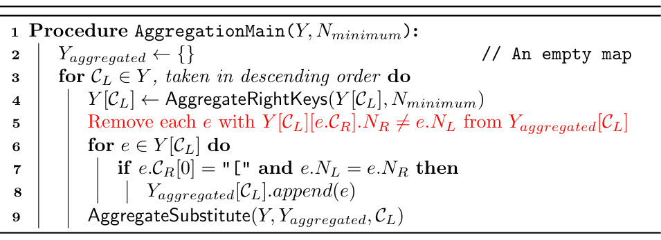
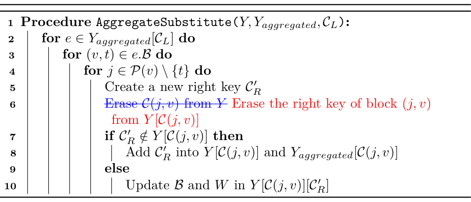

# Errata

Corrections to publications that describe the algorithms of this library. The library implements the corrected versions.

## D. Yong and J. U. Kim, *J. Chem. Theory Comput.* **2025**, 21, 3676

Scheme 3 (AggregationMain) lacks line 5: a right key that `AggregateSubstitute` added to $`Y_{aggregated}`$ must be dropped once `AggregateRightKeys` merges it again, otherwise the blocks beyond it are substituted twice and their concentrations are counted twice. This can occur when identical side chains of two or more blocks are attached at different positions of a polymer, for example a bottlebrush with B–A side chains on backbone blocks of different lengths; the architectures in the paper are not affected. Line 6 of Scheme S3 has a separate error of notation: it erased $`\mathcal{C}(j,v)`$, which lines 7 to 10 use as the left key of block $`(j,v)`$, where the right key of that block is meant. In the schemes, red marks added text and blue strikethrough removed text.

### Scheme 3

[jctc2025_scheme3_corrected.pdf](../figures/jctc2025_scheme3_corrected.pdf)

### Scheme S3

[jctc2025_schemeS3_corrected.pdf](../figures/jctc2025_schemeS3_corrected.pdf)

### Text

- Main text, the paragraph on Scheme 3, after "The procedure AggregateSubstitute carries out this task by updating $`\mathcal{C}_R`$ in $`Y`$ using $`Y_{aggregated}`$.", add: "$`Y_{aggregated}[\mathcal{C}_L]`$ also contains the right keys that AggregateSubstitute added to $`Y[\mathcal{C}_L]`$ while processing higher left keys. If AggregateRightKeys merges such a right key with others, its $`N_R`$ becomes smaller than $`N_L`$, and the right keys of the neighboring blocks must be rewritten using the merged right key that contains it, not using this right key itself. Line 5 of Scheme 3 therefore removes it from $`Y_{aggregated}[\mathcal{C}_L]`$; otherwise, the neighboring blocks would be rewritten twice and their concentrations would be counted twice."
- Supporting Information B ii, "the right key $`(\mathcal{F}5\mathsf{A}5)\mathsf{A}`$, represented by $`\mathcal{C}(j,v)`$ in Scheme S3, is removed from $`Y`$" should read "the right key of block $`(7,4)`$, $`(\mathcal{F}5\mathsf{A}5)\mathsf{A}`$, is removed from $`Y[\mathcal{C}(7,4)] = Y[\mathsf{A}]`$. Here, $`\mathcal{C}(j,v)`$ in Scheme S3 denotes the propagator code of $`q^{j\rightarrow v}(\mathbf{r}, s)`$, which is the left key of block $`(j,v)`$."
- Supporting Information B ii, after "...is added to $`Y_{aggregated}[\mathsf{A}]`$ for potential future substitutions, as well as to $`Y[\mathsf{A}]`$.", add: "In general, when $`\mathcal{C}(j,v)`$ is processed later, AggregateRightKeys may merge $`\mathcal{C}_R^\prime`$ with other right keys of $`\mathcal{C}(j,v)`$, which makes its $`N_R`$ smaller than $`N_L`$ (this does not happen in this example). In that case, $`\mathcal{C}_R^\prime`$ is removed from $`Y_{aggregated}[\mathcal{C}(j,v)]`$ by line 5 of Scheme 3 in the main text, and the merged right key that contains $`\mathcal{C}_R^\prime`$ rewrites the right keys of the neighboring blocks instead."
- Supporting Information B ii, "This process is repeated for $`(j,v) = (7,4)`$" should read $`(j,v) = (8,4)`$; in $`\mathcal{B} = \{(4,1), (5,2), (6,3)\}`$ the braces are missing (twice); "the necessity of AggregationSubstitute" should read "AggregateSubstitute".
