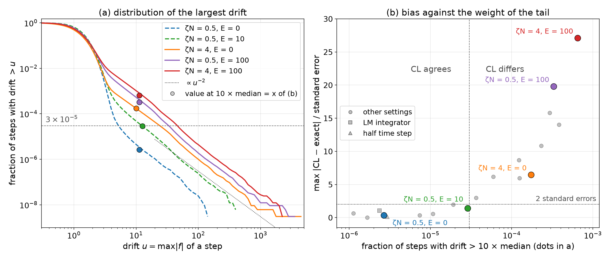

# Complex Langevin Field-Theoretic Simulation (CL-FTS)

This document describes complex Langevin field-theoretic simulation (CL-FTS), which samples every auxiliary field without the partial saddle-point approximation of [L-FTS](PartialSaddlePointApproximation.md). The Langevin integrators, the observables and output files, the structure functions and the renormalization that CL-FTS shares with L-FTS are described in [LangevinFieldTheoreticSimulation.md](LangevinFieldTheoreticSimulation.md).

## Table of Contents

1. [Overview](#1-overview)
2. [Complex Langevin Equations](#2-complex-langevin-equations)
3. [Correct Convergence](#3-correct-convergence)
4. [Hot Spots and Dynamical Stabilization](#4-hot-spots-and-dynamical-stabilization)
5. [Using the CLFTS Class](#5-using-the-clfts-class)
6. [Charged Systems](#6-charged-systems)
7. [References](#7-references)

---

## 1. Overview

CL-FTS drops the partial saddle-point approximation: every auxiliary field fluctuates, including the imaginary fields that L-FTS keeps at their saddle points. The fields then become complex, and so do the concentrations, the partition functions $`Q_p`$ and $`H`$. The method assumes that the stationary averages of this complex dynamics are the averages of the full field theory (References 1 and 3). `CLFTS` uses the compressible model of [PolymerFieldTheory.md](PolymerFieldTheory.md#3-compressible-model) and needs a finite `zeta_n` (default 100).

---

## 2. Complex Langevin Equations

As in [PolymerFieldTheory.md](PolymerFieldTheory.md#63-sign-convention-for-imaginary-fields), $`H`$ is minimized with respect to the real fields and maximized with respect to the imaginary fields at the saddle point; for AB, $`\Omega_-`$ is real and $`\Omega_+`$ imaginary. An imaginary field is integrated along the imaginary axis, $`\Omega_j = i w_j`$ with real $`w_j`$. Written for $`\Omega_j`$, the real Langevin step of $`w_j`$ reverses the sign of the force and makes the noise imaginary:

```math
\Omega_i(\mathbf{r}, \tau + \delta\tau) = \Omega_i(\mathbf{r}, \tau) - \lambda_i \frac{\delta H}{\delta \Omega_i} \delta\tau N + \sigma_i \mathcal{N}_i(\mathbf{r}, \tau) \qquad \text{(real fields)}
```

```math
\Omega_j(\mathbf{r}, \tau + \delta\tau) = \Omega_j(\mathbf{r}, \tau) + \lambda_j \frac{\delta H}{\delta \Omega_j} \delta\tau N + i \sigma_j \mathcal{N}_j(\mathbf{r}, \tau) \qquad \text{(imaginary fields)}
```

The derivatives are those of [PolymerFieldTheory.md](PolymerFieldTheory.md#32-effective-hamiltonian), evaluated with the complex concentrations (smeared, when smearing is used). $`\mathcal{N}_i`$ is real Gaussian noise of unit variance, and $`\sigma_i`$ is that of [Langevin dynamics, Section 2.2](LangevinFieldTheoreticSimulation.md#22-discretized-equation-per-chain-unit). The mobility $`\lambda_i`$ (`dt_scaling` in `clfts.py`) follows [Langevin dynamics, Section 2.1](LangevinFieldTheoreticSimulation.md#21-continuous-langevin-equation) with the eigenvalues of $`U = X + \zeta N \, \mathbf{e}\mathbf{e}^T`$. A field with a zero eigenvalue does not enter $`H`$; it has $`\lambda_i = 0`$ and stays fixed.

LM ([Langevin dynamics, Section 2.4](LangevinFieldTheoreticSimulation.md#24-leimkuhler-matthews-method)) is the default integrator and averages the noise over two steps; `langevin.integrator: "euler"` selects [Langevin dynamics, Section 2.3](LangevinFieldTheoreticSimulation.md#23-euler-method). For an AB diblock, these updates are Eqs. (13)-(16) of Reference 6. The time step is fixed. Reference 6 ran LM with $`\delta\tau N = 2`$ in CL-FTS and $`\delta\tau N = 8`$ in L-FTS.

---

## 3. Correct Convergence

A stable, bounded trajectory does not guarantee that the stationary averages of the complex dynamics are those of the field theory (Section 1): complex Langevin dynamics can converge to wrong averages (Reference 2). The justification of the method requires the distribution of the drift to fall off at least exponentially at large magnitude (Reference 4). Large drifts occur, for example, near zeros of $`Q_p`$, where the concentrations can diverge.

### 3.1 Drift Records

`drift_max_step_history` ([Observables](LangevinFieldTheoreticSimulation.md#3-observables-and-output-files)) records the largest drift of every step for each auxiliary field, and `psi_drift_max_step_history` that of the electrostatic potential (Section 6). The end of a run prints a summary of their distribution, and `scripts/analysis/drift_tail.py` analyzes the records of a run ([Tools](../references/Tools.md#6-cl-fts-drift-distribution)). Near a simple zero of a partition function the drift grows as the inverse distance $`r`$ from the zero in the complex plane of its field amplitude. A finite density of states near the zero then gives a fraction $`S(u) \propto r^2 \propto u^{-2}`$ of steps with a drift above $`u`$, a power-law tail instead of an exponential one. A finite run cannot show that a tail is exponential, so results in a new regime need an independent reference.

### 3.2 Test Against Exact Averages

A model small enough to be summed exactly shows how the tail and the bias are related. Two cells of a box of length $`R_0`$ with reflecting walls hold nine beads: a chain of four beads with valence $`-1`$ each and its first bead fixed in the first cell, two counterions of valence $`+1`$, one ion of valence $`+3`$, one of valence $`-1`$ and one neutral bead. Here $`C = 9/4`$ ($`\bar{N} \approx 5`$), all smearing radii are $`0.1 R_0`$ and $`\chi N = 2`$ between the chain and the neutral bead. The averages follow exactly from the $`2^8`$ particle configurations of the same finite action. Its complex Langevin dynamics was integrated for $`\zeta N`$ from 0.25 to 4 and $`E`$ from 0 to 100 with a reduced implementation of the equations of Section 2; its densities and drifts agree with those of the native solver within $`10^{-13}`$. Each setting has 2048 independent trajectories, Heun steps of $`\delta\tau N = 6.25 \times 10^{-4}`$ and 100 time units after 20 of equilibration, and the largest drift of every step is recorded.



The comparison covers the counterion, polymer and trivalent-ion densities in the first cell, the mean height of the chain and the mean of one field amplitude; max $`\vert z \vert`$ is the largest of $`\vert \mathrm{CL} - \mathrm{exact} \vert`$ over them, in standard errors. $`S(10\times)`$ is the fraction of steps with a drift above ten times its median. The dots in panel (a) mark it on each curve; panel (b) plots it for every setting against the bias, with the settings of panel (a) in their colors, and the dashed line at $`3 \times 10^{-5}`$ is the same boundary in both panels.

| $`\zeta N`$ | $`E`$ | max $`\vert z \vert`$ | $`S(10\times)`$ | CL averages |
|---:|---:|---:|---:|---|
| 0.25 | 0 | 0.66 | $`1.1 \times 10^{-6}`$ | agree |
| 0.5 | 0 | 0.35 | $`2.7 \times 10^{-6}`$ | agree |
| 1 | 0 | 0.55 | $`1.1 \times 10^{-5}`$ | agree |
| 2 | 0 | 2.98 | $`3.6 \times 10^{-5}`$ | differ |
| 4 | 0 | 6.47 | $`1.7 \times 10^{-4}`$ | differ |
| 0.5 | 4 | 0.36 | $`7.4 \times 10^{-6}`$ | agree |
| 0.5 | 10 | 1.43 | $`2.9 \times 10^{-5}`$ | agree |
| 0.25 | 10 | 1.98 | $`1.9 \times 10^{-5}`$ | agree |
| 0.5 | 25 | 5.97 | $`1.2 \times 10^{-4}`$ | differ |
| 0.5 | 100 | 19.80 | $`3.3 \times 10^{-4}`$ | differ |
| 4 | 100 | 27.11 | $`6.5 \times 10^{-4}`$ | differ |

- **Tail:** every setting has the $`u^{-2}`$ tail of a partition-function zero beyond about ten times the median drift (panel a). Strictly, the criterion of Reference 4 is violated in all of them.
- **Bias:** it grows with the weight of the tail (panel b). Where at most $`3 \times 10^{-5}`$ of the steps have a drift above ten times the median, the averages agree with the exact ones within two standard errors, although the interactions shift them by up to about 120 standard errors. From $`3.6 \times 10^{-5}`$ on they differ, by up to 27 standard errors.
- **Regimes:** CL-FTS converges within the statistical errors without charges at $`\zeta N \le 1`$, and with charges up to $`E = 10`$ at $`\zeta N = 0.25`$–$`0.5`$. It fails at $`\zeta N = 4`$ for every tested $`E`$, already without charges, and at $`E \ge 25`$ for every tested $`\zeta N`$. The LM integrator and a half time step give the same agreement.

The thresholds belong to this model, whose $`\bar{N}`$ is very small; they are not criteria for production runs. In a production run, a heavier power-law tail of the drift means a larger bias, and only an independent reference shows whether the bias matters.

---

## 4. Hot Spots and Dynamical Stabilization

The imaginary part of a real field can grow without bound at a few grid points ("hot spots"), most often at small $`\bar{N}`$ and with contact interactions (Reference 5). `CLFTS` stops with a `ValidationError` in either of two cases:

- the fields, the concentrations or $`H`$ become non-finite;
- the spatial mean of $`\sum_i \phi_i - 1`$ exceeds $`5 \times 10^{-8}`$ in magnitude, which is usually the first sign of a hot spot.

Two remedies are available:

- **Dynamical stabilization** (Reference 5, `dynamic_stabilization`): the force on each real field gets the term $`i \alpha_{ds} \mathrm{Im}[\Omega_i]`$, which damps its imaginary part.
  - It biases the sampling toward stronger segregation: a slightly lower $`(\chi N)_{\mathrm{ODT}}`$ and a higher $`S(k^*)`$.
  - Reference 5 used $`\alpha_{ds} = 0.001`$ at $`\bar{N} = 10^6`$-$`10^7`$ and 0.01-0.02 at $`\bar{N} = 10^5`$.
  - Reference 6 found structure functions more sensitive to $`\alpha_{ds}`$ than the order-disorder transition, and computed them without stabilization.
- **Smearing** ([`smearing`](../references/Parameters.md#smearing), [model](PolymerFieldTheory.md#4-smeared-interactions)): finite-range interactions damp the high-$`k`$ fluctuations from which hot spots grow (Reference 6).

[DYNAMICAL_STABILIZATION.md](../../examples/clfts/DYNAMICAL_STABILIZATION.md) and [SMEARING.md](../../examples/clfts/SMEARING.md) in `examples/clfts/` give recommended values.

---

## 5. Using the CLFTS Class

`CLFTS(params, random_seed)` takes the parameters of the [L-FTS example](PartialSaddlePointApproximation.md#4-using-the-lfts-class) without `saddle` and `compressor`. It adds `zeta_n`, `dynamic_stabilization` and, optionally, `smearing` and `electrostatics` (see [CL-FTS Parameters](../references/Parameters.md#cl-fts-parameters)). [examples/clfts/Lamella.py](../../examples/clfts/Lamella.py) and [examples/clfts/ChargedDiblock.py](../../examples/clfts/ChargedDiblock.py) are complete scripts. For a comparison with experiments or other simulations, set `chi_n` and the bare segment lengths as in [Renormalization and calibration](LangevinFieldTheoreticSimulation.md#5-renormalization-and-calibration); CL-FTS needs both corrections, $`z_\infty`$ and $`a_b/a`$.

---

## 6. Charged Systems

[Polymer Field Theory, Section 5](PolymerFieldTheory.md#5-electrostatic-interactions) defines the charged model: the valences $`z_i`$ per segment (`electrostatics`), the smeared charge density $`c`$, the coupling $`E`$ and the electrostatic potential $`\psi`$, with

```math
\frac{\beta H_{el}}{C V / R_0^3} = \frac{1}{2 E V} \int \psi \, \nabla^2 \psi \, d\mathbf{r}, \qquad \frac{\delta H}{\delta \psi} = \frac{\nabla^2 \psi}{E} + c
```

CL-FTS samples $`\psi`$ together with the auxiliary fields and stores it on the rotated contour, like the other imaginary-type fields.

**Update of ψ.** $`\psi`$ moves like an imaginary field (Section 2) with the mobility $`s`$ (`psi_dt_scaling`). Its linear part $`\nabla^2 \psi / E`$ relaxes at the rate $`\gamma_k = s k^2/E`$, which is stiff at large $`k`$. This part is therefore integrated exactly for each wavevector, by exponential time differencing. Like the Leimkuhler-Matthews integrator of the auxiliary fields ([Langevin dynamics, Section 2.4](LangevinFieldTheoreticSimulation.md#24-leimkuhler-matthews-method)), $`\psi`$ takes the mean of the current and the previous noise. It follows the noise scheme the integrator declares (`averaged_noise`, see [Extensions](../internals/Extensions.md#langevin-integrators)): averaged with the Leimkuhler-Matthews integrator, fresh with the Euler integrator. A custom integrator, which does not receive $`\psi`$, must declare it:

```math
\hat\psi_{\mathbf{k}}(\tau + \delta\tau) = a_k \hat\psi_{\mathbf{k}}(\tau) + (1 - a_k) \frac{E}{k^2} \hat c_{\mathbf{k}} + i \sqrt{\frac{1 - a_k}{4 (k^2/E) \, \delta\tau N}} \, \big(\hat{\xi}_{\mathbf{k}} + \hat{\xi}'_{\mathbf{k}}\big), \qquad a_k = e^{-\gamma_k \delta\tau N}
```

In this step:

- $`\hat\xi_{\mathbf{k}}`$ is the Fourier transform of real Gaussian noise with the standard deviation $`\sigma`$ of [Langevin dynamics, Section 2.2](LangevinFieldTheoreticSimulation.md#22-discretized-equation-per-chain-unit), drawn from a separate random-number stream, the jumped stream of the auxiliary fields (`PCG64.jumped()`). The noise of the auxiliary fields is therefore the same as without charges, and runs with neighboring seeds do not share a stream. $`\hat\xi'_{\mathbf{k}}`$ is the noise of the previous step (zero at the first step); checkpoints store it as `psi_noise_prev`.
- $`\hat c_{\mathbf{k}}`$ is the charge density of the state before the step, as for the forces of the auxiliary fields.
- The step is the Leimkuhler-Matthews step of $`\psi`$ with the time step $`(1 - a_k)/\gamma_k < \delta\tau N`$ of each mode, so it is stable for any $`\delta\tau`$. As $`k \to 0`$ it becomes the Leimkuhler-Matthews step with mobility $`s`$.

The Leimkuhler-Matthews step samples a Gaussian distribution exactly for any stable time step and any mobilities. For Gaussian fluctuations, the statistics of $`\psi`$ and of the auxiliary fields therefore do not depend on $`\delta\tau`$, although the charge density is explicit.

With the Euler integrator, $`\psi`$ takes fresh noise, $`i \sqrt{(1 - a_k^2)/(2 (k^2/E)\, \delta\tau N)}\, \hat\xi_{\mathbf{k}}`$. The linear modes alone then keep their exact variance, but the explicit charge density changes it at first order in $`\gamma_k \delta\tau N`$. Where the charge density follows $`\psi`$ as $`\hat c = -R \hat\psi`$, the variance is too large by the factor

```math
\frac{1 + \epsilon}{1 + \frac{2 a_k}{1 + a_k} \epsilon - \frac{1 - a_k}{1 + a_k} \epsilon^2} \approx 1 + \epsilon \tanh\frac{\gamma_k \delta\tau N}{2}, \qquad \epsilon = \frac{R E}{k^2}
```

Before the Leimkuhler-Matthews noise was introduced, this was the step of every integrator. In the polyampholyte of `TestChargedStructureFunctionRPA` ($`E = 300`$, $`\delta\tau N = 1`$) it put the charge structure functions from $`\psi`$ about 2 % above the RPA; with the averaged noise they agree within 0.5 % ([Structure Function Estimators, Section 6](StructureFunctionEstimators.md#6-charge-structure-function)).

**Observables.**
- **H:** the recorded $`H`$ includes $`H_{el}`$.
- **Structure functions:** The estimator of [Structure functions, Section 4.2](LangevinFieldTheoreticSimulation.md#42-estimator) gives $`S_{ij}`$ of all types, counterions included. For composition modes without an auxiliary field, such as two types that differ only in charge, $`\psi`$ completes the estimator ([Structure Function Estimators](StructureFunctionEstimators.md#5-modes-without-an-auxiliary-field)). The charge structure function is $`S_{zz} = \sum_{ij} z_i z_j S_{ij}`$. The files also hold `charge_structure_function`, the structure function of the smeared charge density. It combines two estimators that use $`\psi`$ with the weight of least variance at each wavevector, and it is much less noisy where screening is strong ([Section 6](StructureFunctionEstimators.md#6-charge-structure-function)).
- **RPA:** the RPA of [Structure functions, Section 4.4](LangevinFieldTheoreticSimulation.md#44-rpa-reference) adds $`(E/k^2)\, z z^T`$ to the interaction matrix.

**Tests.**
- `TestClftsElectrostatics` checks:
  - that zero valences, or zero coupling, reproduce CL-FTS without charges bit for bit;
  - that the forces of $`\psi`$ and of the auxiliary fields are the derivatives of $`H`$;
  - that the step of $`\psi`$ without its noise is the exact flow of its force, and that its stationary variance is exact, also with a linear charge response and far beyond the stability limit of Euler steps;
  - that a continued run reproduces an uninterrupted one bit for bit.
- `TestChargedStructureFunctionRPA` compares two systems with the RPA:
  - a charged diblock with counterions;
  - a polyampholyte melt whose charge mode has no auxiliary field.

**Checked range.** The tests compare with the RPA where fluctuations are weak. The comparison with BioFTS ([Structure Function Estimators, Section 7](StructureFunctionEstimators.md#7-validation)) extends to a polyampholyte whose structure function lies up to 28 % above the RPA. BioFTS also uses complex Langevin dynamics, so this agreement checks the implementation, not the convergence of the method (Section 3). Strong electrostatic coupling has not been validated. In the small model of Section 3.2, whose averages can be summed exactly, CL-FTS agrees with the exact averages up to $`E = 10`$ with weak excluded volume and differs at $`E \ge 25`$; at $`E = 100`$ and $`\zeta N = 4`$ the counterion density is about 3 % off, and a smaller time step and other integrators do not remove the difference. At strong coupling, compare with an independent reference where one exists and inspect the tails of `drift_max_step_history` and `psi_drift_max_step_history` (Section 3.1).

**Limitations.** The implementation supports periodic boxes only and no random copolymers. L-FTS keeps imaginary-type fields at their saddle point, so it does not have this fluctuating $`\psi`$.

---

## 7. References

1. Ganesan, V. & Fredrickson, G. H. "Field-theoretic polymer simulations." *Europhys. Lett.* **55**, 814 (2001).

2. Aarts, G., Seiler, E. & Stamatescu, I.-O. "Complex Langevin method: When can it be trusted?" *Phys. Rev. D* **81**, 054508 (2010).

3. Delaney, K. T. & Fredrickson, G. H. "Recent Developments in Fully Fluctuating Field-Theoretic Simulations of Polymer Melts and Solutions." *J. Phys. Chem. B* **120**, 7615 (2016).

4. Nagata, K., Nishimura, J. & Shimasaki, S. "Argument for justification of the complex Langevin method and the condition for correct convergence." *Phys. Rev. D* **94**, 114515 (2016).

5. Willis, J. D. & Matsen, M. W. "Stabilizing complex-Langevin field-theoretic simulations for block copolymer melts." *J. Chem. Phys.* **161**, 244903 (2024).

6. Matsen, M. W., Ramírez, J., Willis, J. D. & Pina, P. D. "Accessing the universal phase behavior of block copolymer melts with complex-Langevin field-theoretic simulations." *J. Chem. Phys.* **164**, 014905 (2026).
