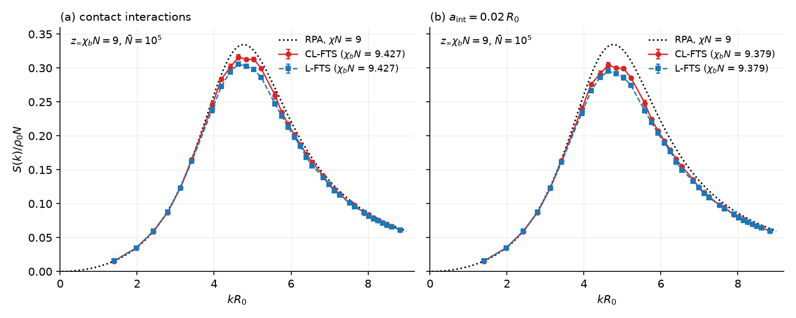

# Langevin Field-Theoretic Simulation (L-FTS)

This document describes Langevin field-theoretic simulation (L-FTS), which includes compositional fluctuations beyond mean-field theory.

## Table of Contents

1. [Overview](#1-overview)
2. [Partial Saddle-Point Approximation](#2-partial-saddle-point-approximation)
3. [Langevin Dynamics](#3-langevin-dynamics)
4. [Saddle-Point Iteration for Imaginary Fields](#4-saddle-point-iteration-for-imaginary-fields)
5. [Structure Functions](#5-structure-functions)
6. [Implementation](#6-implementation)
7. [References](#7-references)

---

## 1. Overview

L-FTS is a simulation method that incorporates compositional fluctuations into polymer field theory. Unlike SCFT, which finds a single saddle-point solution, L-FTS samples field configurations according to the Boltzmann distribution, capturing:

- **Fluctuation effects**: Order-disorder transition shifts, composition fluctuations
- **Correlation functions**: Structure factors, scattering functions
- **Thermodynamic averages**: Ensemble-averaged properties

The key insight is the **partial saddle-point approximation (PSPA)**: real fields fluctuate via Langevin dynamics while imaginary fields are kept at their saddle points.

---

## 2. Partial Saddle-Point Approximation

### 2.1 Partition Function

The canonical partition function in field-theoretic representation:

```math
\mathcal{Z} \propto \int \{\mathcal{D}\Omega_i\} \exp(-\beta H[\{\Omega_i\}])
```

In PSPA, we split auxiliary fields into real ($`\Omega_i`$) and imaginary ($`\Omega_j`$) components:

```math
\mathcal{Z} \propto \int \{\mathcal{D}\Omega_i\} \exp(-\beta H[\{\Omega_i\}, \{\Omega_j^*\}])
```

where $`\{\Omega_j^*\}`$ are saddle-point solutions for imaginary fields:

```math
\left.\frac{\delta H[\{\Omega_i\}, \{\Omega_j\}]}{\delta \Omega_j}\right|_{\Omega_j = \Omega_j^*} = 0
```

### 2.2 Example: AB Diblock Copolymer

For AB-type systems:
- **Real field**: $`\Omega_-`$ (exchange field, composition fluctuations)
- **Imaginary field**: $`\Omega_+`$ (pressure-like field, incompressibility)

The exchange field $`\Omega_-`$ fluctuates according to Langevin dynamics, while $`\Omega_+`$ is kept at its saddle point to enforce incompressibility.

---

## 3. Langevin Dynamics

### 3.1 Continuous Langevin Equation

The real fields evolve according to:

```math
\frac{\partial \Omega_i(\mathbf{r}, \tau)}{\partial \tau} = -\lambda_i \frac{\delta H}{\delta \Omega_i(\mathbf{r}, \tau)} + \eta(\mathbf{r}, \tau)
```

with noise statistics:
- $`\langle \eta(\mathbf{r}, \tau) \rangle = 0`$
- $`\langle \eta(\mathbf{r}, \tau) \eta(\mathbf{r}', \tau') \rangle = 2\lambda_i k_B T \, \delta(\mathbf{r} - \mathbf{r}') \delta(\tau - \tau')`$

Here $`\lambda_i`$ is the relative step size (mobility) of field $`i`$, `dt_scaling` in `lfts.py`, not an eigenvalue: for the first $`M-1`$ auxiliary fields it is the absolute value of the field's eigenvalue in [PolymerFieldTheory.md](PolymerFieldTheory.md#23-effective-hamiltonian) divided by the largest absolute eigenvalue among them, and it is 1 for the last field $`\Omega_M`$. For AB systems $`\lambda_- = \lambda_+ = 1`$.

### 3.2 Discretized Equation (Per Chain Unit)

Discretizing with cell volume $`\Delta V`$ and time step $`\delta\tau`$:

```math
\Omega_i(\mathbf{r}, \tau + \delta\tau) = \Omega_i(\mathbf{r}, \tau) - \lambda_i \frac{\delta H}{\delta \Omega_i} \delta\tau N + \sigma_i \mathcal{N}(\mathbf{r}, \tau)
```

where:
- $`\mathcal{N}`$: Gaussian noise with zero mean and unit variance
- $`\sigma_i^2 = \lambda_i \frac{2 \delta\tau N}{\Delta V / R_0^3 \cdot \sqrt{\bar{N}}}`$
- $`\bar{N} = b^6 \rho_0^2 N`$: invariant polymerization index

### 3.3 Euler Method

The simplest discretization (first-order in $`\delta\tau`$):

```math
\Omega_-(\mathbf{r}, \tau + \delta\tau) = \Omega_-(\mathbf{r}, \tau) - \lambda_- \left[\Phi_-(\mathbf{r}) + \frac{2}{\chi N}\Omega_-(\mathbf{r})\right] \delta\tau N + \sigma \mathcal{N}(\mathbf{r}, \tau)
```

### 3.4 Leimkuhler-Matthews Method

A more accurate second-order method that averages noise over two time steps:

```math
\Omega_i(\mathbf{r}, \tau + \delta\tau) = \Omega_i(\mathbf{r}, \tau) - \lambda_i \frac{\delta H}{\delta \Omega_i} \delta\tau N + \frac{\sigma_i}{2}\left[\mathcal{N}(\mathbf{r}, \tau) + \mathcal{N}(\mathbf{r}, \tau + \delta\tau)\right]
```

**Advantages:**
- Better sampling of the target distribution
- More stable for larger time steps
- Reduced systematic bias

---

## 4. Saddle-Point Iteration for Imaginary Fields

### 4.1 Simple Mixing

Update the pressure-like field using gradient descent; $`k`$ counts the saddle-point iterations within one Langevin step:

```math
\Omega_+^{(k+1)}(\mathbf{r}) = \Omega_+^{(k)}(\mathbf{r}) + \alpha \left[\phi_A(\mathbf{r}) + \phi_B(\mathbf{r}) - 1\right]
```

where $`\alpha`$ is the mixing parameter of the compressor (`mix_init`, adapted as in SCFT simple mixing), not the time step $`\delta\tau N`$.

### 4.2 Anderson Mixing

Accelerates convergence using history of previous iterations (see [SelfConsistentFieldTheory.md](SelfConsistentFieldTheory.md)).

### 4.3 Linear Response

Uses linear response theory to predict the saddle-point directly:

```math
\Omega_+^* \approx \Omega_+^{(0)} + \chi_{\Omega_+}^{-1} \cdot (\phi_+ - 1)
```

where $`\chi_{\Omega_+}`$ is the response function.

### 4.4 Available Compressors

| Name | Description |
|------|-------------|
| `am` | Anderson Mixing |
| `lr` | Linear Response |
| `lram` | Linear Response + Anderson Mixing (hybrid) |

---

## 5. Structure Functions

### 5.1 Definition

The structure function is computed using response theory (chemical potential-density correlation):

```math
S_{ij}(\mathbf{k}) = V \sqrt{\bar{n}} \langle \tilde{\mu}_i(\mathbf{k}) \tilde{\phi}_j(-\mathbf{k}) \rangle, \qquad \mu_i(\mathbf{r}) = \sum_{k} \frac{A_{ik}\, \Omega_k(\mathbf{r})}{\lambda_k}
```

where $`\tilde{\mu}_i(\mathbf{k})`$ and $`\tilde{\phi}_j(\mathbf{k})`$ are the Fourier transforms (normalized by the number of grid points) of the chemical potential field $`\mu_i`$ and of the concentration field, and the sum runs over the auxiliary fields with $`\lambda_k \neq 0`$ (L-FTS: all but the last field, see below; CL-FTS: all fields). Shifting the Gaussian integral over a fluctuating field $`\Omega_k`$ gives $`\langle \Omega_k \phi_j \rangle = (\lambda_k / M) \sum_l A_{lk} \langle \phi_l \phi_j \rangle`$, and $`A A^T = M I`$, so with every field fluctuating $`\langle \mu_i \phi_j \rangle = \langle \delta\phi_i \delta\phi_j \rangle`$ and $`S_{ij}`$ is the structure function in units of $`\rho_0 N`$ (in the disordered phase at weak fluctuations it approaches the random-phase approximation of [Section 5.4](#54-rpa-reference)). For real fields $`\tilde{\phi}_j(-\mathbf{k}) = \tilde{\phi}_j^*(\mathbf{k})`$; CL-FTS fields are complex and use $`\tilde{\phi}_j(-\mathbf{k})`$. For AB systems the estimator equals $`V\sqrt{\bar{n}}\,\langle|\tilde{W}_-(\mathbf{k})|^2\rangle/(\chi N)^2 - 1/(2\chi N)`$ on average.

With smearing the fields couple to the smeared densities, so the estimator gives $`\Gamma(\mathbf{k}) S_{ij}(\mathbf{k})`$; in a periodic box the recorded structure function is divided by $`\Gamma(\mathbf{k})`$ and is that of the densities (modes with $`\Gamma < 10^{-12}`$, which the smeared interaction does not see, are recorded as 0). In a box with walls $`\Gamma`$ is defined in the cosine basis while $`S_{ij}(\mathbf{k})`$ is a Fourier transform, so the estimator is recorded as it is.

In L-FTS the sum runs over the first $`M-1`$ auxiliary fields with $`\lambda_k \neq 0`$: all but the pressure field (incompressible) or the field of the largest eigenvalue (compressible). When these are the real fields, which fluctuate, the estimator gives $`(P S)_{ij}`$, the structure function projected onto their eigenvectors, $`P = \sum_k \mathbf{a}_k \mathbf{a}_k^T / M`$ with $`\mathbf{a}_k`$ the $`k`$-th column of $`A`$. In incompressible models $`\sum_i \delta\phi_i = 0`$ and $`P S = S`$. In compressible L-FTS the field of the largest eigenvalue stays at its saddle point and the projection onto its eigenvector (close to the total density) is not recorded. An imaginary field among the first $`M-1`$ (L-FTS warns when a field other than the pressure field is imaginary) also stays at its saddle point; its term holds the correlation of the field-averaged concentrations without the intrachain part, and the estimator is then not the structure function. CL-FTS samples all fields and records the full $`S_{ij}`$.

### 5.2 Computing Structure Functions

In L-FTS, structure functions are computed by:
1. Fourier transforming the chemical potential fields $`\mu_i(\mathbf{r})`$
2. Fourier transforming the concentration fields $`\phi_j(\mathbf{r})`$
3. Computing $`\tilde{\mu}_i(\mathbf{k}) \tilde{\phi}_j(-\mathbf{k})`$ from the concentrations of the same fields
4. Averaging over Langevin trajectory
5. Multiplying by $`V \sqrt{\bar{n}}`$ normalization factor

### 5.3 Physical Interpretation

- **Peak position**: Characteristic length scale of microphase separation
- **Peak height**: Degree of ordering (diverges at spinodal)
- **Low-$`k`$ behavior**: Long-wavelength fluctuations

### 5.4 RPA Reference

In the disordered phase at weak fluctuations (large $`\bar{N}`$, $`\chi N`$ well below the order-disorder transition) the structure function approaches the random-phase approximation (RPA) of Leibler (Reference 6). `tests/TestStructureFunctionRPA.py` compares L-FTS and CL-FTS runs, with and without smearing, against the formulas below, and `tests/validation/validate_fts_sampling.py` uses the same reference for the sampling studies of [Numerical Validation](../internals/NumericalValidation.md).

Lengths are in units of $`R_0`$ and $`S_{ij}`$ is in units of $`\rho_0 N`$ as in Section 5.1, i.e. $`S_{ij}`$ is Leibler's per-monomer structure function divided by $`N`$.

**Ideal-chain correlations.** For a block of contour fraction $`f`$ whose monomer type has the relative segment length $`\epsilon`$, let $`x = \epsilon^2 k^2 / 6`$ ($`k^2 R_g^2`$ of a whole chain of that type) and

```math
g(f, x) = \frac{2 \left( f x + e^{-f x} - 1 \right)}{x^2}, \qquad h(f, x) = \frac{1 - e^{-f x}}{x}
```

$`g(1, x)`$ is the Debye function and $`g(f, 0) = f^2`$. For a melt of AB diblocks with A fraction $`f`$ the single-chain correlation matrix is

```math
G = \begin{pmatrix} g_{AA} & g_{AB} \\ g_{AB} & g_{BB} \end{pmatrix}, \qquad g_{AA} = g(f, x_A), \quad g_{BB} = g(1-f, x_B), \quad g_{AB} = h(f, x_A) \, h(1-f, x_B)
```

With equal segment lengths, $`g_{AB} = [g(1, x) - g(f, x) - g(1-f, x)]/2`$ and $`g_{AA} + g_{BB} + 2 g_{AB} = g(1, x)`$. These are continuous-chain functions; for the discrete chain model the contour integrals become sums over segments.

**Compressible model.** With $`X`$ the $`\chi N`$ matrix (zero diagonal), $`\mathbf{e} = [1, \ldots, 1]^T`$ and $`U = X + \zeta N \, \mathbf{e}\mathbf{e}^T`$ the interaction matrix of [Polymer Field Theory](PolymerFieldTheory.md),

```math
S(\mathbf{k}) = \left[ G^{-1} + U \right]^{-1}, \qquad U_{AB} = \begin{pmatrix} \zeta N & \zeta N + \chi N \\ \zeta N + \chi N & \zeta N \end{pmatrix}
```

**Incompressible model.** The constraint $`\sum_i \delta\phi_i = 0`$ is the limit $`\zeta N \to \infty`$:

```math
S(\mathbf{k}) = Q \left[ Q^T \left( G^{-1} + X \right) Q \right]^{-1} Q^T
```

where the $`M - 1`$ columns of $`Q`$ are orthonormal and orthogonal to $`\mathbf{e}`$. For AB, $`Q = [1, -1]^T / \sqrt{2}`$ gives Leibler's result

```math
\frac{1}{S_{AA}(k)} = F(x) - 2\chi N, \qquad F(x) = \frac{g_{AA} + g_{BB} + 2 g_{AB}}{g_{AA} g_{BB} - g_{AB}^2}, \qquad S_{BB} = -S_{AB} = S_{AA}
```

which is his $`N/S(q) = F(x) - 2\chi N`$. At $`\chi N = 0`$ this is the athermal $`S_{AA}`$ integrated by the renormalization script `renormalization_rpa.m` ([Tools](../references/Tools.md)).

**Smearing.** The interactions act on the smeared densities, so $`U`$ (or $`X`$) is multiplied by $`\Gamma(\mathbf{k})^2`$, while the recorded structure function is that of the densities (Section 5.1):

```math
S(\mathbf{k}) = \left[ G^{-1} + \Gamma(\mathbf{k})^2 \, U \right]^{-1}, \qquad \frac{1}{S_{AA}(k)} = F(x) - 2\chi N \, \Gamma(k)^2 \quad \text{(incompressible AB)}
```

with $`\Gamma(k)^2 = \exp(-a^2 k^2)`$ for Gaussian smearing. This holds in a periodic box, where the recorded $`S_{ij}`$ is divided by $`\Gamma`$.

**Validity.** The RPA leaves out fluctuation corrections, of relative order $`\bar{N}^{-1/2}`$, which grow as $`\chi N`$ approaches the order-disorder transition. Grid and contour discretization change the high wavevectors, so comparisons use the lowest modes; finite discretization and fluctuation corrections must be distinguished from sampling uncertainty.

**Example.** The conditions of Fig. 3 of Reference 7: symmetric AB diblock ($`f = 0.5`$), discrete chains with $`N = 90`$, $`\zeta N = 90`$, $`\bar{N} = 10^5`$, $`32^3`$ grid with $`L = 4.5 R_0`$, CUDA backend, with contact interactions or Gaussian smearing of $`a_{\mathrm{int}} = 0.02 R_0`$. The bare $`\chi_b N`$ is set so that the effective $`z_\infty \chi_b N = 9`$, with $`z_\infty`$ from Eq. (29) of Reference 7 (0.9548 and 0.9596; the compressible model has the factor $`1/(1 + t/\zeta)`$ in the integrand), and CL-FTS uses the renormalized bare segment length of its Eq. (26) ($`a_b/a = 0.9929`$ and 0.9931). L-FTS treats $`W_+`$ in the partial saddle-point approximation of the same compressible model. Both methods use the LM integrator (L-FTS: $`\Delta t = 8`$; CL-FTS: $`\Delta t = 2`$, $`\alpha_{ds} = 0.01`$) for 15000 steps from zero fields, and the first 5000 steps are discarded. The figure shows $`S = (S_{AA} + S_{BB} - 2 S_{AB})/4`$, the structure function of $`\phi_A - \phi_B`$ used by Reference 7, averaged over shells of equal $`\vert\mathbf{k}\vert`$; error bars are standard errors from two 5000-step blocks. The dotted curve is the incompressible Gaussian-chain RPA at $`\chi N = 9`$.



At the peak ($`k R_0 = 4.63`$), L-FTS gives $`0.306 \pm 0.002`$ (contact) and $`0.295 \pm 0.002`$ (smeared), and CL-FTS gives $`0.316 \pm 0.004`$ and $`0.304 \pm 0.004`$. These agree within about 1 % with the peaks of Fig. 3 of Reference 7 (read from the figure: 0.308 and 0.297 for L-FTS, 0.313 and 0.302 for CL-FTS). Both methods lie below the RPA peak (0.332 at the same $`k`$), which leaves out fluctuation corrections. Reference 7 instead compares the peaks with renormalized one-loop theory and absorbs the remaining difference into a nonlinear $`\chi`$; its coefficient is larger for CL-FTS than for L-FTS (Table I of Reference 7), consistent with CL-FTS lying slightly above L-FTS. In CL-FTS, $`S_{AA}`$ also contains a quarter of the total-density fluctuations, about 0.003 at the peak, so it differs from $`S`$.

---

## 6. Implementation

### 6.1 Using the LFTS Class

```python
from polymerfts import lfts
import numpy as np

params = {
    "platform": "cuda",              # or "cpu-mkl", "cpu-fftw"
    "nx": [40, 40, 40],              # Grid points
    "lx": [4.36, 4.36, 4.36],        # Box size

    "chain_model": "discrete",       # or "continuous"
    "ds": 1/90,                      # Contour step (1/N_Ref)

    "segment_lengths": {"A": 1.0, "B": 1.0},
    "chi_n": {"A,B": 17.0},

    "polymers": [{
        "volume_fraction": 1.0,
        "blocks": [
            {"type": "A", "length": 0.4},
            {"type": "B", "length": 0.6},
        ],
    }],

    "langevin": {
        "max_step": 10000,           # Total Langevin steps
        "dt": 8.0,                   # Time step (delta_tau * N_Ref)
        "nbar": 10000,               # Invariant polymerization index
    },

    "recording": {
        "dir": "data_simulation",
        "checkpoint_interval": 1000,     # Save fields every N steps
        "sample_interval": 10,    # Compute S(k) every N steps
        "statistics_save_interval": 1000,  # Save S(k) every N steps
    },

    "saddle": {
        "max_iter": 100,
        "tolerance": 1e-4,
    },

    "compressor": {
        "name": "lram",              # Linear Response + Anderson Mixing
        "max_hist": 20,
        "start_error": 5e-1,
        "mix_min": 0.01,
        "mix_init": 0.01,
    },

    "verbose_level": 1,
}

# Initialize and run
random_seed = 12345
simulation = lfts.LFTS(params=params, random_seed=random_seed)
simulation.run(initial_fields={"A": w_A, "B": w_B})
```

### 6.2 Key Parameters

| Parameter | Description | Typical Value |
|-----------|-------------|---------------|
| `nbar` | Invariant polymerization index $`\bar{N}`$ | 100 - 10000 |
| `dt` | Time step $`\delta\tau N`$ | 1.0 - 10.0 |
| `max_step` | Total Langevin steps | 10000 - 100000 |
| `tolerance` | Incompressibility tolerance | 1e-4 |

### 6.3 Noise Amplitude

The noise amplitude depends on system parameters:

```math
\sigma = \sqrt{\frac{2 \cdot \delta\tau N}{\Delta V \cdot \sqrt{\bar{N}}}}
```

where $`\Delta V = V/n_{\mathrm{grid}}`$ is the volume of one grid cell; $`V`$ is the volume of the simulation cell, which includes the angle factor of a non-orthogonal cell ($`\Delta V = \Delta x \Delta y \Delta z`$ only for an orthogonal box).

### 6.4 Output Files

| File | Description |
|------|-------------|
| `fields_NNNNNN.mat` | Potential fields and concentrations |
| `structure_function_NNNNNN.mat` | Structure functions $`S_{AA}`$, $`S_{AB}`$, $`S_{BB}`$ |

---

## 7. References

1. Lennon, E. M., Katsov, K. & Fredrickson, G. H. "Free Energy Evaluation in Field-Theoretic Polymer Simulations." *Phys. Rev. Lett.* **101**, 138302 (2008).

2. Matsen, M. W. & Beardsley, T. M. "Field-Theoretic Simulations for Block Copolymer Melts Using the Partial Saddle-Point Approximation." *Polymers* **13**, 2437 (2021).

3. Vorselaars, B. "Efficient Langevin and Monte Carlo sampling algorithms: The case of field-theoretic simulations." *J. Chem. Phys.* **158**, 114117 (2023).

4. Beardsley, T. M. & Matsen, M. W. "Fluctuation correction for the order–disorder transition of diblock copolymer melts." *J. Chem. Phys.* **154**, 124902 (2021).

5. Morse, D. C., Yong, D. & Chen, K. "Polymer Field Theory for Multimonomer Incompressible Models: Symmetric Formulation and ABC Systems." *Macromolecules* **58**, 816 (2025).

6. Leibler, L. "Theory of Microphase Separation in Block Copolymers." *Macromolecules* **13**, 1602 (1980).

7. Matsen, M. W., Ramírez, J., Willis, J. D. & Pina, P. D. "Accessing the universal phase behavior of block copolymer melts with complex-Langevin field-theoretic simulations." *J. Chem. Phys.* **164**, 014905 (2026).
