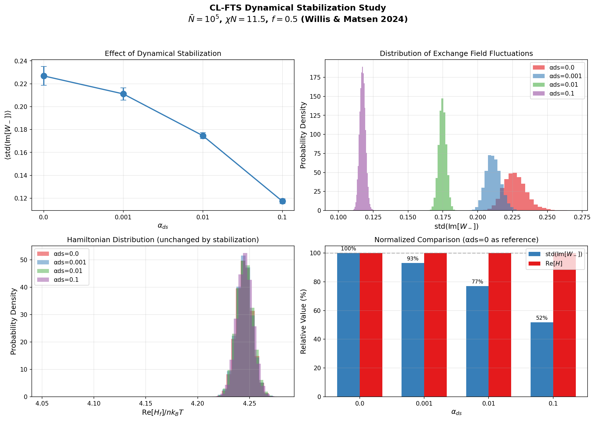

# Dynamical Stabilization for Complex Langevin Field-Theoretic Simulations

## Overview

Complex Langevin field-theoretic simulations (CL-FTS) can suffer from numerical instabilities known as "hot spots" - localized regions where the imaginary part of the exchange field grows uncontrollably. This document describes the dynamical stabilization method implemented in this library, based on Willis & Matsen, *J. Chem. Phys.* **161**, 244903 (2024).

## The Problem: Hot Spots

In CL-FTS, the exchange field $`W_-(\mathbf{r})`$ is a real-type auxiliary field that develops an imaginary component during the simulation. Without stabilization, $`\mathrm{Im}[W_-(\mathbf{r})]`$ can exhibit runaway growth at certain grid points ("hot spots"), leading to:

- Numerical instabilities
- Poor sampling of configuration space
- Eventual simulation failure

## The Solution: Dynamical Stabilization

Willis & Matsen applied dynamical stabilization, a method from complex-Langevin simulations of quantum chromodynamics, to CL-FTS by adding a stabilization term to the force on the exchange field:

```math
\Lambda_-(\mathbf{r}) = \phi_-(\mathbf{r}) + \frac{2}{\chi N} W_-(\mathbf{r}) + i \alpha_{ds} \, \mathrm{Im}[W_-(\mathbf{r})]
```

where:
- $`\alpha_{ds}`$ is the stabilization coefficient
- $`N`$ is the reference polymerization index
- $`W_-`$ is the field per reference chain, as everywhere in this library (the paper writes the same force per segment, with $`\chi_b`$)
- The term $`i \alpha_{ds} \, \mathrm{Im}[W_-(\mathbf{r})]`$ acts as a restoring force that suppresses imaginary fluctuations

## Usage in This Library

Enable dynamical stabilization by setting the `dynamic_stabilization` parameter:

```python
params = {
    # ... other parameters ...
    "dynamic_stabilization": 0.01,  # αds value
}
```

### Recommended Values

The optimal $`\alpha_{ds}`$ depends on the invariant polymerization index $`\bar{N}`$:

| $`\bar{N}`$ | Recommended $`\alpha_{ds}`$ | Notes |
|-----------|---------------------------|-------|
| $`10^6`$ - $`10^7`$ | 0.001 | Minimal stabilization needed |
| $`\sim 10^5`$ | 0.01 - 0.02 | Good balance of stability and accuracy |
| $`\sim 10^4`$ | none reliable | Even $`\alpha_{ds} = 1.0`$ left short-lived hot spots and would bias the results (Willis & Matsen); with smearing, Matsen et al. (2026) used up to 0.03 |

**Note:** Higher $`\alpha_{ds}`$ values provide stronger stabilization but bias the equilibrium statistics: the stabilization enhances the segregation, slightly lowering $`(\chi N)_{\mathrm{ODT}}`$ and raising $`S(k^*)`$. Willis & Matsen found the bias negligible for $`\alpha_{ds} \ll 0.1`$, while $`\alpha_{ds} = 0.1`$ noticeably favored the ordered phase at $`\bar{N} = 10^5`$.

## Validation Results

We tested the stabilization near the $`\bar{N} = 10^5`$ order-disorder transition studied by Willis & Matsen, using:
- $`\bar{N} = 10^5`$ (invariant polymerization index)
- $`\chi N = 11.5`$
- $`f = 0.5`$ (symmetric diblock copolymer)
- $`32 \times 32 \times 32`$ grid
- Discrete chain model

### Results Summary

| $`\alpha_{ds}`$ | $`\mathrm{std}(\mathrm{Im}[W_-])`$ | Reduction | $`\mathrm{Re}[H]`$ |
|---------------|----------------------------------|-----------|------------------|
| 0.0 | $`0.227 \pm 0.008`$ | — | 4.2450 |
| 0.001 | $`0.211 \pm 0.005`$ | 7% | 4.2449 |
| 0.01 | $`0.175 \pm 0.003`$ | 23% | 4.2451 |
| 0.1 | $`0.117 \pm 0.002`$ | 48% | 4.2455 |

### Key Findings

1. **Effective Stabilization**: Dynamical stabilization significantly reduces $`\mathrm{std}(\mathrm{Im}[W_-])`$, the standard deviation of the imaginary part of the exchange field.

2. **Unchanged Hamiltonian**: The Hamiltonian $`\mathrm{Re}[H]`$ remains unchanged ($`\approx 4.245`$) across all $`\alpha_{ds}`$ values. This average does not reveal the bias: Willis & Matsen found that $`\alpha_{ds} = 0.1`$ shifts the order-parameter histogram toward the ordered phase at these conditions, while $`\alpha_{ds} = 0.01`$–$`0.02`$ does not.

3. **Reduced Variance**: Higher $`\alpha_{ds}`$ also reduces the variance in $`\mathrm{std}(\mathrm{Im}[W_-])`$, indicating more stable sampling.



## Implementation Details

The stabilization is applied during the Langevin field update step. For exchange fields (real-type auxiliary fields), the functional derivative is modified:

```python
# In the Langevin update loop
if alpha_ds > 0:
    for i in range(M):
        if i in mpt.aux_fields_real_idx:  # Exchange fields only
            w_lambda[i] += 1j * alpha_ds * np.imag(w_aux[i])
```

The noise structure remains unchanged:
- Real noise for exchange fields ($`W_-`$)
- Imaginary noise for pressure fields ($`W_+`$)

## References

1. Willis, J. D. & Matsen, M. W. "Stabilizing complex-Langevin field-theoretic simulations for block copolymer melts." *J. Chem. Phys.* **161**, 244903 (2024). DOI: [10.1063/5.0245363](https://doi.org/10.1063/5.0245363)

2. Matsen, M. W. & Beardsley, T. M. "Field-Theoretic Simulations for Block Copolymer Melts Using the Partial Saddle-Point Approximation." *Polymers* **13**, 2437 (2021).

3. Matsen, M. W., Ramírez, J., Willis, J. D. & Pina, P. D. "Accessing the universal phase behavior of block copolymer melts with complex-Langevin field-theoretic simulations." *J. Chem. Phys.* **164**, 014905 (2026).

## Example Script

See `Lamella.py` in this directory for a complete example with dynamical stabilization enabled.
